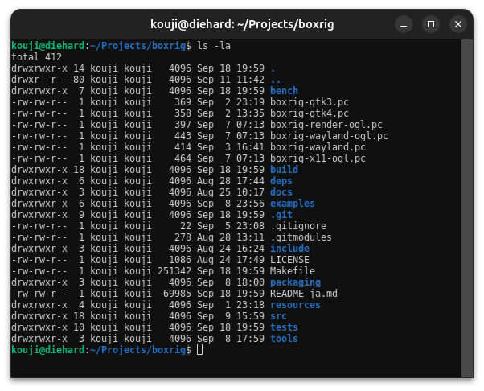
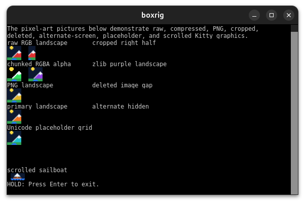
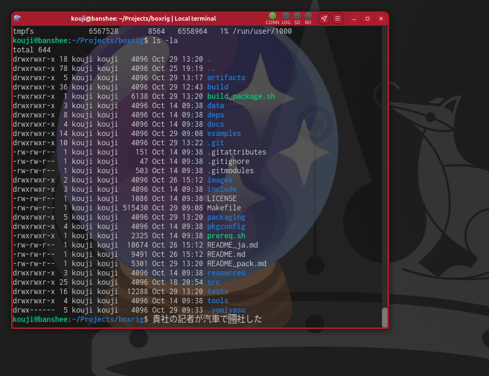
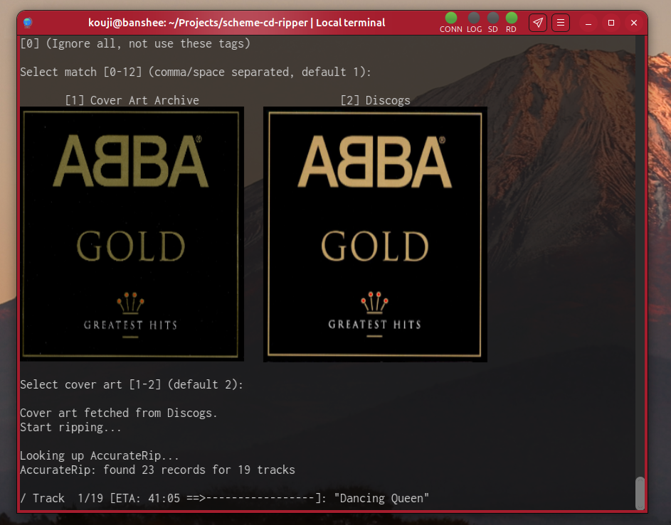

# boxrig

A C99 library for embedding terminal functionality in your applications.


[](https://www.repostatus.org/#wip)
[](https://opensource.org/licenses/MIT)

---

[(For Japanese language/日本語はこちら)](./README_ja.md)

> Please note that this English version of the document was machine-translated and then partially edited, so it may contain inaccuracies.
> We welcome pull requests to correct any errors in the text.

## What is boxrig?

boxrig is a general-purpose library for building terminal applications that display shell and command output and accept keyboard and mouse input.

It handles the features needed to implement a terminal, including text decoration, scrolling, images, IME, and selections.
In addition to shell integration, you can use boxrig to build terminals connected to remote servers and to implement text terminal emulators.

Think of the terminal functionality in `xterm`, made reusable, extended with modern escape sequences and terminal UI elements, and exposed through APIs that work across different environments.

The public API is C99 and can be called from C++ or through an FFI.

## Features

- Multilingual display with UTF-8, combining characters, emoji, bidirectional text, and fallback fonts
- 16-color, 256-color, and RGB output; text decorations, cursors, scrolling, and screen switching
- In-terminal images using Kitty graphics
- Keyboard and mouse handling, and pasting
- Text selection and copying, searching, occurrence monitoring, and decorations for recognition results
- Text input and preedit display with IBus, fcitx 5/4, and Win32 IME
- Configurable fonts, display colors, backgrounds, transparency, and scrollbars
- Support for X11, Wayland, GTK 3/4, and Windows (Win32)
- OpenGL (GL3, EGL) and Direct2D/Direct3D acceleration

The following screenshots show the `boxrig_term` terminal implementation example.
See [Compatibility](./docs/en/compatibility.md) for the support scope of each feature.

A shell displayed with boxrig:



In-terminal images using Kitty graphics:



Overlaying an image on a backdrop and then making the background transparent ([elder-terms](https://github.com/kekyo/elder-terms/)).



Kitty graphics images by [scheme-cd-ripper cover-art](https://github.com/kekyo/scheme-cd-ripper/).



One of boxrig's first-party projects is [elder-terms](https://github.com/kekyo/elder-terms/).
Since it covers a wide range of features, if you want to see what boxrig can actually do, give elder-terms a try.

## Implementation examples

boxrig provides two kinds of libraries: boxrig core and boxrig UI.

- boxrig core parses and interprets bytes, managing characters, attributes, screen contents, and history.
  It does not depend on a window system or I/O devices, so you can reuse it in custom rendering environments.
  Core also provides text retrieval and search, and converts input into output sequences.
  You connect the actual rendering, device input, and communication.
- boxrig UI uses boxrig core to provide reusable rendering and input handling for particular I/O devices.
  Its APIs control X11 widgets and Win32 controls with minimal code and are designed for embedding in your application.

The following excerpts show how to use boxrig.
Both the UI and core examples are excerpts from an application.

### Add a terminal display to an application

On X11, create a terminal, a UI model, and a component with a child window, in that order.

This boxrig UI excerpt assumes that you have already prepared the X11 connection `display` and parent `window`:

```c
    // Get the default boxrig UI configuration
    boxrig_terminal_config config = boxrig_terminal_config_default();
    boxrig_x11_terminal_component_config ui_config =
        boxrig_x11_terminal_component_config_default();

    boxrig_terminal *terminal = NULL;
    boxrig_ui_model *model = NULL;
    boxrig_x11_terminal_component *component = NULL;
    ui_config.view.blink.text_enabled = false;
    ui_config.view.blink.cursor_enabled = false;

    // Initialize boxrig UI
    if (boxrig_terminal_create(&config, &terminal) != BOXRIG_STATUS_OK ||
        boxrig_ui_model_create(terminal, &model) != BOXRIG_UI_OK ||
        boxrig_x11_terminal_component_create_child(
            display, window, model, &ui_config, &component) != BOXRIG_UI_OK) {
        goto cleanup;
    }
```

After allocating the component inside its parent window and connecting event handling, you can display text as follows.
Feed received data into the terminal, synchronize its changes, and render.

This excerpt displays “Hello boxrig UI!” in red:

```c
    // Text containing escape sequences for red characters
    const uint8_t text[] = "\033[31mHello boxrig UI!\033[0m";

    size_t consumed = 0;
    boxrig_ui_component_frame_result frame;

    // Feed the text to boxrig and render it with boxrig UI
    if (boxrig_terminal_feed(terminal, text, sizeof(text) - 1, &consumed)
            != BOXRIG_STATUS_OK || consumed != sizeof(text) - 1 ||
        boxrig_ui_model_synchronize(model) != BOXRIG_UI_OK ||
        boxrig_x11_terminal_component_frame(component, &frame) != BOXRIG_UI_OK) {
        goto cleanup;
    }
```

During cleanup, release the objects that hold references first, then close the parent window and X11 connection.

```c
cleanup:
    // Release resources
    boxrig_x11_terminal_component_destroy(component);
    boxrig_ui_model_destroy(model);
    boxrig_terminal_destroy(terminal);
```

For the complete example, see the [UI step-by-step guide](./docs/en/step-by-step/step-by-step-ui.md#implementing-the-first-version).

### Interpret terminal output without a display

boxrig core alone can retrieve characters and attributes after interpreting control sequences.
This code feeds text with a red foreground setting and reads `H` and color index `1` from the first cell.

```c
    // Get the default boxrig configuration
    boxrig_terminal_config config = boxrig_terminal_config_default();

    // Text containing escape sequences for red characters
    const uint8_t text[] = "\033[31mHello\033[0m";

    boxrig_terminal *terminal = NULL;
    size_t consumed = 0;
    boxrig_cell_view cell;
    int result = 1;

    // Initialize boxrig core
    if (boxrig_terminal_create(&config, &terminal) != BOXRIG_STATUS_OK)
        return 1;

    // Feed the text and retrieve the display information
    if (boxrig_terminal_feed(terminal, text, sizeof(text) - 1, &consumed)
            != BOXRIG_STATUS_OK || consumed != sizeof(text) - 1 ||
        boxrig_terminal_get_cell(terminal, 0, 0, &cell) != BOXRIG_STATUS_OK)
        goto cleanup;

    // Display the retrieved information and check the color
    if (cell.foreground.kind != BOXRIG_COLOR_INDEXED)
        goto cleanup;
    printf("%.*s color=%u\n", (int)cell.text_length, cell.text,
        (unsigned int)cell.foreground.index);
    result = cell.text_length == 1 && cell.text[0] == 'H' &&
        cell.foreground.index == 1 ? 0 : 1;
cleanup:
    // Release resources
    boxrig_terminal_destroy(terminal);
    return result;
```

This example reads the information and prints it directly.
When using boxrig core, you implement terminal rendering yourself.
Once you know that the text should be red, as above, use your environment's drawing facilities to render it in red.

For the complete example, see [Building a terminal from core](./docs/en/step-by-step/step-by-step-core.md).

## Library structure

| Purpose | What to use |
| --- | --- |
| Embed a terminal in an existing display | boxrig UI and an X11, GTK 3/4, native Wayland, or Win32 component |
| Implement rendering yourself | boxrig core, with common UI or rendering APIs as needed |
| Communicate with a shell or another process | A session and a POSIX or Win32 PTY |
| Use OpenGL or Direct3D 11 | The corresponding optional rendering library |

Your application supplies the window, event loop, and communication peer.
See [Basic concepts](./docs/en/architecture.md) for the roles of these components.
OS requirements depend on the layers you use; the Windows PTY requires Windows 10 version 1809 or later.
Check [Compatibility](./docs/en/compatibility.md).

The files distributed with a Windows application depend on static or DLL linking and the selected ConPTY implementation.
See [Distribution](./docs/en/reference/distribution.md).

---

## Getting started

Use the [Getting started guide](./docs/en/getting-started.md) to choose an environment and configuration.
To prepare boxrig from source, continue with [Building and installing](./docs/en/building.md).

To learn by building an application, choose the guide for your purpose.

- [Embed a terminal with boxrig UI](./docs/en/step-by-step/step-by-step-ui.md)
- [Build a terminal from boxrig core](./docs/en/step-by-step/step-by-step-core.md)
- [Run the bundled terminal example](./docs/en/boxrig_term.md)
- [Try emitting control sequences](./docs/en/boxrig_emitter.md)

## Detailed guides

The [documentation index](./docs/en/index.md) covers integration, individual features, and supported specifications.
Start with the introductory guide, then move to the feature pages you need.

---

## License

boxrig is distributed under the [MIT License](./LICENSE).
Libraries you link and files you distribute have their own licenses.
See the [third-party license guide](./packaging/licenses/README.md).

---

## History

- 0.16.0
  - Added versioned checkpoints for resuming a terminal session in another process with its screen, scrollback, pending output, and uploaded Kitty images intact. A Linux example transfers a running shell's PTY to another process and back.
  - Applications can reduce scrollback memory use by switching from the uncompressed default to packed rows or level 1 DEFLATE. The setting applies to existing and future history.
  - The library now uses the same text defaults as `boxrig_term`. Views display text in stored cell order, and the emoji presentation selector (VS16) preserves the base character's width.
  - Added bottom alignment and uniform padding for terminal grids.
  - Cairo outputs can switch between conservative (default), legacy, and bulk rendering for box-drawing characters. The Linux samples can select grayscale font antialiasing independently.
  - The X11 sample and GTK 3 Cairo widget now group redraws during output bursts. OpenGL text shaping also uses less CPU.
  - Sped up decoding of direct Kitty RGBA uploads on CPUs with SSSE3. The compositor now skips resampling when drawing images at their original size.
  - Fixed stale pixels after changing how block characters are drawn. On Windows, DirectWrite now clips combining marks to their own row.
- 0.15.0
  - Filled block characters such as `▀` and `█` now use cell-aligned rectangles to prevent gaps between adjacent blocks. Each view can also use font glyphs.
  - Changed `boxrig_term` to display text in stored cell order and preserve the base character's width when followed by the emoji presentation selector (VS16). These defaults keep text interfaces aligned.
  - Fixed Kitty graphics compatibility with the notcurses terminal UI library by accepting placement IDs on image-only uploads and suppressing replies to image deletions.
  - Reduced Cairo redraw work when text colors change and fixed an OpenGL failure when displaying large images.
- 0.14.0
  - Fixed Kitty image transfers that use separate Base64 padding for each chunk.
- 0.13.0
  - Added a per-view option to keep explicitly colored cell backgrounds opaque on a transparent terminal.
  - Applications can switch an active selection between linear and rectangular shapes or change its unit to words or lines, even when its endpoints are offscreen.
  - Updated character widths and word selection to Unicode 18.0.
  - Kept the last complete frame visible during font zoom in GTK 3's OpenGL renderer.
- 0.12.0
  - Added link decoration options that preserve terminal colors, reverse video, and existing underline styles.
  - Avoided unnecessary redraws on GTK and Wayland when no input method composition is active.
- 0.11.0
  - Made dragging a text selection faster in terminals with long scrollback by avoiding repeated scans for the same lines.
- 0.10.0
  - Added support for moving a running terminal between windows on X11, Wayland, GTK 3/4, and Win32 while preserving its session and selection.
  - Expanded the Linux shared-library SDK to include X11, Wayland, OpenGL, notifications, and background effects.
  - Reduced OpenGL rendering overhead for partial screen updates.
- 0.9.0
  - Aligned selection highlighting with copied text at line breaks. A selected newline is also visible when the text fills the last column.
  - Reduced the cost of matching regular expressions, drawing text annotations, and tracking OSC 8 hyperlinks in scrollback.
  - Fixed missed text recognition notifications when many matches arrive at once.
  - Fixed a GTK 4 rendering failure during repeated font zoom.
- 0.8.0
  - Added font-based sizing for ambiguous-width characters as an alternative to fixed one- or two-column widths.
  - Fixed block cursors to cover wide characters and fitted shaped text to its assigned columns.
  - Rectangular copies now trim trailing ASCII spaces by default, with a per-view option to preserve them.
- 0.7.0
  - Fixed lost scrollback when a full-width scrolling region starts at the top of the main screen and ends above a fixed footer.
- 0.6.0
  - Improved window resize performance for GTK with OpenGL, X11 with EGL, and native Wayland.
  - Reduced the cost of rewrapping scrollback on resize. Height-only changes can reuse rows that already fit.
- 0.5.0
  - Extended rectangular selection and copying into offscreen scrollback, including rows with wide characters, combining marks, and bidirectional text.
  - Kept the selection anchor stable while scrolling or dragging a rectangle back to zero width.
- 0.4.0
  - Added block, bar, and underline cursors that can switch from filled to outlined when focus leaves the terminal, with a configurable outline width.
  - Allowed GTK terminal widgets to set their font at creation so a replacement view can match the original cell size.
- 0.3.0
  - Made screen-reader access to GTK terminal text opt-in and switchable at runtime.
  - Sped up scrolling and ASCII output, reused text recognition results for unchanged lines, and reduced Cairo repaint work on partially changed rows.
- 0.2.0
  - Added fcitx 4 and 5 support for GTK and native Wayland, with automatic input method selection and in-terminal candidate panels.
  - Added a standalone UTF-8 regular expression API with named captures and Unicode character categories. Screen text recognizers can also return captures.
  - Exposed visible terminal text to screen readers on GTK 3 and 4.
  - Added runtime keyboard settings, input suspension, and notifications when a terminal application requests a new grid size.
  - Added nonblocking POSIX PTY startup diagnostics so hosts can distinguish a failure to start a command from the command's exit status.
  - Shipped Linux shared libraries for the core, UI, sessions, POSIX PTYs, and GTK widgets.
- 0.1.0
  - Initial public release of the C99 terminal core and embeddable UI components for X11, Wayland, GTK 3/4, and Win32.
