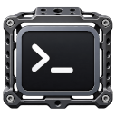
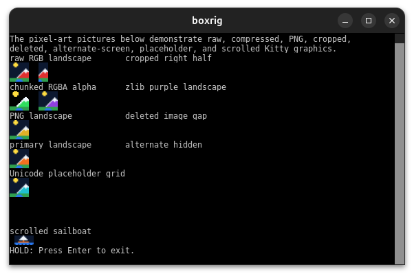

# boxrig

アプリケーションにターミナル機能を組み込むためのC99ライブラリです。



[](https://www.repostatus.org/#wip)
[](https://opensource.org/licenses/MIT)

---

[(English language is here)](./README.md)

## boxrigとは

シェルやコマンドの出力を画面に表示し、キーボードやマウスから操作するターミナルアプリケーションを作ることが出来る、汎用のライブラリです。

文字の装飾、スクロール、画像、IME、選択範囲など、端末の実現に必要な処理をboxrigが担当します。
シェルプログラムとの接続だけではなく、リモートサーバーと接続するターミナルや、テキストターミナルエミュレータを実現することも可能です。

端的に言えば、 `xterm` のターミナル実装部分を汎用化させ、現代的な拡張エスケープシーケンスの処理を追加し、ターミナルとしてのUI要素を実現しつつ、様々な環境に対応させることが出来るAPIを持ちます。

公開APIはC99で、C++やFFIを使用して呼び出せます。

## 機能

- UTF-8、結合文字、絵文字、双方向テキスト、代替フォントを使った表示。多国語対応
- 16色・256色・RGB、文字装飾、カーソル、スクロールと画面切り替え
- Kitty graphicsによる端末内の画像表示
- キーボード、マウスのハンドリング、貼り付け
- 文字列の選択・コピー、検索、出現の監視、認識結果への装飾
- IBus、fcitx 5、Win32 IMEによるインライン編集
- フォント、表示色、背景、透過、スクロールバーの設定
- X11、Wayland、GTK3/4、Windows (Win32)環境に対応
- OpenGL (GL3, EGL)、Direct 2D/3Dアクセラレーションに対応

以下の画像は、ターミナル実装コード例 `boxrig_term` で表示したものです。
機能ごとの対応範囲は[対応状況](./docs/ja/compatibility.md)を参照してください。

boxrigでシェルを表示する例:


Kitty graphicsによるターミナル内の画像表示:



透過背景:

TODO: 透過背景画像

## 実装例

boxrigには、boxrig coreとboxrig UIという、2種類のライブラリがあります:

- boxrig core: バイト列を解析・解釈し、文字、属性、画面や履歴の状態を管理するライブラリです。
  ウィンドウシステムや入出力デバイスに依存しないため、独自の描画環境でも再利用できます。
  文字列の取得・検索や入力の送信列への変換もcoreで行えます。
  実際の描画、デバイスからの入力受付、通信は利用者が接続します。
- boxrig UI: boxrig coreを使用し、特定の入出力デバイスを使用してレンダリングと入力受付を行う、再利用可能なライブラリです。
  X11ウィジェットやWin32のコントロールを最小の実装で制御出来るAPIが公開されており、あなたのアプリケーションに組み込みやすく設計されています。

以下に、boxrig使用例の一部を示します。
UIとcoreの例は、いずれもアプリケーションからの抜粋です。

### アプリケーションへ端末表示を加える

X11では、端末、UIモデル、子ウィンドウを持つコンポーネントを順に生成します。

以下のコード断片はboxrig UIを使用して、X11接続の`display`と親ウィンドウの`window`を用意した後の抜粋です:

```c
    // boxrig UI構成情報を取得
    boxrig_terminal_config config = boxrig_terminal_config_default();
    boxrig_x11_terminal_component_config ui_config =
        boxrig_x11_terminal_component_config_default();

    boxrig_terminal *terminal = NULL;
    boxrig_ui_model *model = NULL;
    boxrig_x11_terminal_component *component = NULL;
    ui_config.view.blink.text_enabled = false;
    ui_config.view.blink.cursor_enabled = false;

    // boxrig UIの初期化
    if (boxrig_terminal_create(&config, &terminal) != BOXRIG_STATUS_OK ||
        boxrig_ui_model_create(terminal, &model) != BOXRIG_UI_OK ||
        boxrig_x11_terminal_component_create_child(
            display, window, model, &ui_config, &component) != BOXRIG_UI_OK) {
        goto cleanup;
    }
```

コンポーネントを親ウィンドウ内へ配置し、イベント処理につなぐと、次の操作で文字を表示できます。
受信データを端末へ渡し、変更を同期してから描画します。

以下のコード断片は、赤い「Hello boxrig UI!」を表示する例です:

```c
    // 赤い文字を描画するエスケープシーケンスを含む文字列
    const uint8_t text[] = "\033[31mHello boxrig UI!\033[0m";

    size_t consumed = 0;
    boxrig_ui_component_frame_result frame;

    // 文字列をboxrigに投入して、boxrig UIに描画させる
    if (boxrig_terminal_feed(terminal, text, sizeof(text) - 1, &consumed)
            != BOXRIG_STATUS_OK || consumed != sizeof(text) - 1 ||
        boxrig_ui_model_synchronize(model) != BOXRIG_UI_OK ||
        boxrig_x11_terminal_component_frame(component, &frame) != BOXRIG_UI_OK) {
        goto cleanup;
    }
```

終了時は、参照している側から解放します。親ウィンドウとX11接続は、この後に閉じます。

```c
cleanup:
    // 終了処理
    boxrig_x11_terminal_component_destroy(component);
    boxrig_ui_model_destroy(model);
    boxrig_terminal_destroy(terminal);
```

このコードの全体的な例は、[UI向けstep-by-step](./docs/ja/step-by-step/step-by-step-ui.md#最初のバージョンの実装)を参照して下さい。

### 画面を使わずに端末出力を解釈する

boxrig coreだけでも、制御シーケンスを解釈した後の文字と属性を取得できます。
次のコードは、赤字指定を含む文字列を投入し、先頭のセルから`H`と色番号`1`を読み取ります。

```c
    // boxrig構成情報を取得
    boxrig_terminal_config config = boxrig_terminal_config_default();

    // 赤い文字を描画するエスケープシーケンスを含む文字列
    const uint8_t text[] = "\033[31mHello\033[0m";

    boxrig_terminal *terminal = NULL;
    size_t consumed = 0;
    boxrig_cell_view cell;
    int result = 1;

    // boxrig coreを初期化
    if (boxrig_terminal_create(&config, &terminal) != BOXRIG_STATUS_OK)
        return 1;

    // 文字列をboxrigに投入して、boxrigから描画すべき情報を得る
    if (boxrig_terminal_feed(terminal, text, sizeof(text) - 1, &consumed)
            != BOXRIG_STATUS_OK || consumed != sizeof(text) - 1 ||
        boxrig_terminal_get_cell(terminal, 0, 0, &cell) != BOXRIG_STATUS_OK)
        goto cleanup;

    // 取得できた情報を表示（ここでは色を確認）
    if (cell.foreground.kind != BOXRIG_COLOR_INDEXED)
        goto cleanup;
    printf("%.*s color=%u\n", (int)cell.text_length, cell.text,
        (unsigned int)cell.foreground.index);
    result = cell.text_length == 1 && cell.text[0] == 'H' &&
        cell.foreground.index == 1 ? 0 : 1;
cleanup:
    // 終了処理
    boxrig_terminal_destroy(terminal);
    return result;
```

この例では、情報を読み取ってそのまま表示しています。
boxrig coreでは、ターミナルの「描画」は実装者が行う必要があります。
上記のように、テキストを赤色で描画する必要があることが分かれば、動作環境の機能を使って赤くテキストを描画すれば良いのです。

このコードの全体的な例は、[coreから端末を作る手順](./docs/ja/step-by-step/step-by-step-core.md)を参照して下さい。

## ライブラリの構成

| 目的 | 使用するもの |
| --- | --- |
| 既存の画面へ端末を埋め込む | boxrig UIとX11、GTK 3／4、native Wayland、Win32のコンポーネント |
| 描画方法を自分で実装する | boxrig core。必要に応じて共通UIや描画APIを追加 |
| シェルや別プロセスと通信する | セッションとPOSIX PTY、またはWin32 PTY |
| OpenGLやDirect3D 11を使う | 対応する任意の描画ライブラリ |

ウィンドウ、イベントループ、通信相手はアプリケーションで用意します。
構成要素の役割は[基本概念](./docs/ja/architecture.md)で説明しています。
OS要件は使用する層で異なり、WindowsのPTYにはWindows 10 version 1809以降が必要です。
[対応状況](./docs/ja/compatibility.md)で確認してください。

<a id="windowsアプリの配布物"></a>
Windowsアプリに同梱するファイルは、静的リンクかDLLを使うか、どのConPTYを選ぶかで変わります。
[配布条件](./docs/ja/reference/distribution.md)を参照してください。

---

## 始める

[最初の利用までのガイド](./docs/ja/getting-started.md)から、環境と利用方法を選べます。
ソースから用意する場合は[ビルドとインストール](./docs/ja/building.md)へ進んでください。

アプリケーションを作りながら学ぶ場合は、目的に応じたガイドを選びます。

- [boxrig UIで端末を組み込む](./docs/ja/step-by-step/step-by-step-ui.md)
- [boxrig coreから端末を作る](./docs/ja/step-by-step/step-by-step-core.md)
- [付属のターミナル例を動かす](./docs/ja/boxrig_term.md)
- [制御シーケンスを出力して試す](./docs/ja/boxrig_emitter.md)

## 詳しい使い方

[文書目次](./docs/ja/index.md)から、組み込み方、機能別の使い方、対応仕様を探せます。
初めて使う場合は導入ガイドから読み、必要になった機能のページへ進んでください。

---

## ライセンス

boxrigは[MITライセンス](./LICENSE)で提供します。
組み込むライブラリや配布物に含めるファイルには、それぞれのライセンスが適用されます。
[第三者ライセンスの案内](./packaging/licenses/README_ja.md)を確認してください。
