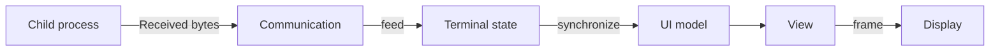

# Basic concepts

[日本語](../ja/architecture.md)

boxrig lets you embed a terminal in an existing display or analyze terminal output without opening a window.
Choose boxrig core or boxrig UI for your purpose, and connect a transport if you need to communicate with a shell or another peer.
This page explains what the library handles and what your application provides.

## Roles of core, UI, and communication

boxrig core interprets received bytes and manages characters, colors, the cursor, screen contents, and history.
It does not depend on a window system or I/O devices, so you can render its results yourself even in environments that boxrig UI does not support.
You can also save or search text and monitor particular output without a display.

boxrig UI displays core state and accepts keyboard, mouse, and IME input.
It embeds terminals in existing applications using X11 or Win32 child windows, GTK widgets, or Wayland child surfaces.
For communication, add a session or connect your application's existing transport.

The public API represents these roles with the following objects.

| Component | Role | What the application provides |
| --- | --- | --- |
| Core `boxrig_terminal` | Interprets received data and stores the screen, character attributes, cursor, and history | Received data and input events; retrieval and processing of results |
| `boxrig_ui_model` | Passes terminal changes to each view | Synchronization calls after updating the terminal |
| UI views and components | Handle text layout, rendering, selection, and IME | Parent window, allocation, event handling, and scheduling of rendering |
| `boxrig_session` | Advances I/O between a nonblocking transport and the terminal | Transport, waiting, and shutdown policy |

Reusing core does not require X11, GTK, or a PTY.
utf8proc, libpng, and zlib are bundled into the core library for Unicode processing and image decoding.
See [Third-party licenses and sources](./reference/distribution.md#third-party-licenses-and-sources) for their terms.

## Data from the terminal to the display

To display a red “Hello,” for example, pass the color control sequence and text to `boxrig_terminal_feed()`.
Core interprets the sequence and stores the characters and red attribute in cells.
It interprets these bytes in the same way whether your application provides them directly, as in the [README examples](../../README.md#implementation-examples), or receives them from a peer.

When using UI, then call `boxrig_ui_model_synchronize()` and render through the component's frame processing.
Feeding data alone does not automatically render it.

When using core alone, retrieve each cell's text, width, and attributes with `boxrig_terminal_get_cell()` and draw it yourself.
A cell is a storage unit on the screen.
Combining characters and wide characters mean that one Unicode code point does not always occupy exactly one cell.

## Data from keyboard input to transmission

Pass keyboard, mouse, paste, and other input to `boxrig_terminal_send_*()`.
Core generates output for the current terminal mode.
For example, the sequence sent for a cursor key depends on the mode selected by the program running in the terminal.

Drain the generated bytes from the output queue and send them to the peer.
Responses to received queries also enter this queue.
A session connects this processing, including partial writes and waiting for output readiness.

Window titles, the clipboard, and notifications cannot be implemented through screen cells alone.
Retrieve requests from core and handle them according to application policy.
Distinguish operations handled by UI components from requests passed to the host.

## Models and multiple views

You can attach multiple views to one terminal.
They share terminal contents while managing view-specific settings, such as selection and display colors, separately.
`boxrig_ui_model_synchronize()` distributes terminal changes to all current views.

A terminal has one grid size.
When multiple windows share a terminal, specify which view determines its rows and columns.
If allocation produces a resize request, resize the terminal and its communication peer, then report success or failure to the component.

The scroll position belongs to terminal state.
Multiple views of the same terminal do not have independent terminal histories.

## Ownership and shutdown

Each API specifies who destroys the objects it creates.
The common relationships are as follows.

| Object | References | Destruction requirements |
| --- | --- | --- |
| UI model | Terminal | Release attached views first |
| UI component | Model, parent window, platform connection | Keep the model and parent window alive while in use |
| Session | Terminal and transport | Transport ownership depends on how it is created and configured |
| Cell reference | Text data inside the terminal | Do not retain it across the next terminal mutation |

Normally, release components, the model, and the terminal in that order, then close the parent window and display connection.
If a session is attached to the terminal, shut it down before destroying the terminal.

Perform operations from the same owning thread as a rule.
Do not design the application to mutate the same terminal concurrently from other threads or callbacks.
Complete or cancel asynchronous requests, such as clipboard transfers, according to the component's shutdown procedure.

## What the application implements

Connect display and communication processing to your application's event loop.
Advance the following work before waiting while any of it remains pending.
Rendering or blink deadlines can remain even when input and output queues are empty.

| Operation | Information to check |
| --- | --- |
| Advance communication | Whether reads, writes, or retained input need processing |
| Update the display | Model changes, rendering requests, and remaining work |
| Resize | Grid dimensions calculated from allocation and completion notification |
| Respond to host requests | Allowed operations and success, rejection, or unsupported results |
| Shut down | Pending requests and the lifetimes of borrowed objects |

In GTK 3/4, placing a widget and connecting communication and frame requests are separate tasks.
GTK widgets borrow the model and terminal.
Manage their lifetimes in the application's shutdown code.

For Win32, the application supplies the parent window and message loop.
Release child components before destroying the parent.

Even when components share the same terminal state, support for IME, the clipboard, transparency, and other features varies by platform.
Use [Compatibility](./compatibility.md) to check the combination of component and features you need.

Continue with the [UI step-by-step guide](./step-by-step/step-by-step-ui.md) to learn the implementation incrementally, or the [core step-by-step guide](./step-by-step/step-by-step-core.md) for custom rendering.

[Back to the documentation index](./index.md)
