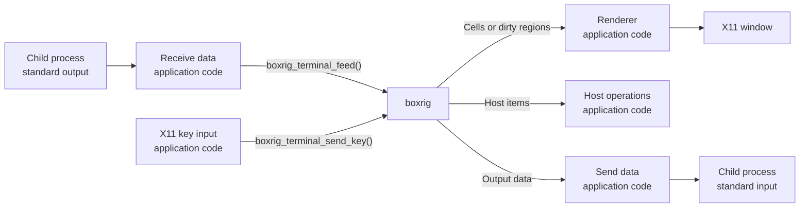
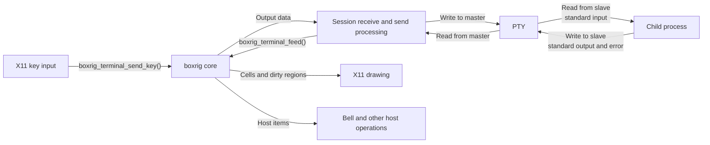

# Implementing a simple terminal application (core)

[日本語](../../ja/step-by-step/step-by-step-core.md)

The boxrig core library parses and interprets the byte streams needed to implement a terminal application.
boxrig also provides a higher-level library, boxrig UI. The main differences are:

- boxrig core parses and interprets byte streams. It is independent of specific environments and has no external dependencies.
  This independence lets you reuse it on devices and platforms that boxrig does not support out of the box.
  The application supplies the rendering, device input, and communication.
- boxrig UI is a reusable library that uses boxrig core to render content and handle input on specific devices.
  Its public APIs let you control X11 widgets and Win32 controls with little application code, making it easy to embed in your application.

This guide builds an X11 terminal application incrementally using the public boxrig core API.
Using core directly requires extensive low-level work and is not the best starting point for most application developers.
If you want to add terminal functionality to an application, start with the [boxrig UI guide](./step-by-step-ui.md).

This guide assumes familiarity with C99.

Throughout this guide, “boxrig” means boxrig core unless a distinction is needed.

---

## boxrig basics and the overall data flow

boxrig manages a terminal through an opaque structure called `boxrig_terminal`.
Create it with `boxrig_terminal_create()` to obtain the object that manages terminal processing.

Feed received data, such as a child process's standard output, to `boxrig_terminal_feed()`.
Processing produces several kinds of results:

| Result | Description |
| :--- | :--- |
| Cells and dirty regions | Data for drawing characters. A cell is the area for one character on the display and contains character data and attributes. A dirty region identifies an area whose displayed content is no longer valid and needs redrawing |
| Host items | Requests for terminal features. These include effects requested by control codes and escape sequences that the host application must handle |
| Output data | Data to send, typically to the child process's standard input as keyboard input. This includes ordinary text such as "ABC" with no special effects |

You also submit interaction data using functions such as `boxrig_terminal_send_*()`.
These functions process keyboard and other input to update terminal state or generate output data.

It may seem sufficient to send this data directly to its destination.
However, terminal modes set by escape sequences can affect how input is interpreted and which bytes are generated, so interaction data must also pass through boxrig.

The following diagram shows the flow:



### Feeding data

Start with the function that feeds received data into boxrig, `boxrig_terminal_feed()`:

```c
boxrig_status boxrig_terminal_feed(
    boxrig_terminal *terminal,
    const uint8_t *bytes,
    size_t length,
    size_t *consumed_out);
```

- `bytes` and `length` specify the data to feed.
  `boxrig_terminal_feed()` is synchronous, and input can be split at any byte boundary.
  If it returns `BOXRIG_STATUS_WOULD_BLOCK`, retry the same bytes starting at the unconsumed position indicated by `consumed_out`.

> Keep received data from the child's standard output, interaction data such as key events, and outgoing data for the child's standard input distinct.
> boxrig needs to handle all three.

Submit interaction data through functions in the `boxrig_terminal_send_*()` family.
For example, use `boxrig_terminal_send_key()` for key events:

```c
boxrig_status boxrig_terminal_send_key(
    boxrig_terminal *terminal,
    const boxrig_key_event *event);
```

The details come later. For now, the important point is that an application calls these functions when user interaction occurs.

### Reading boxrig's results

boxrig does not report processing results through callbacks.
After feeding data, retrieve each kind of result through its corresponding functions.

A terminal usually draws into a window system.
The information needed to draw characters is available from its cells.

Think of the terminal as a grid of rows and columns.
An 80-column, 25-row terminal has 2,000 cells, each containing character data and attributes.

One simple rendering strategy is to retrieve every cell and draw its contents.
`boxrig_terminal_get_cell()` makes this straightforward:

```c
boxrig_cell_view cell;
const boxrig_status status =
    boxrig_terminal_get_cell(terminal, row, column, &cell);
```

`row` and `column` identify the cell to retrieve.
The returned `boxrig_cell_view` includes the UTF-8 text to display, its cell width, colors, and decorations.
This is a read-only view owned by boxrig, valid until the next change to `terminal` state.
The structure looks like this, with some fields omitted:

```c
typedef struct boxrig_cell_view {
    /** Length-delimited UTF-8 extended grapheme cluster. */
    const char *text;
    /** Number of bytes in text. */
    size_t text_length;
    /** Logical foreground color. */
    boxrig_color foreground;
    /** Logical background color. */
    boxrig_color background;
} boxrig_cell_view;
```

There are other attributes, but this is enough to understand what a cell contains.
Retrieving the cells in the 80-by-25 grid and drawing their characters with X11 produces a terminal display.

> Dirty regions allow more efficient rendering, but we will introduce them later.
> We will also postpone handling output data for the child process.

## Implementing the first version

We can now build the first version: an application that displays "Hello boxrig!" in a terminal window.

This deliberately simple X11 application does not start a child process, exchange data with one, or accept user interaction.
It is enough to show the overall flow.

Save the following code as `main.c` for the Makefile below:

```c
/* The guide uses the public boundary and no private boxrig headers. */
#include "boxrig/terminal.h"

#include <X11/Xlib.h>
#include <X11/Xutil.h>

#include <stdbool.h>
#include <stdint.h>
#include <stdio.h>

/* Draws every cell in the fixed-size terminal. */
static int draw_terminal(
    Display *display,
    Window window,
    GC graphics,
    XFontStruct *font,
    boxrig_terminal *terminal,
    unsigned int cell_width,
    unsigned int cell_height,
    size_t rows,
    size_t columns)
{
    size_t row;
    size_t column;

    XClearWindow(display, window);
    XSetForeground(display, graphics, BlackPixel(display, DefaultScreen(display)));

    /* Search all cells */
    for (row = 0; row < rows; row++) {
        for (column = 0; column < columns; column++) {
            boxrig_cell_view cell;
            char glyph;

            /* Finish using this view before any terminal mutation occurs. */
            if (boxrig_terminal_get_cell(
                    terminal,
                    row,
                    column,
                    &cell) != BOXRIG_STATUS_OK) {
                return -1;
            }

            /* The first example contains only one-byte ASCII cells. */
            if (cell.text_length != 1) {
                continue;
            }
            glyph = cell.text[0];
            XDrawString(
                display,
                window,
                graphics,
                (int)(column * cell_width),
                (int)(row * cell_height) + font->ascent,
                &glyph,
                1);
        }
    }
    XFlush(display);
    return 0;
}

int main(void)
{
    /* No control sequence is needed to create the first visible cells. */
    static const uint8_t message[] = "Hello boxrig!";

    boxrig_terminal_config config = boxrig_terminal_config_default();
    boxrig_terminal *terminal = NULL;
    Display *display = NULL;
    int screen = 0;
    Window window = None;
    XFontStruct *font = NULL;
    GC graphics = NULL;
    Atom delete_window = None;
    unsigned int cell_width;
    unsigned int cell_height;
    size_t consumed = 0;
    bool running = true;
    int result = 1;

    /* X11 resources remain owned by this frontend, never by boxrig. */
    display = XOpenDisplay(NULL);
    if (display == NULL) {
        fprintf(stderr, "hello-boxrig: could not open X display\n");
        goto cleanup;
    }
    screen = DefaultScreen(display);
    font = XLoadQueryFont(display, "fixed");
    if (font == NULL || font->max_bounds.width <= 0 ||
        font->ascent <= 0 || font->descent < 0) {
        fprintf(stderr, "hello-boxrig: fixed font is unavailable\n");
        goto cleanup;
    }
    cell_width = (unsigned int)font->max_bounds.width;
    cell_height = (unsigned int)(font->ascent + font->descent);

    /* Configure the model before creating the matching pixel-sized window. */
    config.rows = 25;
    config.columns = 80;

    /* feed() is synchronous and reports exactly how many bytes it consumed. */
    if (boxrig_terminal_create(&config, &terminal) != BOXRIG_STATUS_OK ||
        boxrig_terminal_feed(
            terminal,
            message,
            sizeof(message) - 1,
            &consumed) != BOXRIG_STATUS_OK ||
        consumed != sizeof(message) - 1) {
        fprintf(stderr, "hello-boxrig: could not build terminal cells\n");
        goto cleanup;
    }

    /* One fixed-font character cell maps to one terminal grid cell. */
    window = XCreateSimpleWindow(
        display,
        RootWindow(display, screen),
        0,
        0,
        (unsigned int)config.columns * cell_width,
        (unsigned int)config.rows * cell_height,
        0,
        BlackPixel(display, screen),
        WhitePixel(display, screen));
    if (window == None) {
        goto cleanup;
    }
    graphics = XCreateGC(display, window, 0, NULL);
    if (graphics == NULL) {
        goto cleanup;
    }
    XSetFont(display, graphics, font->fid);
    XSelectInput(display, window, ExposureMask);
    delete_window = XInternAtom(display, "WM_DELETE_WINDOW", False);
    if (delete_window == None ||
        XSetWMProtocols(display, window, &delete_window, 1) == 0) {
        goto cleanup;
    }
    XStoreName(display, window, "boxrig core guide: step 1");
    XMapWindow(display, window);

    /* This first event loop only redraws exposure and handles window close. */
    while (running) {
        XEvent event;

        XNextEvent(display, &event);
        if (event.type == Expose && event.xexpose.count == 0) {
            if (draw_terminal(
                    display,
                    window,
                    graphics,
                    font,
                    terminal,
                    cell_width,
                    cell_height,
                    config.rows,
                    config.columns) == -1) {
                goto cleanup;
            }
        } else if (event.type == ClientMessage &&
                   (Atom)event.xclient.data.l[0] == delete_window) {
            running = false;
        }
    }
    result = 0;

cleanup:
    /* No cell view survives here; release each owned resource exactly once. */
    if (display != NULL && graphics != NULL) {
        XFreeGC(display, graphics);
    }
    if (display != NULL && window != None) {
        XDestroyWindow(display, window);
    }
    if (display != NULL && font != NULL) {
        XFreeFont(display, font);
    }
    if (display != NULL) {
        XCloseDisplay(display);
    }
    boxrig_terminal_destroy(terminal);
    return result;
}
```

> Calling `boxrig_terminal_feed()` only once is an extreme simplification for this first example.
> A real terminal repeatedly feeds child-process output and handles user interaction throughout its lifetime.

> This example omits most terminal features.
> For example, it cannot display multilingual text or follow window resizing yet.

To build it, the compiler needs access to `boxrig/terminal.h`, and the linker needs `libboxrig.a`.
Here is a simple Makefile:

```makefile
CC ?= cc
# This default matches build/core-guide below the repository root.
BOXRIG_ROOT ?= ../..
# Only the public boxrig include directory and X11 headers are visible.
CPPFLAGS += -I$(BOXRIG_ROOT)/include $(shell pkg-config --cflags x11)
CFLAGS ?= -O2 -g
# Keep every checkpoint valid portable C99 with strict diagnostics.
CFLAGS += -std=c99 -Wall -Wextra -Wpedantic -Werror
LDLIBS += $(shell pkg-config --libs x11)
LIBBOXRIG := $(BOXRIG_ROOT)/build/libboxrig.a

.PHONY: all clean

all: hello-boxrig

# Reuse the repository's normal core archive target.
$(LIBBOXRIG):
	$(MAKE) -C $(BOXRIG_ROOT) build/libboxrig.a

hello-boxrig: main.c $(LIBBOXRIG)
	$(CC) $(CPPFLAGS) $(CFLAGS) $< $(LIBBOXRIG) $(LDLIBS) -o $@

clean:
	rm -f hello-boxrig
```

## Drawing cells efficiently

The first version draws every cell on every update.

This works, but an 80-column, 25-row terminal redraws 2,000 cells even when only one character changes.
Terminals typically update as each character is typed, so this can make typing feel slow.

Only changed cells need redrawing.
boxrig can enumerate those cells, reducing the amount of work considerably.

Instead of visiting every cell with `boxrig_terminal_get_cell()`, use `boxrig_terminal_take_dirty()` to retrieve the regions that need redrawing:

```c
boxrig_dirty dirty;

while (boxrig_terminal_take_dirty(terminal, &dirty)) {
    // Calculate the invalid region
    const size_t end = dirty.column + dirty.column_count;
    size_t column;

    for (column = dirty.column; column < end; column++) {
        boxrig_cell_view cell;

        if (boxrig_terminal_get_cell(
                terminal, dirty.row, column, &cell) == BOXRIG_STATUS_OK) {
            // Render the cell here.
        }
    }
}
```

`boxrig_terminal_take_dirty()` removes each returned region from the queue.
The renderer draws that region before retrieving the next one.

Here is the revised drawing function:

```c
/* Draws only the cells in changed row intervals. */
static int draw_terminal(
    Display *display,
    Window window,
    GC graphics,
    XFontStruct *font,
    boxrig_terminal *terminal,
    unsigned int cell_width,
    unsigned int cell_height)
{
    boxrig_dirty dirty;

    XSetForeground(display, graphics, BlackPixel(display, DefaultScreen(display)));

    while (boxrig_terminal_take_dirty(terminal, &dirty)) {
        const size_t end = dirty.column + dirty.column_count;
        size_t column;

        for (column = dirty.column; column < end; column++) {
            boxrig_cell_view cell;
            char glyph;
            const int x = (int)(column * cell_width);
            const int y = (int)(dirty.row * cell_height);

            /* Finish using this view before the next dirty is consumed. */
            if (boxrig_terminal_get_cell(
                    terminal,
                    dirty.row,
                    column,
                    &cell) != BOXRIG_STATUS_OK) {
                /* Restore redraw work if drawing cannot be completed. */
                boxrig_terminal_invalidate(terminal);
                return -1;
            }

            /* Clear old glyphs even when the updated cell is empty. */
            XClearArea(display, window, x, y, cell_width, cell_height, False);

            /* This version still supports only one-byte ASCII cells. */
            if (cell.text_length != 1) {
                continue;
            }
            glyph = cell.text[0];
            XDrawString(
                display,
                window,
                graphics,
                x,
                y + font->ascent,
                &glyph,
                1);
        }
    }
    XFlush(display);
    return 0;
}
```

`XClearArea()` replaces `XClearWindow()` so that only the affected cells are cleared.
Clearing the background also removes old glyphs when a cell becomes empty.
Passing `False` as the last argument prevents this operation from generating additional Expose events.
See “Clearing Areas” in the [Xlib reference](https://www.x.org/releases/current/doc/libX11/libX11/libX11.html).

The function gets its row and column bounds from the dirty regions, so it no longer needs `rows` or `columns` arguments.
Replace the first version's Expose handler as follows:

```c
if (event.type == Expose && event.xexpose.count == 0) {
    /* Expose requires repainting even when terminal cells have not changed. */
    boxrig_terminal_invalidate(terminal);
    if (draw_terminal(
            display,
            window,
            graphics,
            font,
            terminal,
            cell_width,
            cell_height) == -1) {
        goto cleanup;
    }
}
```

Expose asks the application to redraw window contents; it does not mean that cell contents changed.
Call `boxrig_terminal_invalidate()` to mark all cells for redrawing in this case.
For other updates, calling `draw_terminal()` after feeding data redraws only changed cells.

## Submitting interaction data

The basic renderer is ready.
Next, submit information about user interaction to boxrig.

> "Hello boxrig!" currently stands in for output from a child process.
> We will also need a stand-in for sending data to a child's standard input, which the next section adds.
> First, we will submit keyboard input to boxrig.

Call `boxrig_terminal_send_key()` when a key event occurs:

```c
boxrig_status boxrig_terminal_send_key(
    boxrig_terminal *terminal,
    const boxrig_key_event *event);
```

`boxrig_key_event` describes that event. For example:

```c
//  Prepare key input (Ctrl+C)
boxrig_key_event event = {
    .key = BOXRIG_KEY_NONE,                 // Ordinary key
    .codepoint = 'c',
    .shifted_codepoint = 'C',
    .base_layout_codepoint = 'c',
    .action = BOXRIG_KEY_PRESS,             // Key press
    .modifiers = BOXRIG_MODIFIER_CONTROL,   // Control modifier
    .text = "\x03",                         // Key text
    .text_length = 1,
};

// Submit the key event
const boxrig_status status =
    boxrig_terminal_send_key(terminal, &event);
```

This structure includes modifiers and other information, rather than only an ASCII character.
It lets boxrig interpret the keyboard state in detail.

The other `boxrig_terminal_send_*()` functions likewise describe different forms of user interaction.
An application can choose which interactions to support; features corresponding to functions it never calls will not be available.

For example, `boxrig_terminal_send_mouse()` handles mouse interaction.
If the application does not call it for mouse events, the terminal cannot respond to those events.

We will now recognize key events and pass them to `boxrig_terminal_send_key()`.

Add the following header and function before `main()`.
This example assumes a basic keyboard layout for entering ASCII characters:

```c
#include <X11/keysym.h>

/* Converts an X11 key press to one portable terminal input event. */
static boxrig_status send_key_press(
    boxrig_terminal *terminal,
    XKeyEvent *xevent)
{
    char text[32];
    KeySym keysym = NoSymbol;
    const int length = XLookupString(
        xevent, text, (int)sizeof(text), &keysym, NULL);
    boxrig_key_event event = {0};

    event.action = BOXRIG_KEY_PRESS;
    if (xevent->state & ShiftMask) {
        event.modifiers |= BOXRIG_MODIFIER_SHIFT;
    }
    if (xevent->state & ControlMask) {
        event.modifiers |= BOXRIG_MODIFIER_CONTROL;
    }
    /* This example assumes that Mod1 is assigned to Alt. */
    if (xevent->state & Mod1Mask) {
        event.modifiers |= BOXRIG_MODIFIER_ALT;
    }
    if (xevent->state & LockMask) {
        event.modifiers |= BOXRIG_MODIFIER_CAPS_LOCK;
    }

    switch (keysym) {
    case XK_Return:    event.key = BOXRIG_KEY_ENTER; break;
    case XK_BackSpace: event.key = BOXRIG_KEY_BACKSPACE; break;
    case XK_Tab:
    case XK_ISO_Left_Tab: event.key = BOXRIG_KEY_TAB; break;
    case XK_Escape:    event.key = BOXRIG_KEY_ESCAPE; break;
    case XK_Left:     event.key = BOXRIG_KEY_LEFT; break;
    case XK_Right:    event.key = BOXRIG_KEY_RIGHT; break;
    case XK_Up:       event.key = BOXRIG_KEY_UP; break;
    case XK_Down:     event.key = BOXRIG_KEY_DOWN; break;
    default: {
        const KeySym unshifted = XLookupKeysym(xevent, 0);
        const KeySym shifted = XLookupKeysym(xevent, 1);
        int index;

        /* Latin-1 bytes outside ASCII are not valid standalone UTF-8. */
        for (index = 0; index < length; index++) {
            if ((unsigned char)text[index] > 0x7f) {
                return BOXRIG_STATUS_OK;
            }
        }
        if (unshifted < 0x20 || unshifted > 0x7e) {
            return BOXRIG_STATUS_OK;
        }
        event.key = BOXRIG_KEY_NONE;
        event.codepoint = (uint32_t)unshifted;
        if (shifted >= 0x20 && shifted <= 0x7e) {
            event.shifted_codepoint = (uint32_t)shifted;
        }
        /* Keep the native text, including Control-generated ASCII bytes. */
        event.text = text;
        event.text_length = (size_t)length;
        break;
    }
    }

    /* The stack-owned text remains valid for this synchronous call. */
    return boxrig_terminal_send_key(terminal, &event);
}
```

Ordinary character keys use `BOXRIG_KEY_NONE` together with character information.
Enter and arrow keys use the corresponding `key` value.
For Ctrl+C, `codepoint` is still `'c'`, before conversion to a control code.
`text` contains the string returned by X11; boxrig combines it with modifier information to generate outgoing data.
Since this example has no base-layout information, `base_layout_codepoint` stays at its initial value of 0.

`XLookupString()` returns Latin-1 text, so the example rejects non-ASCII characters.
It assumes Shift, Control, Caps Lock, and Alt assigned to Mod1.
See “Using Keyboard Utility Functions” and “Using Latin-1 Keyboard Event Functions” in the [Xlib reference](https://www.x.org/releases/current/doc/libX11/libX11/libX11.html).

Replace `XSelectInput()` in `main()` so that the application also receives key-press events:

```c
XSelectInput(display, window, ExposureMask | KeyPressMask);
```

In the event loop, add this `else if` after the Expose handler.
Keep the existing ClientMessage exit handler after it:

```c
else if (event.type == KeyPress) {
    const boxrig_status status =
        send_key_press(terminal, &event.xkey);

    if (status != BOXRIG_STATUS_OK) {
        fprintf(stderr, "hello-boxrig: could not send key (%d)\n", (int)status);
        goto cleanup;
    }
} else if (event.type == MappingNotify) {
    /* Keep Xlib's cached keymap up to date. */
    XRefreshKeyboardMapping(&event.xmapping);
}
```

At this stage, data generated from key input accumulates in boxrig's output queue.
boxrig does not echo it automatically, so typing does not yet display characters in the terminal window.

When the output queue fills, the function returns `BOXRIG_STATUS_WOULD_BLOCK`.
This version reports an error and exits in that case.

## Sending output data

With key input reaching boxrig, it can now generate outgoing data.

Use `boxrig_terminal_output_peek()` to access a contiguous span of output bytes:

```c
const uint8_t *bytes;
const size_t length = boxrig_terminal_output_peek(terminal, &bytes);

if (length != 0) {
    // Send bytes[0] through bytes[length - 1] to the terminal client.
}
```

boxrig owns `bytes`, and the span remains valid only until the next change to `terminal` state.
Pass the number of bytes accepted by the destination to `boxrig_terminal_output_consume()` to remove them from the queue:

```c
const boxrig_status status =
    boxrig_terminal_output_consume(terminal, sent_length);
```

If the destination accepts only part of the data, consume only that part and send the rest later.
This preserves the order of keyboard input and responses to escape sequences.

We are not managing a real child process yet, so write the outgoing data to this application's standard output to observe the behavior:

```c
#include <errno.h>
#include <unistd.h>

/* Writes queued bytes unchanged to the application's standard output. */
static int flush_terminal_output(boxrig_terminal *terminal)
{
    for (;;) {
        const uint8_t *bytes;
        const size_t length = boxrig_terminal_output_peek(terminal, &bytes);
        ssize_t written;

        if (length == 0) {
            return 0;
        }

        /* Retry interruptions that occurred before any bytes were written. */
        do {
            written = write(STDOUT_FILENO, bytes, length);
        } while (written == -1 && errno == EINTR);

        if (written <= 0) {
            return -1;
        }

        /* Consume only bytes that the destination actually accepted. */
        if (boxrig_terminal_output_consume(terminal, (size_t)written) !=
            BOXRIG_STATUS_OK) {
            return -1;
        }
        /* Obtain a fresh view after consume() changes the terminal state. */
    }
}
```

Add this header and function before `main()`.
`write()` returns the number of bytes written; consume that many bytes from the output queue.
If data remains, the next loop iteration calls `boxrig_terminal_output_peek()` again and sends the next span.

Retry `EINTR`, which indicates interruption by a signal, and return other write failures to the caller.
See [`write()` in the Linux man-pages](https://man7.org/linux/man-pages/man2/write.2.html).

At the end of `while (running)`, after the Expose, KeyPress, MappingNotify, and ClientMessage branches, add:

```c
if (flush_terminal_output(terminal) == -1) {
    fprintf(stderr, "hello-boxrig: could not write terminal output\n");
    goto cleanup;
}
```

Bytes generated from key events are now written to the application's standard output each time.
The code sends the byte span exactly as returned, including control codes, without assuming NUL termination.

The boxrig window still displays "Hello boxrig!".
The characters you type should appear in the terminal from which you launched the application.

## Handling host items

The application now displays "Hello boxrig!" and sends typed input to its own standard output.
This establishes the minimum structure needed to use boxrig.
We can build on it to make the application behave more like a terminal.

Start with host items, which we have not handled yet.

Host items describe effects beyond displaying text. Some examples are:

| Type | Meaning |
| :--- | :--- |
| `BOXRIG_HOST_ITEM_BELL` | A BEL code was received. A terminal usually responds with a short bell or beep |
| `BOXRIG_HOST_ITEM_TITLE` | A request to change the window or icon title was received |
| `BOXRIG_HOST_ITEM_WORKING_DIRECTORY` | A URI identifying the child process's current working directory was received |
| `BOXRIG_HOST_ITEM_CLIPBOARD_WRITE` | A request to write data to the clipboard was received |

There are several other host-item types.
Retrieve them with `boxrig_terminal_host_item_peek()` and remove them from the queue with `boxrig_terminal_host_item_consume()`.
This resembles the output-data procedure:

```c
bool boxrig_terminal_host_item_peek(
    const boxrig_terminal *terminal,
    boxrig_host_item *item_out);
```

`boxrig_host_item` holds the information about an item.
Here is part of its definition:

```c
typedef enum boxrig_host_item_type {
    /** Audible or visible bell request without a payload. */
    BOXRIG_HOST_ITEM_BELL = 0,
} boxrig_host_item_type;

typedef struct boxrig_host_item {
    /** Event or request kind. */
    boxrig_host_item_type type;
    /** Nonzero identifier for a request requiring completion, otherwise zero. */
    uint64_t request_id;
} boxrig_host_item;
```

`BOXRIG_HOST_ITEM_BELL` has no extra data or conditions to check.
Matching `type` is enough to decide when to ring the bell.
A bell also needs no completion notification, so consuming it after handling it completes the operation.

Here is an implementation using the X11 bell:

```c
/* Handles bell items without retaining any boxrig-owned view. */
static int process_host_items(
    Display *display,
    boxrig_terminal *terminal)
{
    boxrig_host_item item;

    while (boxrig_terminal_host_item_peek(terminal, &item)) {
        const uint64_t request_id = item.request_id;

        /* Handle bells and ignore unsupported host operations. */
        if (item.type == BOXRIG_HOST_ITEM_BELL) {
            (void)XBell(display, 0);
        }

        if (boxrig_terminal_host_item_consume(terminal) != BOXRIG_STATUS_OK) {
            return -1;
        }
        /* Resolve unsupported requests after consuming their items. */
        if (request_id != 0 &&
            boxrig_terminal_complete_host_request(
                terminal, request_id, BOXRIG_HOST_REQUEST_UNAVAILABLE,
                NULL, 0) != BOXRIG_STATUS_OK) {
            return -1;
        }
    }
    XFlush(display);
    return 0;
}
```

Add this function before `main()`.

- `XBell(display, 0)` rings the bell at the base volume configured on the X server.
  See `XBell()` in the [Xlib reference](https://www.x.org/releases/current/doc/libX11/libX11/libX11.html).
- This example implements only the bell and consumes other items without handling their effects. Requests that need completion are completed as unsupported.

To try it, replace the received string in `main()` with:

```c
static const uint8_t message[] = "Hello boxrig!\a";
```

The trailing `\a` is BEL.
Feeding it to `boxrig_terminal_feed()` produces a bell host item.
Add the following immediately before `XNextEvent()` in the event loop:

```c
if (process_host_items(display, terminal) == -1) {
    fprintf(stderr, "hello-boxrig: could not process host item\n");
    goto cleanup;
}
XNextEvent(display, &event);
```

On startup, the application displays "Hello boxrig!" and asks the X server to ring the bell once.
BEL becomes a host item rather than a displayed character.

## Terminal size and cursor control

The examples so far hard-code an 80-column, 25-row terminal.
We will now prepare the application to handle changing terminal dimensions and display a cursor.

> Following actual window resizing comes in the next section.

boxrig maintains the cursor position as it processes escape sequences, cursor movements, carriage returns, line feeds, and other control codes.
Read the current cursor state with `boxrig_terminal_get_cursor()`, rather than through host items, and use it to draw the cursor:

```c
void boxrig_terminal_get_cursor(
    const boxrig_terminal *terminal,
    boxrig_cursor_view *cursor_out);
```

`row` and `column` in `boxrig_cursor_view` are zero-based cell coordinates.
`visible` indicates whether the cursor should currently be displayed.
The view also describes its shape and blinking behavior, but this example draws a non-blinking rectangular outline.

Replace the fixed 80-by-25 assumptions with the dimensions maintained by boxrig.
Use `boxrig_terminal_size()` to retrieve the current rows and columns:

```c
void boxrig_terminal_size(
    const boxrig_terminal *terminal,
    size_t *rows_out,
    size_t *columns_out);
```

Control codes and escape sequences can impose detailed cursor-movement rules.
Using boxrig's dimensions keeps rendering consistent with the terminal size on which those rules depend.

Draw the cursor in `draw_terminal()`, after the dirty-region loop and immediately before the final `XFlush()`.
This prevents cell rendering from erasing it:

```c
// ...

{
    size_t rows;
    size_t columns;
    boxrig_cursor_view cursor;

    boxrig_terminal_size(terminal, &rows, &columns);
    boxrig_terminal_get_cursor(terminal, &cursor);
    if (cursor.visible && cursor.row < rows && cursor.column < columns) {
        /* Draw the cursor after the cells so that their backgrounds do not erase it. */
        XDrawRectangle(
            display,
            window,
            graphics,
            (int)(cursor.column * cell_width),
            (int)(cursor.row * cell_height),
            cell_width - 1,
            cell_height - 1);
    }
}
```

Multiplying cell coordinates by cell pixel dimensions places the cursor in the same coordinate system as the characters.
`XDrawRectangle()` includes the right and bottom edges, so subtract 1 from the width and height to keep the outline inside one cell.
See “Drawing Single and Multiple Rectangles” in the [Xlib reference](https://www.x.org/releases/current/doc/libX11/libX11/libX11.html).

When the cursor moves, boxrig marks both its previous and new cells dirty.
The existing cell renderer clears the old outline, and the cursor code draws at the new position.
The application does not need to remember the previous cursor position.

To reflect cursor movement, feed received data with `boxrig_terminal_feed()` and then call `draw_terminal()`.
The application does not need to interpret control codes or calculate the cursor position itself.

Next, create the window using the current terminal dimensions.
Replace `window = XCreateSimpleWindow(...)` in `main()` with:

```c
{
    size_t rows;
    size_t columns;

    /* Use the created terminal's dimensions for the initial window size. */
    boxrig_terminal_size(terminal, &rows, &columns);
    window = XCreateSimpleWindow(
        display,
        RootWindow(display, screen),
        0,
        0,
        (unsigned int)columns * cell_width,
        (unsigned int)rows * cell_height,
        0,
        BlackPixel(display, screen),
        WhitePixel(display, screen));
}
```

Changing the initial `config.rows` or `config.columns` now requires no change to the window-creation code.
The initial display area and the positions of characters and the cursor all use the same cell counts and pixel dimensions.

For a quick check, change the received string to:

```c
static const uint8_t message[] =
    "Hello boxrig!\r\nNext line\b!\a";
```

boxrig processes the newline and backspace, leaving "Next lin!" on the second line.
The cursor outline appears immediately after it at zero-based row 1, column 9.
The trailing BEL still uses the bell handler from the previous section.

## Following window resizing

When a terminal window is resized, it usually changes its row and column counts while keeping the font size fixed.
We will implement that behavior here.

> Changing the font size instead is also possible.

The window system's display dimensions, boxrig's cell counts, and the rendered content must agree.
If the application converts the display area to whole cells and then requests a new window size based on that result, its requests can compete with the user's resize operation and make the size oscillate.

Platforms also differ in when dimensions become final and when drawing occurs.
These differences make resizing more complex than it first appears:

| Platform | Considerations |
| :--- | :--- |
| X11 | `ConfigureNotify` reports the inner dimensions chosen by the window manager. They may include leftover pixels smaller than a cell, so accept the actual dimensions and draw within them |
| GTK 3 | Widget allocation and drawing notifications occur separately. Starting to wait for drawing after an allocation change can miss a draw that already happened and delay the content update |
| GTK 4 | Geometry hints and `gtk_window_resize()` from GTK 3 were removed. Trying to correct every allocation to whole-cell dimensions can create a cycle of resize requests |
| Win32 | Interactive move and resize operations run a dedicated modal message loop. Relying only on the normal event loop can delay drawing during the operation and conflict with resize requests from other paths |

> Cell dimensions normally depend on the font's pixel size.
> This guide assumes one fixed-pitch font whose size does not change while the application is running.

Divide the inner width and height from `ConfigureNotify` by the fixed font's cell dimensions to get columns and rows.
Round down and treat the leftover area as window background.
Pass those counts to `boxrig_terminal_resize()`, then draw the updated cells and cursor.
Do not call `XResizeWindow()` in response to this notification; accepting the allocated size avoids a cycle of resize requests.

`boxrig_terminal_resize()` is the public API for changing row and column counts:

```c
boxrig_status boxrig_terminal_resize(
    boxrig_terminal *terminal,
    size_t rows,
    size_t columns);
```

Both counts must be at least 1.
Text on the normal screen is reflowed using newline and wrapping information, so do not retain cell views across a resize.
The function returns an error on failure; this example exits instead of continuing to draw.

Add this function before `main()`:

```c
/* Fits the terminal grid to the actual X11 window dimensions. */
static int resize_terminal(
    Display *display,
    Window window,
    boxrig_terminal *terminal,
    unsigned int cell_width,
    unsigned int cell_height,
    unsigned int width,
    unsigned int height)
{
    size_t rows;
    size_t columns;
    size_t current_rows;
    size_t current_columns;
    unsigned int grid_width;
    unsigned int grid_height;

    if (width == 0 || height == 0 || cell_width == 0 || cell_height == 0) {
        return -1;
    }

    /* Floor partial cells, keeping a minimum grid of one cell. */
    rows = height / cell_height;
    columns = width / cell_width;
    if (rows == 0) {
        rows = 1;
    }
    if (columns == 0) {
        columns = 1;
    }

    boxrig_terminal_size(terminal, &current_rows, &current_columns);
    if (rows != current_rows || columns != current_columns) {
        if (boxrig_terminal_resize(terminal, rows, columns) != BOXRIG_STATUS_OK) {
            return -1;
        }
    }

    /* Erase old glyphs in the strips outside the new complete-cell grid. */
    grid_width = (unsigned int)columns * cell_width;
    grid_height = (unsigned int)rows * cell_height;
    if (grid_width < width) {
        XClearArea(
            display, window, (int)grid_width, 0,
            width - grid_width, height, False);
    }
    if (grid_height < height) {
        XClearArea(
            display, window, 0, (int)grid_height,
            width, height - grid_height, False);
    }

    /* Pixel dimensions may change even when the cell count stays the same. */
    boxrig_terminal_invalidate(terminal);
    return 0;
}
```

Resize core only when cell counts change, but redraw even when they stay the same.
Clearing the leftover area at the right and bottom prevents old characters from remaining outside the grid after a reduction in size.
If the window becomes smaller than a cell, keep core's counts at least 1 and let X11 clip the content that does not fit.

Replace `XSelectInput()` in `main()` with:

```c
XSelectInput(display, window, ExposureMask | KeyPressMask | StructureNotifyMask);
```

Adding `StructureNotifyMask` enables `ConfigureNotify` for the window.
Before the ClientMessage exit handler, add this branch to the event loop:

```c
else if (event.type == ConfigureNotify &&
         event.xconfigure.window == window &&
         event.xconfigure.width > 0 && event.xconfigure.height > 0) {
    if (resize_terminal(
            display,
            window,
            terminal,
            cell_width,
            cell_height,
            (unsigned int)event.xconfigure.width,
            (unsigned int)event.xconfigure.height) == -1 ||
        draw_terminal(
            display,
            window,
            graphics,
            font,
            terminal,
            cell_width,
            cell_height) == -1) {
        fprintf(stderr, "hello-boxrig: could not resize terminal\n");
        goto cleanup;
    }
}
```

Ignore notifications for other windows and dimensions that are not positive.
Draw only after core accepts the change.
`ConfigureNotify` also occurs when a window moves, so skipping reflow when the cell count is unchanged avoids unnecessary work.
See “ConfigureNotify Events” in the [Xlib reference](https://www.x.org/releases/current/doc/libX11/libX11/libX11.html) for the dimensions and event fields.

Enlarging and shrinking the running window should now update wrapping and cursor placement to match the new row and column counts.

> For complete GTK or Win32 drawing synchronization, DPI changes, and font-size changes, refer to the boxrig UI implementation.

## Connecting a child process

boxrig core is an independent library.
As the examples show, it is tied neither to a particular display or input system nor to a child process as the source and destination of terminal data.

You could exchange bytes over a TCP connection or connect the terminal to a serial device instead.

We will now connect a child process and use the application as a terminal emulator.

> Child-process integration is not the main subject of this guide, but it is needed for the next section.

On POSIX systems, a PTY, or pseudoterminal, connects the application and child process.
It consists of a master side that the application reads and writes and a slave side that appears to the child as a terminal.
Connect the child's standard input, output, and error to the slave side to exchange data through the master.
Unlike an ordinary pipe, a PTY also provides terminal input processing and size queries.
See [`pty(7)` in the Linux man-pages](https://man7.org/linux/man-pages/man7/pty.7.html).



This example starts `/bin/sh -i`.
To keep the connection code small, it uses the public `libboxrig-posix` and `libboxrig-session` libraries.
These are separate from core and handle PTY startup and non-blocking I/O.
`boxrig_session_dispatch()` feeds bytes received from the PTY to core and sends core's outgoing data to the PTY.
It also retains unconsumed input and consumes only the bytes actually sent when a write is partial.

Add this definition before every `#include` in the source file to enable POSIX API declarations:

```c
#define _POSIX_C_SOURCE 200809L
```

Add these headers:

```c
#include "boxrig/posix.h"

#include <errno.h>
#include <poll.h>
#include <signal.h>
```

Remove the fixed `message` string and its `consumed` count from `main()`.
Replace the initialization that combined `boxrig_terminal_create()` and `boxrig_terminal_feed()` with:

```c
/* The child process supplies terminal input from this point on. */
if (boxrig_terminal_create(&config, &terminal) != BOXRIG_STATUS_OK) {
    fprintf(stderr, "hello-boxrig: could not create terminal\n");
    goto cleanup;
}
```

Add these NULL-initialized variables beside the other resource variables in `main()`.
The existing `cleanup` path can then release them even when initialization fails partway through:

```c
boxrig_posix_pty *pty = NULL;
boxrig_session *session = NULL;
```

After creating the X11 window, immediately before the event loop, add:

```c
{
    char *arguments[] = { "/bin/sh", "-i", NULL };
    boxrig_session_config session_config = boxrig_session_config_default();
    size_t rows;
    size_t columns;

    boxrig_terminal_size(terminal, &rows, &columns);
    if (boxrig_posix_pty_spawn(arguments, "dumb", rows, columns, &pty) == -1 ||
        boxrig_posix_pty_session_create(
            terminal, pty, &session_config, &session) != BOXRIG_SESSION_OK) {
        fprintf(stderr, "hello-boxrig: could not connect child process\n");
        goto cleanup;
    }
}
```

`boxrig_posix_pty_spawn()` creates the PTY and child process and makes the master side non-blocking.
The initial size uses core's rows and columns.
The child's `TERM` is `dumb` to match this example's display capabilities.
The session borrows `terminal` and `pty`, so neither may be destroyed before the session.

Remove `flush_terminal_output()` and its call at the end of the event loop.
The session now handles outgoing data.

Previously, `XNextEvent()` waited for an X11 event.
To also handle child output when no X11 event arrives, use `poll()` to wait on both the X11 connection and PTY.
Replace the code from the start of `while (running)` through `XNextEvent()` with the following.
Keep the subsequent Expose, KeyPress, MappingNotify, ConfigureNotify, and ClientMessage branches and the closing brace:

```c
uint32_t ready = BOXRIG_SESSION_READY_NONE;

while (running) {
    XEvent event;
    boxrig_session_dispatch_result dispatched;
    boxrig_host_item item;
    uint32_t interests;
    bool had_host_items;
    bool retry_input;
    int timeout;
    struct pollfd descriptors[2] = {
        { XConnectionNumber(display), POLLIN, 0 },
        { boxrig_posix_pty_descriptor(pty), 0, 0 }
    };

    /* Retained input is retried even when ready is NONE. */
    if (boxrig_session_dispatch(session, ready, &dispatched) != BOXRIG_SESSION_OK) {
        fprintf(stderr, "hello-boxrig: could not exchange terminal data\n");
        goto cleanup;
    }
    had_host_items = boxrig_terminal_host_item_peek(terminal, &item);
    if (process_host_items(display, terminal) == -1 ||
        draw_terminal(
            display, window, graphics, font,
            terminal, cell_width, cell_height) == -1) {
        fprintf(stderr, "hello-boxrig: could not process terminal results\n");
        goto cleanup;
    }
    if (dispatched.peer_closed) {
        break;
    }

    interests = boxrig_session_interests(session);
    if ((interests & BOXRIG_SESSION_INTEREST_READ) != 0) {
        descriptors[1].events |= POLLIN;
    }
    if ((interests & BOXRIG_SESSION_INTEREST_WRITE) != 0) {
        descriptors[1].events |= POLLOUT;
    }

    /* Retry after capacity was freed; otherwise wait for PTY writability. */
    retry_input = (interests & BOXRIG_SESSION_INTEREST_DISPATCH) != 0 &&
        (!dispatched.core_blocked || had_host_items ||
         dispatched.transport_bytes_written != 0);
    timeout = XPending(display) > 0 || retry_input ? 0 : -1;
    ready = BOXRIG_SESSION_READY_NONE;
    if (poll(descriptors, 2, timeout) == -1) {
        if (errno == EINTR) {
            continue;
        }
        perror("hello-boxrig: poll");
        goto cleanup;
    }
    if ((descriptors[0].revents & (POLLERR | POLLHUP | POLLNVAL)) != 0 ||
        (descriptors[1].revents & POLLNVAL) != 0) {
        fprintf(stderr, "hello-boxrig: connection is unavailable\n");
        goto cleanup;
    }
    /* Read remaining bytes before treating a PTY hangup as EOF. */
    if ((descriptors[1].revents & (POLLIN | POLLHUP | POLLERR)) != 0) {
        ready |= BOXRIG_SESSION_READY_READ;
    }
    if ((descriptors[1].revents & (POLLOUT | POLLHUP | POLLERR)) != 0) {
        ready |= BOXRIG_SESSION_READY_WRITE;
    }

    /* Xlib may already have queued events even when its descriptor is quiet. */
    if (XPending(display) == 0) {
        continue;
    }
    XNextEvent(display, &event);
```

`ready` tells the session on the next iteration which read and write operations became ready during the preceding wait.
The application waits for write readiness only when the output queue contains data.
If core blocks received data, the session retries after host-item consumption or outgoing writes free capacity.
If no capacity was freed, it waits for PTY write readiness instead of repeatedly retrying the same input and occupying the CPU.
The session also limits the amount of received data processed at once, so continuous child output does not prevent X11 event handling.

Do not wait when Xlib already has queued events, and do not call `XNextEvent()` when `XPending()` is 0.
See [`poll()` in the Linux man-pages](https://man7.org/linux/man-pages/man2/poll.2.html) and “Event Queue Management” in the [Xlib reference](https://www.x.org/releases/current/doc/libX11/libX11/libX11.html).

Immediately after `cleanup:`, add:

```c
/* Release the borrower before its terminal and PTY. */
boxrig_session_destroy(session);
if (pty != NULL) {
    int child_status;

    /* Stop the direct child before waiting for its termination. */
    (void)kill(boxrig_posix_pty_child(pty), SIGKILL);
    if (boxrig_posix_pty_wait(pty, &child_status) == -1) {
        perror("hello-boxrig: could not reap child process");
        result = 1;
    }
    boxrig_posix_pty_destroy(pty);
}
```

On exit, this example stops the immediate child process, collects its exit status, and releases the PTY.
See [`kill()` in the Linux man-pages](https://man7.org/linux/man-pages/man2/kill.2.html) for signal targets and behavior.
The existing X11 and core cleanup follows.

In the Makefile, replace the `LIBBOXRIG` definition and the rule that builds its archives with the following.
Also add `-lutil` for Linux PTY support:

```makefile
# Link the PTY adapter, session, and core in dependency order.
LIBBOXRIG := $(BOXRIG_ROOT)/build/libboxrig-posix.a \
             $(BOXRIG_ROOT)/build/libboxrig-session.a \
             $(BOXRIG_ROOT)/build/libboxrig.a
LDLIBS += -lutil

$(LIBBOXRIG):
	$(MAKE) -C $(BOXRIG_ROOT) $(patsubst $(BOXRIG_ROOT)/%,%,$@)
```

The existing `hello-boxrig` link rule can use this variable unchanged.
Build and start the application; a shell prompt should appear in the window.
Type `printf 'Hello boxrig!\n'` and press Enter to display child-process output.
Entering `exit` closes the window, and closing the window also exits the application.

## Notifying the child of terminal size changes

boxrig maintains terminal dimensions internally, as described earlier.
We will now send those dimensions to the child's PTY so that the child can follow window resizing.

A PTY stores its own row and column counts separately from core.
Resizing core does not update the PTY, so both must receive the same counts.
The child can then query the size for prompt placement and screen redrawing.

The POSIX connection library exposes `boxrig_posix_pty_resize()` to update PTY dimensions:

```c
int boxrig_posix_pty_resize(
    boxrig_posix_pty *pty,
    size_t rows,
    size_t columns);
```

On Linux, it uses `ioctl(TIOCSWINSZ)`.
When the size changes, the kernel sends `SIGWINCH` to the terminal's foreground process group.
The application therefore does not need to send a separate signal to the child.
See [`TIOCSWINSZ` in the Linux man-pages](https://man7.org/linux/man-pages/man2/TIOCSWINSZ.2const.html).
Whether the child redraws is up to that program; not every program responds to size changes.

Add a PTY argument to the `resize_terminal()` function from the previous section:

```c
static int resize_terminal(
    Display *display,
    Window window,
    boxrig_terminal *terminal,
    boxrig_posix_pty *pty,
    unsigned int cell_width,
    unsigned int cell_height,
    unsigned int width,
    unsigned int height)
```

Replace the part that reads and changes core's dimensions with:

```c
boxrig_terminal_size(terminal, &current_rows, &current_columns);
if (rows != current_rows || columns != current_columns) {
    if (boxrig_terminal_resize(terminal, rows, columns) != BOXRIG_STATUS_OK ||
        boxrig_posix_pty_resize(pty, rows, columns) == -1) {
        return -1;
    }
}
```

Compare against the current size from `boxrig_terminal_size()` and update core and the PTY only when it changes.
Pass the rows and columns accepted by core, not pixel dimensions, to the PTY.
If either update fails, the existing caller's error handling exits the application.
The two changes cannot be rolled back together, so the example does not continue with mismatched dimensions.

Add `pty` to the `resize_terminal()` call in the ConfigureNotify branch.
Keep the existing `draw_terminal()` call and error handling:

```c
resize_terminal(
    display,
    window,
    terminal,
    pty,
    cell_width,
    cell_height,
    (unsigned int)event.xconfigure.width,
    (unsigned int)event.xconfigure.height)
```

Run `stty size` in the shell to display the PTY's rows and columns.
Resize the window and run it again to check that the values follow the visible cell grid.

This checks size notification without depending on the child's redraw behavior.
Whether a shell updates its display when resized depends on its implementation and line-editing facilities.

For full-screen programs such as `vim`, set `TERM` to an identifier describing the terminal's screen-control capabilities.
In this example, change the second argument to `boxrig_posix_pty_spawn()` from `"dumb"` to `"xterm"`.
That value becomes the child's `TERM` and is inherited by Vim launched from the shell.
`xterm` is covered by the [core compatibility profile](../compatibility.md), though this example's renderer still handles only ASCII characters and a simple cursor.

Vim uses `TERM` to obtain control sequences for cursor movement, screen clearing, and other operations from sources such as terminfo.
The PTY size update and `SIGWINCH` provide resize notification.
Vim responds by reading the new dimensions and updating its screen to fit.
See Vim's [terminal documentation](https://github.com/vim/vim/blob/master/runtime/doc/term.txt) and [Unix resize handling](https://github.com/vim/vim/blob/master/src/os_unix.c).

> Full-featured CLI applications such as `vim` require additional control-code and escape-sequence support in the host application.
> Implementing the missing host-item handlers is a useful next step.

## Further improvements

The application now feeds child-process output to boxrig and sends data generated from key input back to the child.
Window resizing updates both core's display area and the child's PTY.

This completes the guide.

You can extend the application incrementally with the features you need:

| Feature | Implementation outline |
| :--- | :--- |
| Unicode display | Replace the single-ASCII-character renderer with one that accepts UTF-8 spans. Handle combining characters, wide characters, and font fallback, and use `column_width` and `continuation` to avoid drawing a character twice |
| Colors and text decorations | Render cell `foreground`, `background`, and `attributes`. Resolve indexed colors through the palette and default colors through the dynamic-color APIs. Start with background and foreground colors |
| Keyboard input and IME | Obtain characters and modifiers from the keymap, and support the keys, repeat events, and releases omitted here. Submit committed UTF-8 text from the IME and manage preedit text and candidate-window placement |
| Mouse and focus | Convert window events to cell coordinates or focus state and call `boxrig_terminal_send_mouse()` and `boxrig_terminal_send_focus()`. Reports depend on the modes enabled by the child process |
| Scrollback | Read the retained row count with `boxrig_terminal_scrollback_rows()` and apply wheel or scrollbar input through `boxrig_terminal_set_viewport_offset()`. Redraw cells after changing the viewport |
| Selection, copy, and paste | Add mouse selection and clipboard integration. Submit paste through the start, data, and end operations of `boxrig_terminal_send_paste()`. The [boxrig UI guide](./step-by-step-ui.md) also covers public APIs for retrieving selections and text |
| Host items beyond the bell | Start with title changes, then add clipboard operations and notifications. Respect payload lengths and lifetimes. After consuming a request with a nonzero `request_id`, complete it exactly once with `boxrig_terminal_complete_host_request()` |
| Cursor shape and blinking | Draw a block, underline, or bar according to `boxrig_cursor_view.shape`. When `blinking` is enabled, toggle visibility through the event loop and restore the underlying cell when hiding the cursor |
| Retained images and drawing timing | Retain rendered content separately from the window and present it again on Expose. While `boxrig_terminal_synchronized_output()` is enabled, preserve the previous display without consuming dirty regions, while continuing to process received data and host items |

The `boxrig_term` sample implements a more complete terminal using boxrig core and covers features beyond this guide.
Reading it after working through the guide can help you explore those features.

---

## Appendix: the completed simple terminal

The complete implementation is [simple_core_term.c](../../ja/step-by-step/simple_core_term.c).
Build it with the [Makefile](../../ja/step-by-step/Makefile) in the same source directory.
The English and Japanese guides share these source files.

Run the following from the repository root:

```sh
make -C docs/ja/step-by-step simple_core_term
./docs/ja/step-by-step/simple_core_term
```

[Documentation index](../index.md)
