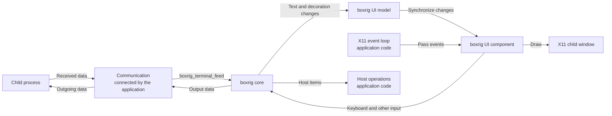

# Implementing a simple terminal application (UI)

[日本語](../../ja/step-by-step/step-by-step-ui.md)

The boxrig UI library lets you build a terminal application with relatively little code.
boxrig also provides the lower-level boxrig core library. The main differences are:

- boxrig core parses and interprets byte streams. It is independent of specific environments and has no external dependencies.
  This independence lets you reuse it on devices and platforms that boxrig does not support out of the box.
  The application supplies the rendering, device input, and communication.
- boxrig UI is a reusable library that uses boxrig core to render content and handle input on specific devices.
  Its public APIs let you control X11 widgets and Win32 controls with little application code, making it easy to embed in your application.

This guide builds an X11 terminal application incrementally using the public boxrig UI API.
It also outlines usage with Wayland, OpenGL, Win32 (GDI), and Direct2D/3D.

boxrig UI is designed for general application development.
If you need very fine-grained control or want to implement a terminal on a substantially different platform that boxrig UI does not support, start with the [boxrig core guide](./step-by-step-core.md).

This guide assumes familiarity with C99.

---

## boxrig UI basics and the overall data flow

boxrig UI works with core to draw the characters and decorations that core interprets.
It exposes abstract models and components that also submit keyboard and other window-system input to core.

The core guide showed how to retrieve and draw individual cells.
With boxrig UI, you do not need to implement that rendering yourself.

Start with the roles of these three structures:

| Structure | Role |
| :--- | :--- |
| `boxrig_terminal` | The core terminal object. It interprets received data and maintains logical terminal state, including characters, decorations, and the cursor |
| `boxrig_ui_model` | Manages logical UI state. It connects the terminal to boxrig UI and distributes terminal changes to the attached views |
| `boxrig_x11_terminal_component` | The X11 UI component. It owns a child window and handles drawing, keyboard input, mouse input, and IME. Other specialized components support platforms such as Wayland, OpenGL, and Win32 |

These are opaque structures managed through creation and operation functions.
This guide creates one terminal, one UI model, and one component.

Place the component inside a parent window created by your application.
The application remains responsible for the parent window, event loop, child-process startup, and communication.
The following diagram shows the flow:



### Connecting the terminal to boxrig UI

Create the terminal with core's `boxrig_terminal_create()`.
Then create its UI model:

```c
boxrig_ui_status boxrig_ui_model_create(
    boxrig_terminal *terminal,
    boxrig_ui_model **model_out);
```

The UI model references the terminal but never destroys it.
Keep the terminal alive until you have finished using the model.

Next, create an X11 UI component:

```c
boxrig_ui_status boxrig_x11_terminal_component_create_child(
    Display *display,
    Window parent,
    boxrig_ui_model *model,
    const boxrig_x11_terminal_component_config *config,
    boxrig_x11_terminal_component **component_out);
```

This function creates a dedicated child window inside the specified parent and prepares the renderer, fonts, and input handling.
It only references the parent window and UI model, so keep both alive until the component is destroyed.

### Displaying received data

Feed received bytes to core's `boxrig_terminal_feed()`.
When terminal contents change, update boxrig UI in this order:

```c
boxrig_ui_model_synchronize(model);
boxrig_x11_terminal_component_frame(component, &frame);
```

`boxrig_ui_model_synchronize()` distributes terminal changes to the views attached to the model.
`boxrig_x11_terminal_component_frame()` renders those changes.
The application calls both functions; feeding data alone does not automatically draw anything.

> Explicit updates let the host application adapt drawing to its own schedule, rather than having a component operate entirely on its own once placed.
> The API is designed to keep the required integration small.

The following sections build the necessary processing around these calls.

## Implementing the first version

First, display the fixed string `"Hello boxrig UI!"` in an 80-column, 25-row window.

This example derives the parent window's initial size from terminal cell metrics, passes the parent allocation to the component, then applies the resulting row and column count to the terminal. This order keeps the parent window, component, and terminal on the same grid.

boxrig UI prepares the font, so the application does not need to load an X11 font itself. `boxrig_x11_terminal_component_get_effective_metrics()` returns the effective width and height of a cell, which the example uses to size the parent window for 80 columns and 25 rows.

`boxrig_x11_terminal_component_allocate()` specifies the component's position and size inside its parent.
The component fills the parent here, so its origin is `0, 0`.
`BOXRIG_UI_WINDOW_EMBEDDED` makes the component follow the parent's allocation.

This example hides the scrollbar to simplify initial size calculation.
Without an explicit `scrollbar_presentation`, the component adds its own scrollbar by default.

`apply_grid_resize()` applies the row and column counts chosen by the component to the terminal.
This must happen before drawing begins. The resizing section explains it in detail.

Save the following as `hello_ui_term.c`:

<!-- ui-guide-source: hello_ui_term.c -->
```c
/* The guide uses the public boundary and no private boxrig headers. */
#include "boxrig/terminal.h"
#include "boxrig/x11.h"

#include <X11/Xlib.h>

#include <limits.h>
#include <locale.h>
#include <stdbool.h>
#include <stdint.h>
#include <stdio.h>

/* Display the number of rows and columns determined by the component in the terminal */
static int apply_grid_resize(
    boxrig_x11_terminal_component *component,
    boxrig_terminal *terminal)
{
    boxrig_ui_layout_action action;

    while (boxrig_x11_terminal_component_take_layout_action(component, &action)) {
        if (action.kind != BOXRIG_UI_LAYOUT_ACTION_GRID_RESIZE) {
            return -1;
        }
        const bool succeeded = boxrig_terminal_resize(
            terminal, action.value.grid_resize.rows,
            action.value.grid_resize.columns) == BOXRIG_STATUS_OK;

        if (boxrig_x11_terminal_component_complete_grid_resize(
                component, action.revision, succeeded) != BOXRIG_UI_OK ||
            !succeeded) {
            return -1;
        }
    }
    return 0;
}

int main(void)
{
    static const uint8_t message[] = "Hello boxrig UI!";

    boxrig_terminal_config config = boxrig_terminal_config_default();
    boxrig_x11_terminal_component_config component_config =
        boxrig_x11_terminal_component_config_default();
    boxrig_terminal *terminal = NULL;
    boxrig_ui_model *model = NULL;
    boxrig_x11_terminal_component *component = NULL;
    Display *display = NULL;
    Window window = None;
    Atom delete_window = None;
    Atom protocols = None;
    boxrig_font_effective_metrics metrics;
    unsigned int width;
    unsigned int height;
    size_t consumed = 0;
    bool running = true;
    int result = 1;

    /* Select the application locale before creating the XIM input adapter. */
    if (setlocale(LC_ALL, "") == NULL || XSetLocaleModifiers("") == NULL) {
        goto cleanup;
    }
    display = XOpenDisplay(NULL);
    if (display == NULL) {
        fprintf(stderr, "hello-ui-term: could not open X display\n");
        goto cleanup;
    }
    window = XCreateSimpleWindow(
        display, DefaultRootWindow(display), 0, 0, 1, 1, 0, 0, 0);
    if (window == None) {
        goto cleanup;
    }
    XSelectInput(display, window, FocusChangeMask);
    delete_window = XInternAtom(display, "WM_DELETE_WINDOW", False);
    protocols = XInternAtom(display, "WM_PROTOCOLS", False);
    if (delete_window == None || protocols == None ||
        XSetWMProtocols(display, window, &delete_window, 1) == 0) {
        goto cleanup;
    }
    XStoreName(display, window, "boxrig UI guide: step 1");

    /* The component owns its child, renderer, fonts, and input adapter. */
    config.rows = 25;
    config.columns = 80;
    component_config.scrollbar_presentation = BOXRIG_UI_COMPONENT_SCROLLBAR_NONE;
    /* This first example has no animation adapter yet. */
    component_config.view.blink.text_enabled = false;
    component_config.view.blink.cursor_enabled = false;
    if (boxrig_terminal_create(&config, &terminal) != BOXRIG_STATUS_OK ||
        boxrig_ui_model_create(terminal, &model) != BOXRIG_UI_OK ||
        boxrig_x11_terminal_component_create_child(
            display, window, model, &component_config, &component) != BOXRIG_UI_OK ||
        boxrig_x11_terminal_component_get_effective_metrics(
            component, &metrics) != BOXRIG_FONT_CATALOG_OK ||
        metrics.cell_width == 0 || metrics.cell_height == 0 ||
        metrics.cell_width > UINT_MAX / config.columns ||
        metrics.cell_height > UINT_MAX / config.rows) {
        goto cleanup;
    }
    width = (unsigned int)config.columns * metrics.cell_width;
    height = (unsigned int)config.rows * metrics.cell_height;
    XResizeWindow(display, window, width, height);

    {
        const boxrig_ui_component_allocation allocation = {
            0, 0, width, height, BOXRIG_UI_WINDOW_EMBEDDED
        };
        boxrig_ui_layout_result layout;

        if (boxrig_x11_terminal_component_allocate(
                component, &allocation, &layout) != BOXRIG_UI_OK ||
            apply_grid_resize(component, terminal) == -1 ||
            boxrig_x11_terminal_component_set_visible(component, true) != BOXRIG_UI_OK ||
            boxrig_terminal_feed(
                terminal, message, sizeof(message) - 1, &consumed) != BOXRIG_STATUS_OK ||
            consumed != sizeof(message) - 1) {
            goto cleanup;
        }
    }
    XMapWindow(display, window);

    while (running) {
        boxrig_ui_component_frame_result frame;
        XEvent event;
        boxrig_ui_component_event_result handled;

        if (boxrig_ui_model_synchronize(model) != BOXRIG_UI_OK ||
            boxrig_x11_terminal_component_frame(component, &frame) != BOXRIG_UI_OK) {
            goto cleanup;
        }
        if (frame.additional_dispatch && XPending(display) == 0) {
            continue;
        }
        XNextEvent(display, &event);
        handled = boxrig_x11_terminal_component_dispatch_event(component, &event);
        if (handled == BOXRIG_UI_COMPONENT_EVENT_FAILURE ||
            handled == BOXRIG_UI_COMPONENT_EVENT_BLOCKED) {
            goto cleanup;
        }
        if (handled == BOXRIG_UI_COMPONENT_EVENT_UNRELATED) {
            if (event.type == FocusIn && event.xfocus.window == window) {
                if (boxrig_x11_terminal_component_request_focus(component) != BOXRIG_UI_OK) {
                    goto cleanup;
                }
            } else if (event.type == ClientMessage &&
                       event.xclient.window == window &&
                       event.xclient.message_type == protocols &&
                       event.xclient.format == 32 &&
                       (Atom)event.xclient.data.l[0] == delete_window) {
                running = false;
            }
        }
    }
    result = 0;

cleanup:
    if (result != 0) {
        fprintf(stderr, "hello-ui-term: terminal operation failed\n");
    }
    /* Destroy borrowers before their model, terminal, parent, and Display. */
    boxrig_x11_terminal_component_destroy(component);
    boxrig_ui_model_destroy(model);
    boxrig_terminal_destroy(terminal);
    if (display != NULL) {
        if (window != None) {
            XDestroyWindow(display, window);
        }
        XCloseDisplay(display);
    }
    return result;
}
```

### Building and running

This example uses the X11 UI library, the platform-independent UI library, and core.
It requires X11 development packages, Pango, Cairo, Fontconfig, D-Bus, and `pkg-config`.
See the [README](../../../README.md) for the repository's build prerequisites and links.

Save the following `Makefile` beside the source.
To keep the existing Makefile for the completed examples, put these two files in a separate directory and set `BOXRIG_ROOT` to the absolute path of the boxrig repository.

<!-- ui-guide-source: Makefile -->
```make
CC ?= cc
BOXRIG_ROOT ?= ../../..
ROOT := $(abspath $(BOXRIG_ROOT))
PACKAGES := x11 xcomposite xrender xfixes 'pango >= 1.50' pangocairo pangoft2 fontconfig dbus-1

CPPFLAGS += -I$(ROOT)/include $(shell pkg-config --cflags $(PACKAGES))
CFLAGS ?= -O2 -g
CFLAGS += -std=c99 -Wall -Wextra -Wpedantic -Werror
LDLIBS += $(shell pkg-config --libs $(PACKAGES))
LIBBOXRIG := $(ROOT)/build/libboxrig-x11.a \
             $(ROOT)/build/libboxrig-ui.a \
             $(ROOT)/build/libboxrig.a

.PHONY: all clean libraries

all: hello_ui_term

libraries:
	$(MAKE) -C $(ROOT) build/libboxrig-x11.a build/libboxrig-ui.a build/libboxrig.a

$(LIBBOXRIG): libraries

hello_ui_term: hello_ui_term.c $(LIBBOXRIG)
	$(CC) $(CPPFLAGS) $(CFLAGS) $(LDFLAGS) $< $(LIBBOXRIG) $(LDLIBS) -o $@

editable_document: editable_document.c $(LIBBOXRIG)
	$(CC) $(CPPFLAGS) $(CFLAGS) $(LDFLAGS) $< $(ROOT)/build/libboxrig-ui.a $(ROOT)/build/libboxrig.a -o $@

clean:
	$(RM) hello_ui_term editable_document
```

Build and run with:

```sh
make
./hello_ui_term
```

If you saved the files elsewhere, use a command such as:

```sh
make BOXRIG_ROOT=/path/to/boxrig
./hello_ui_term
```

The example works if `Hello boxrig UI!` appears and closing the window exits the application.
The application handles closing the parent window; boxrig UI handles the Expose events needed to draw text.

### Resource destruction order

The first example destroys the component, UI model, terminal, parent window, and X11 connection in that order.
The component references the model, parent window, and X11 connection, while the model references the terminal.

Destroying the component also destroys its child window and renderer.
Do not destroy that child window a second time from the application.
The application owns the parent window and X11 connection and releases them last.

## Drawing cells efficiently

The first example calls `boxrig_ui_model_synchronize()` and `boxrig_x11_terminal_component_frame()` when drawing.
Those calls already let boxrig UI concentrate updates on changed cells.
You do not need the dirty-region retrieval and per-cell drawing from the core guide.

boxrig UI also draws foreground and background colors, the cursor, and multibyte characters.
Try changing `message` to:

```c
static const uint8_t message[] =
    "Hello boxrig UI!\r\n"
    "\033[31mRed text\033[0m\r\n"
    "\033[1mBold text\033[0m";
```

After rebuilding, the window displays separate lines with red and bold text.
`\033` represents ESC; core interprets the escape sequences that follow it, and UI renders the result.
The application needs no additional drawing code for those decorations.

> While using boxrig UI, do not consume core's dirty regions yourself.
> `boxrig_ui_model_synchronize()` retrieves them and passes the changes to the components.

`boxrig_x11_terminal_component_frame()` performs one frame's work without waiting.
If `frame.additional_dispatch` is true, more work can progress immediately, so run another frame without waiting for an event.

`frame.frame_pending` also indicates unfinished work, but includes work waiting for resize completion or an X11 event.
Looping solely on that flag can keep the application running when it should wait.
The first example uses `additional_dispatch` to decide when to run again.

## Submitting interaction data

In the core guide, the application converted X11 key events into core events and called `boxrig_terminal_send_key()`.
With boxrig UI, pass the X11 event to the component and let it perform that conversion.

The first example already contains:

```c
handled = boxrig_x11_terminal_component_dispatch_event(component, &event);
```

The component handles keyboard, mouse, focus, IME, selection, and drawing events.
Its return value indicates what happened:

| Return value | Meaning |
| :--- | :--- |
| `BOXRIG_UI_COMPONENT_EVENT_HANDLED` | The component handled the event |
| `BOXRIG_UI_COMPONENT_EVENT_UNRELATED` | The event concerns something outside the component, such as its parent window. The application handles it |
| `BOXRIG_UI_COMPONENT_EVENT_BLOCKED` | There is not enough capacity to retain outgoing data. Keep the same event and retry after capacity becomes available |
| `BOXRIG_UI_COMPONENT_EVENT_FAILURE` | Processing failed |

Pass all events to the component without first filtering by target window.
IME communication can use events addressed to windows other than the input child window.
Events such as closing the parent return `UNRELATED`, so the application can handle them afterward.

When the parent gains focus, the first example calls `boxrig_x11_terminal_component_request_focus()` to transfer focus to the component's child window so it can receive keys.
Setting the locale before component creation also prepares IME support.

There is no child process yet.
Keys generate outgoing data, but that data is not fed back as display content, so typing does not change the window.
The next section lets you inspect the outgoing data.

The first example also exits on `BLOCKED`.
The child-process section changes this to retain and retry the same event.

## Sending output data

boxrig UI submits key input to core but does not choose where the resulting bytes go.
The application must retrieve them and send them to a child process or another destination.
Responses to terminal queries use the same output stream.

Before adding a child process, write the data to this application's standard output.
Add this function before `main()`:

```c
static int send_output(boxrig_terminal *terminal)
{
    const uint8_t *bytes;
    size_t length;

    while ((length = boxrig_terminal_output_peek(terminal, &bytes)) != 0) {
        const size_t written = fwrite(bytes, 1, length, stdout);

        if (written != 0 &&
            boxrig_terminal_output_consume(terminal, written) != BOXRIG_STATUS_OK) {
            return -1;
        }
        if (written != length) {
            return -1;
        }
    }
    return fflush(stdout) == 0 ? 0 : -1;
}
```

Before `boxrig_ui_model_synchronize()` in the event loop, add:

```c
if (send_output(terminal) == -1) {
    goto cleanup;
}
```

Build, run, and type letters or numbers in the boxrig UI window.
They should appear in the terminal that launched the application.
To display typed text inside the boxrig UI window, the application will feed text returned by the child as received data.

The terminal owns the bytes returned by `boxrig_terminal_output_peek()`.
Consume only the bytes actually sent, using `boxrig_terminal_output_consume()`.
This temporary example may wait while writing to standard output. A later section replaces it with non-blocking PTY communication.

## Handling host items

boxrig UI draws text and the cursor, but the application handles host items such as title changes and bells.
As in the core guide, this example handles only the bell and ignores other effects.

You can create one host-item access point for a UI model.
Add this variable in `main()`:

```c
boxrig_ui_host_item_consumer *consumer = NULL;
```

After successfully creating the terminal and component, but before the initial allocation, add:

```c
if (boxrig_ui_host_item_consumer_create(model, &consumer) != BOXRIG_UI_OK) {
    goto cleanup;
}
```

Add this function before `main()`:

```c
static int process_host_items(
    Display *display,
    boxrig_ui_host_item_consumer *consumer)
{
    boxrig_host_item item;

    while (boxrig_ui_host_item_consumer_peek(consumer, &item)) {
        const uint64_t request_id = item.request_id;

        /* Handle bells and ignore unsupported host operations. */
        if (item.type == BOXRIG_HOST_ITEM_BELL) {
            (void)XBell(display, 0);
        }
        if (boxrig_ui_host_item_consumer_consume(consumer) != BOXRIG_UI_OK ||
            (request_id != 0 &&
             boxrig_ui_host_item_consumer_complete(
                 consumer, request_id, BOXRIG_HOST_REQUEST_UNAVAILABLE,
                 NULL, 0) != BOXRIG_UI_OK)) {
            return -1;
        }
    }
    return 0;
}
```

Before `send_output()` in the event loop, add:

```c
if (process_host_items(display, consumer) == -1) {
    goto cleanup;
}
```

In cleanup, before destroying the UI model, add:

```c
boxrig_ui_host_item_consumer_destroy(consumer);
```

Append `\a` to the fixed string to test the bell:

```c
static const uint8_t message[] = "Hello boxrig UI!\a";
```

After rebuilding, the application displays the text and requests a bell.
Whether it produces a sound depends on the X11 environment's configuration.
See the [Xlib bell documentation](https://www.x.org/releases/X11R7.6/doc/libX11/specs/libX11/libX11.html).

The handler consumes unsupported items too and completes requests that require a response as unavailable.
Leaving unhandled items in the queue would eventually prevent received data from progressing.

## Terminal size and cursor control

core stores the row and column counts and interprets cursor position and shape.
UI draws the cursor, so the application does not need to retrieve its coordinates and draw it itself.

For example, this string places the cursor after the text:

```c
static const uint8_t message[] = "Hello boxrig UI!\033[?25h";
```

The first example disabled blinking.
Now connect the standard poll adapter to enable cursor blinking and image animation.
The shared runtime manages the clock and deadlines and requests frames only when the display needs to change.
The application continues its normal event and frame processing.

Add this definition at the beginning of the file, before every `#include`:

```c
#define _POSIX_C_SOURCE 200809L
```

Add these headers:

```c
#include <errno.h>
#include <poll.h>
```

Add an adapter variable in `main()`:

```c
boxrig_ui_animation_poll *animations = NULL;
```

Before creating the component, replace the two lines that disabled blinking with:

```c
if (boxrig_x11_animation_poll_create(&animations) != BOXRIG_UI_OK) {
    goto cleanup;
}
component_config.animation_runtime = boxrig_ui_animation_poll_runtime(animations);
component_config.view.blink = boxrig_ui_blink_config_default();
```

In `cleanup`, release the adapter immediately after destroying the component:

```c
boxrig_ui_animation_poll_destroy(animations);
```

Replace the entire event loop with the following, which includes the host-item and output handling added earlier:

```c
while (running) {
    boxrig_ui_component_frame_result frame;
    XEvent event;
    boxrig_ui_component_event_result handled;
    struct pollfd descriptor = { ConnectionNumber(display), POLLIN, 0 };
    int timeout;

    if (boxrig_ui_animation_poll_dispatch(animations) != BOXRIG_UI_OK ||
        process_host_items(display, consumer) == -1 ||
        send_output(terminal) == -1 ||
        boxrig_ui_model_synchronize(model) != BOXRIG_UI_OK ||
        boxrig_x11_terminal_component_frame(component, &frame) != BOXRIG_UI_OK) {
        goto cleanup;
    }
    timeout = frame.additional_dispatch || XPending(display) > 0 ? 0 : -1;
    if (boxrig_ui_animation_poll_prepare_wait(animations, timeout, &timeout) != BOXRIG_UI_OK) {
        goto cleanup;
    }
    XFlush(display);
    if (poll(&descriptor, 1, timeout) == -1) {
        if (errno == EINTR) {
            continue;
        }
        goto cleanup;
    }
    if ((descriptor.revents & (POLLERR | POLLHUP | POLLNVAL)) != 0) {
        goto cleanup;
    }
    if (XPending(display) == 0) {
        continue;
    }
    XNextEvent(display, &event);
    handled = boxrig_x11_terminal_component_dispatch_event(component, &event);
    if (handled == BOXRIG_UI_COMPONENT_EVENT_FAILURE ||
        handled == BOXRIG_UI_COMPONENT_EVENT_BLOCKED) {
        goto cleanup;
    }
    if (handled == BOXRIG_UI_COMPONENT_EVENT_UNRELATED) {
        if (event.type == FocusIn && event.xfocus.window == window) {
            if (boxrig_x11_terminal_component_request_focus(component) != BOXRIG_UI_OK) {
                goto cleanup;
            }
        } else if (event.type == ClientMessage &&
                   event.xclient.window == window &&
                   event.xclient.message_type == protocols &&
                   event.xclient.format == 32 &&
                   (Atom)event.xclient.data.l[0] == delete_window) {
            running = false;
        }
    }
}
```

`boxrig_ui_animation_poll_dispatch()` updates display state whose deadline has arrived and requests any needed frames.
Drawing still happens through the normal `frame()` call.
During model synchronization, the runtime also establishes start times for newly received image animations and synchronized output.

`boxrig_ui_animation_poll_prepare_wait()` incorporates runtime deadlines into the normal wait.
With no active deadline, it waits indefinitely.
The application does not calculate blink periods or the next blink time.
Manually updating the same terminal's clock would return `BUSY`, so this example does not call the manual time-update API.

As described in [Xlib's event-queue documentation](https://www.x.org/releases/X11R7.6/doc/libX11/specs/libX11/libX11.html#Event_Queue_Management), Xlib can retain events internally.
Waiting only on the connection's file descriptor could miss events already received, so the example checks `XPending()` before waiting.
Following the behavior described for [`poll()`](https://man7.org/linux/man-pages/man2/poll.2.html), it also dispatches the adapter on the next iteration after a timeout.

Build, run, and focus the window. The cursor should blink without further input.

## Following window resizing

Next, resize the component and terminal when the parent window changes size.
boxrig UI calculates rows and columns from pixel dimensions and the effective font.
The application does not need to divide by cell dimensions itself.

Handle resizing in this order:

1. Read the actual allocated width and height from the parent's `ConfigureNotify`.
2. Pass them to `boxrig_x11_terminal_component_allocate()`.
3. Retrieve the row and column change through `boxrig_x11_terminal_component_take_layout_action()`.
4. Resize the terminal and tell the component that the change with the same revision has completed.
5. Synchronize the UI model and run a frame.

Allocation alone does not change terminal rows and columns.
When connected to a child, the communication endpoint must change size too, so applying the change remains the application's responsibility.

### Passing parent dimensions to the component

The first example performs initial allocation inside `main()`.
To reuse that operation for resizing, add this function before `main()`:

```c
static int allocate_component(
    boxrig_x11_terminal_component *component,
    unsigned int width,
    unsigned int height)
{
    const boxrig_ui_component_allocation allocation = {
        0, 0, width, height, BOXRIG_UI_WINDOW_EMBEDDED
    };
    boxrig_ui_layout_result layout;

    return boxrig_x11_terminal_component_allocate(
        component, &allocation, &layout) == BOXRIG_UI_OK ? 0 : -1;
}
```

The width includes the component's scrollbar.
Even with a scrollbar enabled, pass the full parent width without subtracting the scrollbar yourself.

Add `StructureNotifyMask` to the parent window's selected events:

```c
XSelectInput(display, window, StructureNotifyMask | FocusChangeMask);
```

### Applying row and column changes

Replace the first example's `apply_grid_resize()` with this `process_layout()`:

```c
static int process_layout(
    boxrig_x11_terminal_component *component,
    boxrig_terminal *terminal,
    unsigned int width,
    unsigned int height)
{
    boxrig_ui_layout_action action;

    while (boxrig_x11_terminal_component_take_layout_action(component, &action)) {
        if (action.kind == BOXRIG_UI_LAYOUT_ACTION_GRID_RESIZE) {
            const bool succeeded = boxrig_terminal_resize(
                terminal, action.value.grid_resize.rows,
                action.value.grid_resize.columns) == BOXRIG_STATUS_OK;

            if (boxrig_x11_terminal_component_complete_grid_resize(
                    component, action.revision, succeeded) != BOXRIG_UI_OK ||
                !succeeded) {
                return -1;
            }
        } else {
            bool applied;
            boxrig_ui_layout_result layout;

            /* This host keeps its parent allocation for content-size requests. */
            if (boxrig_x11_terminal_component_complete_size_command(
                    component, action.revision, BOXRIG_UI_SIZE_REJECTED,
                    (boxrig_ui_fixed)width * BOXRIG_UI_FIXED_ONE,
                    (boxrig_ui_fixed)height * BOXRIG_UI_FIXED_ONE,
                    &applied, &layout) != BOXRIG_UI_OK) {
                return -1;
            }
        }
    }
    return 0;
}
```

`GRID_RESIZE` carries the new rows and columns and a revision identifying the change.
`take_layout_action()` retrieves each change only once, so complete it using the returned `action.revision`.

`CONTENT_SIZE` asks to resize the parent, for example after a font change.
This simple application keeps the existing parent allocation and rejects the request with the current width and height.
Completion coordinates use 26.6 fixed point, so multiply pixel dimensions by `BOXRIG_UI_FIXED_ONE`.
This guide does not add interactive font changes.

### Updating initial allocation and the event loop

Replace the initial allocation block in `main()` with:

```c
if (allocate_component(component, width, height) == -1 ||
    process_layout(component, terminal, width, height) == -1 ||
    boxrig_x11_terminal_component_set_visible(component, true) != BOXRIG_UI_OK ||
    boxrig_terminal_feed(
        terminal, message, sizeof(message) - 1, &consumed) != BOXRIG_STATUS_OK ||
    consumed != sizeof(message) - 1) {
    goto cleanup;
}
```

In the event loop's `UNRELATED` branch, add resize handling before the `FocusIn` condition:

```c
if (event.type == ConfigureNotify &&
    event.xconfigure.window == window &&
    event.xconfigure.width > 0 && event.xconfigure.height > 0) {
    width = (unsigned int)event.xconfigure.width;
    height = (unsigned int)event.xconfigure.height;
    if (allocate_component(component, width, height) == -1) {
        goto cleanup;
    }
} else if (event.type == FocusIn && event.xfocus.window == window) {
    /* Keep the existing focus handling here. */
}
```

After handling events, add this at the end of the loop:

```c
if (process_layout(component, terminal, width, height) == -1) {
    goto cleanup;
}
```

A frame can also produce a new size request.
Add the same call immediately after a successful `boxrig_x11_terminal_component_frame()`.

Build and run. Enlarging the window should enlarge the terminal display area.
The next section connects a child process and makes its rows and columns follow the same changes.

## Connecting a child process

The application currently feeds a fixed string as received data and writes outgoing keyboard data to standard output.
Replace this with PTY communication with a child process.
A PTY is an I/O endpoint that the child can use as a terminal.

The UI component does not create a child process or PTY.
The application connects boxrig's POSIX and session libraries.
The session feeds received data to core, sends outgoing data to the PTY, and retains data that could only be partially processed.

### Creating a PTY and session

Add these headers:

```c
#include "boxrig/posix.h"
#include <signal.h>
```

Add these variables in `main()`:

```c
boxrig_session_config session_config = boxrig_session_config_default();
boxrig_posix_pty *pty = NULL;
boxrig_session *session = NULL;
```

Before the initial allocation, add:

```c
{
    char *child_arguments[] = { "/bin/sh", "-i", NULL };

    if (boxrig_posix_pty_spawn(
            child_arguments, "xterm", config.rows, config.columns, &pty) == -1 ||
        boxrig_posix_pty_session_create(
            terminal, pty, &session_config, &session) != BOXRIG_SESSION_OK) {
        goto cleanup;
    }
}
```

`boxrig_posix_pty_spawn()` starts a child connected to the PTY.
Its second argument, `"xterm"`, becomes the child's `TERM` environment variable.
`TERM` identifies the terminal type and the escape sequences the child can use; it does not specify rows or columns.

Remove the `message` and `consumed` declarations, along with `boxrig_terminal_feed()` and the consumed-byte check in the initial allocation.
Also remove `send_output()` and its calls.
The session now owns receive and send processing, so the application must not consume the same outgoing data itself.

### Notifying the child of terminal size changes

The previous `process_layout()` changes only core's rows and columns.
To notify the child too, change its second argument from `boxrig_terminal *terminal` to `boxrig_session *session` and replace the `GRID_RESIZE` application code with:

```c
const bool succeeded = boxrig_session_resize(
    session, action.value.grid_resize.rows,
    action.value.grid_resize.columns) == BOXRIG_SESSION_OK;
```

Keep the completion notification unchanged.
At every `process_layout()` call, replace the second argument `terminal` with `session`.

`boxrig_session_resize()` updates both the PTY and terminal.
The POSIX PTY implementation uses `TIOCSWINSZ`; on Linux, a size change generates `SIGWINCH` for the foreground process group.
Programs launched from the shell, such as vim, can then obtain the new size.
See the [TTY resize documentation](https://man7.org/linux/man-pages/man2/TIOCSWINSZ.2const.html).

### Processing communication and events in one loop

The event loop must wait for both the X11 connection and PTY.
Translate readiness as follows:

| Session interest | poll condition | Readiness passed to the session |
| :--- | :--- | :--- |
| `BOXRIG_SESSION_INTEREST_READ` | `POLLIN` | `BOXRIG_SESSION_READY_READ` |
| `BOXRIG_SESSION_INTEREST_WRITE` | `POLLOUT` | `BOXRIG_SESSION_READY_WRITE` |
| `BOXRIG_SESSION_INTEREST_DISPATCH` | Retry retained received data | Dispatch even without readiness flags |

Use this loop order:

1. Update the current time and call `boxrig_session_dispatch()` to advance receiving and sending.
2. Process host items.
3. Pass X11 events to the component and handle parent-window events.
4. Apply row and column changes to the session.
5. Synchronize the UI model and run a frame, then check size requests again.
6. Read the next communication interests and animation deadline, then wait for the X11 connection and PTY.

When `boxrig_session_dispatch()` cannot feed more input, consuming host items or sending output can free space so retained input can be retried.
Setting the wait timeout to 0 solely because `INTEREST_DISPATCH` is present can spin while no space is available.
The completed example also checks whether the last dispatch was blocked, whether host items were consumed, and whether sending made progress.

Do not discard an X11 event that returns `BLOCKED`.
The completed example saves it in `blocked_event` and retries it before retrieving another event:

```c
if (blocked) {
    event = blocked_event;
} else {
    XNextEvent(display, &event);
}
handled = boxrig_x11_terminal_component_dispatch_event(component, &event);
if (handled == BOXRIG_UI_COMPONENT_EVENT_FAILURE) {
    goto cleanup;
}
blocked = handled == BOXRIG_UI_COMPONENT_EVENT_BLOCKED;
if (blocked) {
    blocked_event = event;
} else if (handled == BOXRIG_UI_COMPONENT_EVENT_UNRELATED) {
    /* Handle parent allocation, focus, and window close here. */
}
```

While the saved event remains blocked, queued Xlib events alone do not trigger an immediate next iteration.
Advance PTY writes and frame processing, and wait for conditions that allow a retry.
Temporarily exclude X11 read readiness from the wait so events that cannot yet be retrieved do not repeatedly wake the loop.
The component can also retain input internally.
While `frame.input_blocked` is true and sending has not progressed, suppress immediate repetition from `additional_dispatch` and wait for PTY write readiness.
Processing one X11 event per iteration gives communication and drawing a turn even during a continuous stream of events.

Add variables in `main()` for the retained event and communication readiness:

```c
bool blocked = false;
XEvent blocked_event;
uint32_t ready = BOXRIG_SESSION_READY_NONE;
```

Replace the entire event loop with the following, which also includes resizing, focus, and close handling:

```c
while (running) {
    boxrig_session_dispatch_result dispatched;
    boxrig_ui_component_frame_result frame;
    boxrig_host_item item;
    bool had_host_items;
    uint32_t interests;
    bool retry_session;
    bool waiting_for_output;
    int timeout;
    struct pollfd descriptors[2] = {
        { ConnectionNumber(display), POLLIN, 0 },
        { boxrig_posix_pty_descriptor(pty), 0, 0 }
    };

    if (boxrig_ui_animation_poll_dispatch(animations) != BOXRIG_UI_OK ||
        boxrig_session_dispatch(session, ready, &dispatched) != BOXRIG_SESSION_OK) {
        goto cleanup;
    }
    ready = BOXRIG_SESSION_READY_NONE;
    had_host_items = boxrig_ui_host_item_consumer_peek(consumer, &item);
    if (process_host_items(display, consumer) == -1) {
        goto cleanup;
    }

    /* Handle at most one native event before servicing the PTY and frame. */
    if (blocked || XPending(display) > 0) {
        XEvent event;
        boxrig_ui_component_event_result handled;

        if (blocked) {
            event = blocked_event;
        } else {
            XNextEvent(display, &event);
        }
        handled = boxrig_x11_terminal_component_dispatch_event(component, &event);
        if (handled == BOXRIG_UI_COMPONENT_EVENT_FAILURE) {
            goto cleanup;
        }
        blocked = handled == BOXRIG_UI_COMPONENT_EVENT_BLOCKED;
        if (blocked) {
            blocked_event = event;
        } else if (handled == BOXRIG_UI_COMPONENT_EVENT_UNRELATED) {
            if (event.type == ConfigureNotify &&
                event.xconfigure.window == window &&
                event.xconfigure.width > 0 && event.xconfigure.height > 0) {
                width = (unsigned int)event.xconfigure.width;
                height = (unsigned int)event.xconfigure.height;
                if (allocate_component(component, width, height) == -1) {
                    goto cleanup;
                }
            } else if (event.type == FocusIn && event.xfocus.window == window) {
                if (boxrig_x11_terminal_component_request_focus(component) !=
                    BOXRIG_UI_OK) {
                    goto cleanup;
                }
            } else if (event.type == ClientMessage &&
                       event.xclient.window == window &&
                       event.xclient.message_type == protocols &&
                       event.xclient.format == 32 &&
                       (Atom)event.xclient.data.l[0] == delete_window) {
                running = false;
            }
        }
    }
    if (!running) {
        break;
    }
    if (process_layout(component, session, width, height) == -1 ||
        boxrig_ui_model_synchronize(model) != BOXRIG_UI_OK ||
        boxrig_x11_terminal_component_frame(component, &frame) != BOXRIG_UI_OK ||
        process_layout(component, session, width, height) == -1) {
        goto cleanup;
    }
    if (dispatched.peer_closed) {
        break;
    }

    interests = boxrig_session_interests(session);
    /* Later native events cannot advance a retained blocked event. */
    descriptors[0].events = blocked ? 0 : POLLIN;
    if ((interests & BOXRIG_SESSION_INTEREST_READ) != 0) {
        descriptors[1].events |= POLLIN;
    }
    if ((interests & BOXRIG_SESSION_INTEREST_WRITE) != 0) {
        descriptors[1].events |= POLLOUT;
    }
    retry_session = (interests & BOXRIG_SESSION_INTEREST_DISPATCH) != 0 &&
        (!dispatched.core_blocked || had_host_items ||
         dispatched.transport_bytes_written != 0);
    waiting_for_output = frame.input_blocked &&
        (interests & BOXRIG_SESSION_INTEREST_WRITE) != 0 &&
        dispatched.transport_bytes_written == 0;
    timeout = (frame.additional_dispatch && !waiting_for_output) || retry_session ||
        (blocked && dispatched.transport_bytes_written != 0) ||
        (!blocked && XPending(display) > 0) ? 0 : -1;
    if (boxrig_ui_animation_poll_prepare_wait(animations, timeout, &timeout) != BOXRIG_UI_OK) {
        goto cleanup;
    }
    XFlush(display);
    /* poll with timeout zero still collects PTY readiness during UI work. */
    if (poll(descriptors, 2, timeout) == -1) {
        if (errno == EINTR) {
            continue;
        }
        perror("simple-ui-term: poll");
        goto cleanup;
    }
    if ((descriptors[0].revents & (POLLERR | POLLHUP | POLLNVAL)) != 0 ||
        (descriptors[1].revents & POLLNVAL) != 0) {
        goto cleanup;
    }
    /* Drain unread bytes on hangup before accepting transport EOF. */
    if ((descriptors[1].revents & (POLLIN | POLLHUP | POLLERR)) != 0) {
        ready |= BOXRIG_SESSION_READY_READ;
    }
    if ((descriptors[1].revents & (POLLOUT | POLLHUP | POLLERR)) != 0) {
        ready |= BOXRIG_SESSION_READY_WRITE;
    }
}

```

On a PTY hangup, read remaining input before letting the session determine that the peer has closed.
When `dispatched.peer_closed` becomes true, the application exits too.

### Adding cleanup

Stop component event handling before destroying the component.
Destroy the session before stopping and reaping the child.
Replace the code between component destruction and UI-model destruction with:

```c
if (component != NULL) {
    (void)boxrig_x11_terminal_component_quiesce(component);
}
boxrig_x11_terminal_component_destroy(component);
boxrig_ui_animation_poll_destroy(animations);
boxrig_session_destroy(session);
boxrig_ui_host_item_consumer_destroy(consumer);
if (pty != NULL) {
    int child_status;

    /* This minimal host forcibly stops its direct child on window close. */
    (void)kill(boxrig_posix_pty_child(pty), SIGKILL);
    if (boxrig_posix_pty_wait(pty, &child_status) == -1) {
        result = 1;
    }
    boxrig_posix_pty_destroy(pty);
}
```

The session references both the terminal and PTY and must be destroyed before either.
Destroying the PTY does not reap the child, so the example also calls `boxrig_posix_pty_wait()`.
This simple application chooses to forcibly stop its immediate child on exit.

### Building and checking the result

Change the Makefile's library list to:

```make
LIBBOXRIG := $(ROOT)/build/libboxrig-x11.a \
             $(ROOT)/build/libboxrig-posix.a \
             $(ROOT)/build/libboxrig-session.a \
             $(ROOT)/build/libboxrig-ui.a \
             $(ROOT)/build/libboxrig.a
LDLIBS += -lutil

libraries:
	$(MAKE) -C $(ROOT) build/libboxrig-x11.a build/libboxrig-posix.a build/libboxrig-session.a build/libboxrig-ui.a build/libboxrig.a
```

This replaces the existing `LIBBOXRIG` and `libraries` definitions.
Add `-lutil` to the existing `LDLIBS`; the source and executable names can stay the same.

After building and starting, a shell prompt replaces the fixed string.
Enter a command such as `echo hello` and check that its output appears in the boxrig UI window.

Run `stty size` to display the rows and columns.
Initially, it reports `25 80`.
Resize the window and run it again to check that the values change.
Programs such as vim use the same size-change notification.

## Choosing IME and candidate presentation on GTK and Wayland

GTK 3/4 widget creation uses `ime_policy` to select the default `BOXRIG_GTK_IME_AUTO`, the normal GTK path `BOXRIG_GTK_IME_GTK`, or direct IBus with `BOXRIG_GTK_IME_IBUS`.
AUTO considers the actual GDK backend, GTK version, Wayland input capabilities, and any explicitly selected module.
On GTK 4.23.4 and later GTK 4 versions, it prefers standard Wayland input with clause attributes.
On older environments or X11, it connects directly to the configured IBus.

Set `candidate_policy` at creation to choose candidate presentation.
The default `BOXRIG_UI_CANDIDATE_AUTO` uses an in-terminal list with direct IBus and system presentation on the standard path.
`BOXRIG_UI_CANDIDATE_SYSTEM` requests system presentation; `BOXRIG_UI_CANDIDATE_CLIENT` requests in-terminal presentation.
CLIENT lets automatic selection choose available IBus support but does not override an explicit GTK path or module.
GTK 4/X11 AUTO with SYSTEM uses normal GTK input.

`boxrig_gtk3_terminal_widget_get_ime_state()` and `boxrig_gtk4_terminal_widget_get_ime_state()` report the input path, selection reason, candidate owner, and reasons for unavailability.
The public types are in the [shared GTK input header](../../../include/boxrig/gtk/input.h).
If connecting to IBus fails, input returns to the normal path and does not report candidate presentation as available.

For native Wayland, set `input_method` and `candidate_policy` in `boxrig_wayland_context_config`.
The library's default input path is `BOXRIG_WAYLAND_IME_WAYLAND`.
Select `BOXRIG_WAYLAND_IME_AUTO` to use automatic selection like the sample application.
Candidate-policy values are shared with GTK.
Use context diagnostics to inspect the effective input path and `boxrig_wayland_terminal_component_get_diagnostic()` for candidate state.

Both Cairo and OpenGL position in-terminal candidates relative to the caret and terminal viewport.
The visible range includes the selected candidate and indicates when additional rows lie outside that range.
Use the IME's keyboard controls; clicks and wheel events over candidates do not reach the terminal behind them.
Candidates disappear on focus loss.
Hiding candidates and deciding whether to commit or cancel preedit are separate policies.

Candidates and preedit text are not part of the terminal screen or PTY text.
A normal terminal sends only committed text to the PTY.
If the application owns an editable document, connect that owner through the APIs in the next section.

## Providing an application's editable document to the IME

In a normal terminal, a child such as the shell edits input.
Committed IME text goes to the PTY; the application does not infer an editable document from the displayed screen.
If the application manages its own text and cursor, it can use the view's editable-document API.

Save this example as `editable_document.c`.
It demonstrates context publication, synchronous replacement, and rejection by the owner without opening a window.
The same document owner can be connected to an IME-enabled widget.

<!-- ui-guide-source: editable_document.c -->
```c
/* The application owns the body; boxrig owns a copied context. */
#include "boxrig/ui.h"

#include <inttypes.h>
#include <stdio.h>
#include <stdlib.h>
#include <string.h>

typedef struct document_state {
    char text[64];
    uint64_t revision;
    uint64_t cursor;
    bool accept;
} document_state;

static boxrig_ui_status apply_document_edit(
    const boxrig_ui_editable_replacement_request *request,
    const boxrig_ui_editable_document_snapshot *proposed, void *context)
{
    document_state *owner = context;
    if (request->document_identity != 1 ||
        request->base_document_revision != owner->revision)
        return BOXRIG_UI_STALE;
    if (!owner->accept) return BOXRIG_UI_UNAVAILABLE;

    size_t length = strlen(owner->text);
    if (request->range.offset > length ||
        request->range.length > length - (size_t)request->range.offset)
        return BOXRIG_UI_STALE;
    size_t retained = length - request->range.length;
    if (request->replacement_length >= sizeof(owner->text) - retained)
        return BOXRIG_UI_LIMIT_EXCEEDED;

    /* All checks precede mutation. No I/O, endpoint mutation or event loop
     * is permitted inside the synchronous owner callback. */
    size_t first = (size_t)request->range.offset;
    memmove(owner->text + first + request->replacement_length,
        owner->text + first + request->range.length,
        length - first - request->range.length + 1);
    if (request->replacement_length != 0)
        memcpy(owner->text + first, request->replacement,
            request->replacement_length);
    owner->revision = proposed->document_revision;
    owner->cursor = proposed->cursor;
    return BOXRIG_UI_OK;
}

int main(int argc, char **argv)
{
    if (argc > 2 || (argc == 2 && strcmp(argv[1], "--reject") != 0))
        return EXIT_FAILURE;
    document_state owner = {"前かな後", 1, 9, argc == 1};
    boxrig_terminal *terminal = NULL;
    boxrig_ui_model *model = NULL;
    boxrig_ui_view *view = NULL;
    boxrig_terminal_config terminal_config = boxrig_terminal_config_default();
    boxrig_ui_view_config view_config = boxrig_ui_view_config_default();
    int result = EXIT_FAILURE;
    if (boxrig_terminal_create(&terminal_config, &terminal) != BOXRIG_STATUS_OK ||
        boxrig_ui_model_create(terminal, &model) != BOXRIG_UI_OK ||
        boxrig_ui_view_create(model, &view_config, &view) != BOXRIG_UI_OK)
        goto cleanup;

    boxrig_ui_editable_document *document = boxrig_ui_view_editable_document(view);
    boxrig_ui_editable_context_input input = {
        .document_identity = 1,
        .document_revision = owner.revision,
        .context = owner.text,
        .context_length = strlen(owner.text),
        .context_offset = 0,
        .cursor = owner.cursor,
        .anchor = owner.cursor,
    };
    if (boxrig_ui_editable_document_set_apply_handler(
            document, apply_document_edit, &owner) != BOXRIG_UI_OK ||
        boxrig_ui_editable_document_publish_context(document, &input) != BOXRIG_UI_OK)
        goto cleanup;

    boxrig_ui_editable_document_snapshot snapshot;
    if (boxrig_ui_editable_document_get_context(document, 4000, &snapshot) != BOXRIG_UI_OK)
        goto cleanup;
    /* Replace the committed character before the cursor. Native frontends
     * normally translate an IME request into this public edit operation. */
    boxrig_ui_editable_edit edit = {
        .input_generation = snapshot.input_generation,
        .range = {6, 3},
        .replacement = "語",
        .replacement_length = 3,
        .cursor_after = 9,
        .anchor_after = 9,
    };
    boxrig_ui_status expected = owner.accept ? BOXRIG_UI_OK : BOXRIG_UI_UNAVAILABLE;
    if (boxrig_ui_editable_document_apply_edit(document, &edit) != expected)
        goto cleanup;
    if (owner.accept && boxrig_ui_editable_document_apply_edit(document, &edit) != BOXRIG_UI_STALE)
        goto cleanup;
    const uint8_t *output;
    size_t output_length = boxrig_terminal_output_peek(terminal, &output);
    printf("%s revision=%" PRIu64 " cursor=%" PRIu64 " pty=%zu\n",
        owner.text, owner.revision, owner.cursor, output_length);
    result = EXIT_SUCCESS;

cleanup:
    boxrig_ui_view_destroy(view);
    boxrig_ui_model_destroy(model);
    boxrig_terminal_destroy(terminal);
    return result;
}
```

Run it with the following commands. The existing guide Makefile already contains this target:

```sh
make editable_document
./editable_document
./editable_document --reject
```

Successful replacement prints `前か語後 revision=2 cursor=9 pty=0`; rejection prints `前かな後 revision=1 cursor=9 pty=0`.
Applying a request twice within the same input generation returns `BOXRIG_UI_STALE` and does not modify the text twice.
This example publishes the entire document.
For larger documents, publish a bounded window containing both cursor and anchor, and set `context_offset` to the window's absolute starting byte offset.

### Connecting a widget and managing ownership

For real input, replace the example's standalone view with the component's view.
For an X11 component, obtain the document endpoint as follows:

```c
boxrig_ui_editable_document *document = boxrig_ui_view_editable_document(
    boxrig_x11_terminal_component_view(component));
```

On GTK 3/4 and native Wayland, use the corresponding widget or component's `view()`.
When using low-level X11 or Win32 input adapters alone, specify the endpoint with `set_editable_document()`.
A Win32 component also requires `boxrig_win32_terminal_component_set_editable_document_provider(component, true)`.
The document owner remains responsible for displaying the document and managing the application cursor.
Publishing text does not automatically draw it on the terminal screen.

The application owns the text and callback state; the view copies the published context.
The document endpoint has the same lifetime as the view.
Strings in a snapshot are borrowed and valid only until the next document-state update.
Copy them using their lengths if they must be retained.
The window returned by `get_context()` is not necessarily NUL-terminated at the stated length.

The synchronous callback checks the document ID, text revision, and absolute byte range and performs the replacement exactly once.
Before returning `BOXRIG_UI_OK`, it updates the text and adopts the supplied next revision and cursor position.
On failure, it leaves the text unchanged. Pending work can return `BOXRIG_UI_BUSY`.
Do not wait for I/O, reenter the event loop, update document APIs, or destroy the view inside the callback.
If a character-based deletion targets part of a combining sequence, boxrig converts it to a replacement of the whole grapheme, including the characters to retain.

When the application changes the text, advance the revision and publish again.
For cursor-only movement, update cursor and anchor without changing the text revision.
boxrig's input generation is separate from the text revision and invalidates IME requests made before a document switch or cursor change.
Use `boxrig_ui_editable_document_invalidate_input()` to cancel input explicitly and `clear()` to detach the document.
Unregister the handler with `set_apply_handler(document, NULL, NULL)` before releasing owner state.
Check return values and advance pending retries through normal frame/dispatch processing.

### Providing context versus accepting edits

`publish_context()` alone provides context.
Registering a synchronous owner also enables edit requests from GTK, Wayland, and supported XIM paths.
Empty documents and empty selections are valid.
`capabilities()` reports context support, synchronous editing, and reconversion of nonempty selections separately.
These describe document capabilities and do not guarantee support in the connected IME.
When a context-only document rejects deletion, GTK, Wayland, and XIM do not forward the following commit to the PTY.

Win32 provides context through `IMR_DOCUMENTFEED` and handles reconversion of an explicit selection through the existing asynchronous request API.
Retrieve a request with `take_replacement()`, apply it to the text, and report the result exactly once with `complete_replacement()`.
Registering a synchronous owner alone does not redirect normal Win32 IME commits into the document.
Ordinary commits continue to go to the PTY.

Default limits are 64 KiB for context and 4 KiB for selections and replacements.
Publication beyond a limit fails and preserves the previous document.
Windows passed to Wayland and XIM are at most 4000 bytes; if a range containing both cursor and anchor cannot fit, the operation is unsupported.
GTK and Wayland do not send context containing NUL.
XIM reports unsupported for a requested range containing NUL or characters that cannot be represented in the locale.
See the [compatibility table](../compatibility.md#ime-surrounding-text-and-synchronous-editing) for verified IME versions, selection-position limits, and unsupported behavior.

## Further improvements

The simple boxrig UI terminal is now complete.
The component handles text, decorations, keyboard, and mouse input, while the application connects the parent window, event loop, communication, and resizing.

Possible extensions include:

| Improvement | Implementation direction |
| :--- | :--- |
| Scrollbar | Restore the default `BOXRIG_UI_COMPONENT_SCROLLBAR_NATIVE_CHILD` configuration and include scrollbar space in the initial width |
| Window title and clipboard | Use `boxrig_x11_host_adapter` for host items. Specify the parent window and selection owner, and configure which operations are allowed |
| Font changes | Use `boxrig_x11_terminal_component_set_font_specification()`. If parent resizing is allowed, complete `CONTENT_SIZE` after the actual allocation |
| Child handling on exit | Replace forced termination with a staged shutdown and reaping policy |
| Other window systems | Use the Win32, GTK, or Wayland UI components. The model-to-terminal connection is shared, while event delivery and allocation differ |

See the [shared UI header](../../../include/boxrig/ui/view.h) and [X11 component header](../../../include/boxrig/x11/component.h) for API details.
The [terminal application sample](../../../examples/boxrig_term/) connects more features.

---

## Appendix: the completed simple terminal

The completed implementation is [simple_ui_term.c](../../ja/step-by-step/simple_ui_term.c), shared with the Japanese guide.
It starts at 80 columns and 25 rows and launches `/bin/sh -i` without arguments.
The completed version also accepts an alternative command so that you can try other programs.

Build and run it from the repository root:

```sh
make -C docs/ja/step-by-step
./docs/ja/step-by-step/simple_ui_term
```

For example, run another command with:

```sh
./docs/ja/step-by-step/simple_ui_term /bin/sh -c 'printf "Hello boxrig UI!\r\n"; exec /bin/sh -i'
```

The [Makefile](../../ja/step-by-step/Makefile) in the shared source directory builds both `simple_core_term` and `simple_ui_term`.

---

## Appendix: support for other platforms

### Wayland

With native Wayland, the application owns the `wl_display` connection, dedicated event queue, and parent surface. Once the connection-management context created by `boxrig_wayland_context_create()` reaches READY, create a child surface with `boxrig_wayland_terminal_component_create()`.

Dispatch the dedicated queue, call `boxrig_wayland_context_dispatch()`, synchronize the model, and advance the component's `frame()`. Pass surface logical coordinates to `allocate()`; the component prepares a target for the display scale. Take placement requests requiring a parent commit through `take_host_action()`, commit the parent, then acknowledge with `complete_parent_commit()`. Return to event waiting while buffer release or a frame callback is pending.

At shutdown, stop wait registrations and callbacks, destroy the component and context, then release the parent surface, queue, and display. Terminal and model handling remains the same as in the main guide. See [native Wayland](../platforms/wayland.md) for creation and event-loop examples.

### OpenGL

Replace the X11 factory with `boxrig_x11_opengl_terminal_component_create_child()` to create an OpenGL child window. The parent window, `allocate()`, event forwarding, model synchronization, and `frame()` remain the same as in the X11 example. The component manages its graphics context and presentation resources; return to event waiting while presentation completion is pending. Destroy the component before the parent window and display.

Wayland provides `boxrig_wayland_opengl_terminal_component_create()`, and Win32 provides `boxrig_win32_opengl_terminal_component_create_child()`. Use each platform's parent, allocation, event handling, and destruction order. For application-owned framebuffers (FBOs) or textures, see the standalone-renderer appendix below and [Rendering](../renderers.md#prepare-an-opengl-target).

### Checking GTK 3/4 OpenGL integration

Build a minimal driver for each GTK version to display a terminal in a GtkGLArea.
The current drivers display fixed terminal contents, verify pixels and diagnostics, then exit.

```sh
make gtk3-gl-driver gtk4-gl-driver
./build/tests/gtk3_gl_driver require none /tmp/gtk3-terminal.png
./build/tests/gtk4_gl_driver require none /tmp/gtk4-terminal.png
```

The first argument is `cairo`, `prefer`, or `require`, for Cairo only, OpenGL preferred, or OpenGL required.
The second argument `none` selects normal behavior.
`context` injects context-creation failure; `capability` injects missing required GL functions.
The drivers verify that `prefer` draws through Cairo and `require` reports a diagnostic without completing drawing.
These arguments belong to the verification drivers.

For public GTK 3/4 widgets, set `render_policy` before creation.
The default is Cairo only.
This example prefers GL and falls back to Cairo when GL is unavailable:

```c
boxrig_gtk3_terminal_widget_config config =
    boxrig_gtk3_terminal_widget_config_default();
config.render_policy = BOXRIG_GTK_RENDER_OPENGL_PREFERRED;
boxrig_gtk_render_state state;
BoxrigGtk3TerminalWidget *widget = NULL;
boxrig_ui_status status = boxrig_gtk3_terminal_widget_create_with_render_state(
    model, &config, &widget, &state);
```

GL preparation occurs during GTK realization and drawing, so `active_backend` is `NONE` immediately after creation.
Continue calling `frame()` and returning control to the GTK event loop.
After presentation, use `boxrig_gtk3_terminal_widget_get_render_state()` to retrieve the active path and failure reason.
With a required policy, `frame()` fails if GL is unavailable and no previous rendering path can continue.
GL diagnostics remain available after a preferred policy falls back to Cairo.
For GTK 4, replace `gtk3` with `gtk4` and `Gtk3` with `Gtk4` in the example.

Both sample versions accept these startup choices:

```sh
make boxrig-term-gtk3 boxrig-term-gtk4
./build/boxrig_term/gtk3/boxrig_term --renderer=cairo
./build/boxrig_term/gtk3/boxrig_term --renderer=auto
./build/boxrig_term/gtk3/boxrig_term --renderer=opengl
./build/boxrig_term/gtk4/boxrig_term --renderer=opengl
```

`auto` prefers OpenGL, and `opengl` requires it.
The sample writes the effective rendering path and diagnostics to standard output.
Start it with `BOXRIG_RENDERER_DEMO=1` to enable runtime switching.
`Ctrl+Shift+F6` selects Cairo only, `Ctrl+Shift+F7` prefers OpenGL, and `Ctrl+Shift+F8` requires OpenGL.
It reports `render-pending=1` during a switch and `render-pending=0` afterward, while preserving the terminal session.

Use `set_render_policy()` to switch at runtime.
Call it on GTK's owning thread, outside `frame()` and GTK drawing callbacks:

```c
status = boxrig_gtk3_terminal_widget_set_render_policy(
    widget, BOXRIG_GTK_RENDER_OPENGL_PREFERRED);
```

When a request is accepted, `pending` becomes true and remains true until the destination completes a full redraw.
Continue frame and GTK event processing while pending.
`active_backend` changes only after drawing on the destination succeeds.
If preparation fails, the widget keeps a previous path that can continue and records the failure in `status` and `reason`.
The same rule applies when switching from GL to Cairo.
Reselecting a failed GL policy retries initialization; ordinary frames do not retry it automatically.
Changing only the rendering policy preserves the terminal model, view, history position, selection, IME composition, and effective cell dimensions.

GL rendering requires OpenGL ES 3.0 or later, or desktop OpenGL 3.3 core or later.
GTK 3 requests ES first and tries desktop GL if necessary.
The effective API also depends on [GDK's shared context](https://gitlab.gnome.org/GNOME/gtk/-/blob/3.24.41/gdk/x11/gdkglcontext-x11.c).
The target may use RGBA8, sRGB8 alpha8, or opaque RGB8 storage and must not use multisampling. GTK 3's opaque path uses RGB8 without alpha.
The [shared GTK rendering settings](../../../include/boxrig/gtk/rendering.h) distinguish the requested policy from the active path.
GTK 4 [allows both APIs on GtkGLArea](https://docs.gtk.org/gtk4/method.GLArea.set_allowed_apis.html), and GTK selects one for the environment.
The rendering state's `is_gles` identifies the last validated GL context API; the sample reports `OpenGL` or `OpenGL ES` in `graphics-api`.
GTK manages the GL context and final composition, while boxrig draws into a borrowed target.
Operate the widget on GTK's owning thread and keep the terminal model alive until widget destruction.
Widget-owned GL resources are released during switching or unrealization and recreated from terminal contents when displayed again.
The application does not destroy GTK's GL context or target or swap buffers itself.
GTK 4's `GSK_RENDERER` selects GTK's own composition method; `render_policy` selects boxrig's rendering path.
Even when GTK rotates textures, boxrig transfers unchanged terminal areas from its retained buffer.

`GTK_OPENGL=1` enables OpenGL in the GTK libraries by default.
Build Cairo-only artifacts with `make GTK_OPENGL=0 install-gtk3 install-gtk4 PREFIX=...`.
The rendering-policy API remains available: a preferred GL policy falls back to Cairo, while creation with required GL returns `UNAVAILABLE` with reason `NOT_BUILT`.
This configuration does not require boxrig's GL headers or libepoxy beyond GTK's own dependencies.
OpenGL-enabled static linking requires libepoxy.
Runtime fallback to Cairo does not guarantee startup when a linked library is missing.

### Win32 (GDI)

`boxrig_win32_terminal_component_create_child()` creates a child window beneath the existing parent's `HWND`. The application supplies the parent and message loop, advances `pretranslate_message()`, model synchronization, and `frame()`, and passes the client area to `allocate()`. Apply the confirmed grid to the terminal and PTY.

When no additional work remains, wait for messages and communication activity. Stop wait registrations and input, destroy the component on its creating UI thread, then release the model, terminal, and parent resources. See [Win32](../platforms/win32.md) for creation examples and presentation completion.

### Direct3D 11

`boxrig_win32_d3d11_terminal_component_create_child()` returns the common Win32 component and manages GPU presentation in its child window. Input, `allocate()`, model synchronization, and `frame()` are shared with standard Win32. Wait for `activity_handle()` along with messages and call `dispatch_activity()` after its notification to process presentation completion. Create, render, and destroy on the creating UI thread; keep the parent and model alive until component destruction.

To composite into an application-owned texture, use the Direct3D 11 renderer and manage its device, target, and frame acceptance or abort. See the [Direct3D 11 component](../d3d11-component.md) and [Direct3D 11 renderer](../d3d11-renderer.md) for the appropriate integration.

---

## Appendix: using renderers

A component combines window placement, input, fonts, a render target, and presentation completion. Use a standalone renderer when compositing terminal output into an application-owned FBO or texture.

With a standalone renderer, the application manages target creation, UI-view allocation and synchronization, frame preparation, acceptance or abort of the result, and resource lifetimes. A renderer does not present a window, swap, read pixels back, or wait for completion.

See [Rendering](../renderers.md) for OpenGL FBO and Direct3D 11 texture examples, together with the common frame protocol.

[Documentation index](../index.md)
