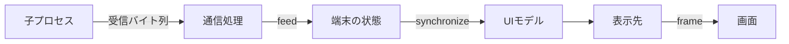

# boxrigの基本概念

[English](../en/architecture.md)

boxrigを使うと、既存の画面へ端末を組み込むアプリケーションや、画面を開かずに端末出力を解析するプログラムを作れます。
用途に合わせてboxrig coreとboxrig UIを選び、シェルなどと通信する場合は通信路を接続します。
このページでは、ライブラリへ任せられる処理と、アプリケーションが用意する部分を説明します。

## core・UI・通信の役割

boxrig coreは、受信したバイト列を解釈し、文字、色、カーソル、画面や履歴の状態を管理します。
ウィンドウシステムや入出力デバイスに依存しないため、boxrig UIが対応していない表示環境でも、coreの結果を使って独自に描画できます。
画面を使わずに文字列を保存・検索したり、特定の出力を監視したりすることもできます。

boxrig UIは、coreの状態を表示し、キーやマウス、IMEからの入力を受け取るためのライブラリです。
X11やWin32の子ウィンドウ、GTKウィジェット、Waylandの子surfaceを使い、既存のアプリケーションへ端末を配置できます。
通信にはセッションを追加するか、アプリケーションが持つ通信処理を接続します。

公開APIでは、これらの役割を次のオブジェクトで扱います。

| 構成要素 | 役割 | アプリケーションが用意するもの |
| --- | --- | --- |
| coreの`boxrig_terminal` | 受信データを解釈し、画面、文字属性、カーソル、履歴を保持する | 受信データと入力イベント。結果の取得と処理 |
| `boxrig_ui_model` | 端末の変更を各表示先へ伝える | 端末を更新した後の同期呼び出し |
| UIの表示先とコンポーネント | 文字の配置、描画、選択、IMEなどを扱う | 親ウィンドウ、配置、イベント処理、描画を進めるタイミング |
| `boxrig_session` | 非ブロッキングの通信路と端末の間で送受信を進める | 通信路、待機処理、終了の方針 |

coreの再利用にX11、GTK、PTYは必要ありません。
Unicode処理と画像デコードにはutf8proc、libpng、zlibを同梱し、coreのライブラリへ組み込んでいます。
各ライブラリの条件は[配布条件](./reference/distribution.md#第三者ライセンスと出典)を参照してください。

## 端末から画面までのデータ

例えば「赤いHello」を表示したい場合は、色指定の制御シーケンスと文字列を`boxrig_terminal_feed()`へ渡します。
coreは制御シーケンスを解釈し、文字と赤の属性をセルへ保存します。
このバイト列は、[READMEの実装例](../../README_ja.md#実装例)のようにアプリケーションから直接渡しても、通信先から受信しても同じように解釈されます。

UIを使う場合は、その後に`boxrig_ui_model_synchronize()`を呼び、コンポーネントのフレーム処理で描画します。
データ投入だけで自動的に描画されるわけではありません。

coreだけを使う場合は、`boxrig_terminal_get_cell()`でセルの文字、幅、属性を取得して自分で描画します。
セルは画面上の格納単位です。
結合文字や幅の広い文字があるため、一つのUnicode符号位置が常に一セルになるわけではありません。

## キー入力から送信までのデータ

キー、マウス、貼り付けなどの入力は、`boxrig_terminal_send_*()`へ渡します。
coreは現在の端末モードに応じた送信データを生成します。
例えばカーソルキーの送信列は、端末内のプログラムが選んだモードによって変わります。

生成したバイト列は出力キューから取り出し、通信相手へ送ります。
受信した問い合わせへの応答も、この出力キューへ入ります。
セッションを使うと、部分書き込みや送信待ちを含む処理を接続できます。

ウィンドウタイトル、クリップボード、通知などは、画面のセルだけでは実現できません。
coreから要求を取得し、アプリケーションの方針に従って処理します。
UIコンポーネントが扱う操作と、ホスト側へ渡される要求を区別してください。

## モデルと複数の表示先

一つの端末に対して複数の表示先を接続できます。
端末の内容は共有し、選択や表示色など、表示先に属する設定は個別に管理します。
`boxrig_ui_model_synchronize()`は、端末の変更を現在の全表示先へ配布します。

端末の行列数は一つです。
複数のウィンドウを同じ端末へ接続した場合、どの表示先が行列数を決めるかを指定します。
配置変更でリサイズ要求が発生したときは、端末と通信相手のサイズを変更し、処理の成否をコンポーネントへ返します。

スクロール位置は端末の状態に属します。
複数の表示先が同じ端末を参照している場合、別々の端末履歴を持つことにはなりません。

## 所有権と終了

生成したオブジェクトを誰が破棄するかは、APIごとに決まっています。
共通する関係は次のとおりです。

| オブジェクト | 参照しているもの | 解放時の条件 |
| --- | --- | --- |
| UIモデル | 端末 | 接続した表示先を先に解放する |
| UIコンポーネント | モデル、親ウィンドウ、環境固有の接続 | モデルと親ウィンドウを使用中に破棄しない |
| セッション | 端末と通信路 | 通信路の所有権は生成方法と設定に従う |
| セルの参照 | 端末内部の文字データ | 次の端末変更を越えて保持しない |

通常はコンポーネント、モデル、端末の順に解放し、その後に親ウィンドウや画面接続を閉じます。
セッションを端末へ接続した場合は、端末の破棄より先に終了させます。

操作は同じ所有スレッドから行うことを基本にします。
別スレッドやコールバックから同じ端末を同時に変更する設計にはしないでください。
クリップボード転送などの非同期要求は、各コンポーネントの終了手順に従って完了または取り消します。

## アプリケーションが実装する部分

表示と通信の処理を、アプリケーションのイベントループにつなぎます。
次の処理が残っている間は、それを進めてから待機します。
入力や出力が空でも、描画や点滅の期限があることに注意してください。

| 行うこと | 確認する情報 |
| --- | --- |
| 通信を進める | 読み込み・書き込み・保持済み入力の処理が必要か |
| 画面を更新する | モデルの変更、描画要求、追加の処理が残っているか |
| サイズを変更する | 配置から計算された行列数と、処理完了の通知 |
| ホスト要求に応答する | 許可する操作、成功・拒否・未対応の結果 |
| 終了する | 未完了の要求と、借用しているオブジェクトの寿命 |

GTK 3／4でも、ウィジェットを配置することと、通信やフレーム要求を接続することは別です。
GTKウィジェットはモデルと端末を借用します。
アプリケーション側の終了処理で、それぞれの寿命を管理します。

Win32では親ウィンドウとメッセージループをアプリケーションが用意します。
子コンポーネントを使う場合も、親の破棄より先にコンポーネントを解放します。

共通の端末状態を扱っていても、IME、クリップボード、透過などは環境によって対応範囲が異なります。
[対応状況](./compatibility.md)で、使用するコンポーネントと必要な機能の組み合わせを確認してください。

実装を順に学ぶ場合は[UI向けstep-by-step](./step-by-step/step-by-step-ui.md)へ、独自描画を行う場合は[core向けstep-by-step](./step-by-step/step-by-step-core.md)へ進んでください。

[文書目次へ戻る](./index.md)
