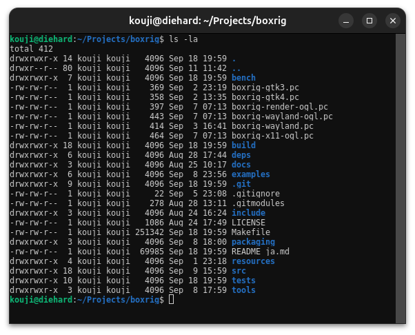

# 付属ターミナルを使う

[English](../en/boxrig_term.md)

`boxrig_term`は、boxrig coreとboxrig UIの公開APIを使ってシェルを操作する、ターミナル実装のコード例です。
色付きの文字、画像、選択・コピー、IME、背景透過などを試し、アプリケーションへの組み込み方をソースから確認できます。
以下は、`boxrig_term`でシェルの出力を表示した例です。



このページでは、実装例を起動し、表示や操作を試す方法を説明します。
ここに示す環境変数とショートカットは`boxrig_term`専用の設定です。
ライブラリを使うアプリケーションからは、各機能のAPIで設定します。

## デモの目的と準備

`boxrig_term`では、端末の内容をcore、描画と入力受付をUIが担当し、シェルの起動、通信、イベントループをアプリケーション側で接続しています。
短いコードから役割を確認したい場合は[READMEの実装例](../../README_ja.md#実装例)、段階的に端末を作る場合は[UI向けstep-by-step](./step-by-step/step-by-step-ui.md)を参照してください。
実装全体は、[X11](../../examples/boxrig_term/x11/application.c)、[GTK 3](../../examples/boxrig_term/gtk3/application.c)、[GTK 4](../../examples/boxrig_term/gtk4/application.c)、[Wayland](../../examples/boxrig_term/wayland/application.c)、[Win32](../../examples/boxrig_term/win32/application.c)のアプリケーションからたどれます。

[ビルド手順](./building.md)に従って、Linuxでは`make native`、Windowsでは`make win32`で作成します。
必要なGUIライブラリと実行環境を用意してください。
coreをビルドするだけでは端末デモはできません。

表示内容を一定にして確認する場合は、[boxrig_emitter](./boxrig_emitter.md)を子プロセスとして起動できます。
ライブラリの使い方を順に学ぶ場合は[UI step-by-step](./step-by-step/step-by-step-ui.md)を参照してください。

## 各環境で起動する

リポジトリのルートから、利用する環境のコマンドを実行します。

```sh
./build/boxrig_term/x11/boxrig_term
./build/boxrig_term/gtk3/boxrig_term
./build/boxrig_term/gtk4/boxrig_term
./build/boxrig_term/wayland/boxrig_term
```

Linuxでは`SHELL`、未設定なら`/bin/sh`を子プロセスにします。
実行するプログラムを指定する場合は`--`の後に置きます。

```sh
./build/boxrig_term/x11/boxrig_term -- /bin/sh -l
```

<a id="ネイティブwayland端末を実行する"></a>

native Wayland版には実行中のWayland compositorが必要です。
`BOXRIG_WAYLAND_DECORATION=auto`では利用可能なserver decoration、libdecor、装飾なしの順に選びます。
`server`、`client`は指定した方式が使えなければ失敗し、`none`は装飾を作りません。
libdecorは任意のビルド依存です。

Windowsでは対象ABIの`build\boxrig_term\win32\amd64\boxrig_term.exe`または`i686\boxrig_term.exe`を実行します。
同じディレクトリの`boxrig_term_launcher.exe`も必要です。
既定の子プロセスはコマンドプロンプトです。
LinuxからWineで試す場合は次のように実行できますが、実Windowsの描画・ConPTY確認とは分けてください。

```sh
wine ./build/boxrig_term/win32/amd64/boxrig_term.exe
```

## キー・マウス・コピー・リンク操作

| 操作 | 結果 |
| --- | --- |
| 左ドラッグ | 文字単位の選択 |
| ダブルクリック／トリプルクリック | Unicodeの単語／折り返しを結合した論理行の選択 |
| Ctrl＋左ドラッグ | 行列による矩形選択 |
| Shift＋ドラッグ | 子プロセスのマウス追跡中も端末側で選択 |
| Ctrl＋Shift＋C | 選択をCLIPBOARDへコピー |
| Ctrl＋Shift＋V、Shift＋Insert | CLIPBOARDから貼り付け |
| 中クリック | Linuxで利用可能なPRIMARYから貼り付け |
| 右クリック | マウス追跡が優先されない場合、有効な選択をCLIPBOARDへコピー |
| ホイール | 通常は履歴を3行移動。子プロセスのマウス追跡が有効なら入力を送信 |
| Shift＋ホイール | 端末側の履歴を移動 |
| Ctrl＋ホイール | 文字を拡大・縮小 |

Ctrlを押した複数クリックも矩形の文字選択です。
選択開始時に決めた送り先を終了まで保ち、途中で修飾キーが変わってもPTYへ重複送信しません。
矩形コピーは表示行をLFで区切り、既定で行の右端まで続く空セルと半角スペースを除去します。
選択範囲の右側に文字がある場合は、その手前の空白を保持します。
`BOXRIG_BLOCK_COPY_TRIM_TRAILING_SPACES=0`で空白を保持し、`1`で除去します。
この環境変数を指定すると、Ctrl＋Shift＋F5で実行中にも切り替えられます。同じ選択からコピーし直せます。
空になった行も残し、行間のLFを保ちます。末尾に余分なLFは加えません。
全角空白や結合文字などの扱いは[選択とコピー](./text.md#選択とコピー)を参照してください。
Linuxは選択終了時にPRIMARYも更新します。
Win32では選択終了だけでシステムclipboardを書き換えません。

alternate screenでは履歴バーを無効にします。
マウス追跡がなくモード1007が有効な場合、縦ホイールを子プロセスへの上下キーにできます。
コピーと貼り付けの上限・環境差は[対応表](./reference/platform-support.md)を参照してください。

OSC 8と自動認識したHTTP／HTTPSリンクは、修飾なしの左クリックで開けます。
ドラッグや複数クリックと区別するため、クリック後は判定を待ちます。
範囲外への移動、focus喪失、本文更新で開く操作を中止します。
OSC 8を優先し、許可しないURIなら自動認識へ置き換えて開きません。
空host、空白・制御文字、8,192バイトを超えるURIは開きません。
`BOXRIG_AUTO_URLS=0`で自動認識だけを無効にできます。

## フォントと表示を変える

Ctrl＋`+`／`-`で文字を拡大・縮小し、Ctrl＋`0`で既定へ戻します。
カーソルは既定で点滅矩形です。
シェルから`printf '\033[5 q'`を実行すると点滅する縦棒、`printf '\033[1 q'`で矩形になります。
`q`の直前の空白が必要です。

| 環境変数 | 試す内容 | 有効時の切り替え |
| --- | --- | --- |
| `BOXRIG_SCROLLBAR=always/auto/never` | バーを常時表示／履歴がある場合／非表示 | Ctrl＋Shift＋F9 |
| `BOXRIG_SELECTION_STYLE_DEMO=1` | 選択範囲の装飾 | Ctrl＋Shift＋F10 |
| `BOXRIG_CURSOR_STYLE_DEMO=1` | カーソルの装飾 | Ctrl＋Shift＋F11 |
| `BOXRIG_CURSOR_STYLE_DEMO=2` | フォーカスに応じて塗り分ける3形状の箱 | Ctrl＋Shift＋F11 |
| `BOXRIG_COLOR_GLYPHS=0/1` | Linuxで絵文字などの単色／カラー表示 | Ctrl＋Shift＋F11 |
| `BOXRIG_COLOR_FILTER_DEMO=1` | 表示色の補正 | Ctrl＋Shift＋F12 |
| `BOXRIG_AMBIGUOUS_WIDTH=narrow/wide/font` | 曖昧幅文字を1列／2列／フォント依存で表示 | 起動時に指定 |

指定がない場合、バーは常時表示、カラーフォントは有効です。
曖昧幅文字の既定値は`narrow`の1列です。2列に固定する場合は`wide`、フォント依存にする場合は`font`を指定してください。フォント依存では送り幅を整数列へ切り上げ、字形を元の幅で中央に配置します。例えば2.1セル分なら3列になります。
デモ用の切り替えキーは対応する環境変数を設定したときだけ使えます。
F11を使う二つのデモは個別に試してください。

<a id="表示色の補正を試す"></a>

色補正は、補正あり、補正なし、色を変えない補正の順に切り替わります。
端末が保持する色やコピー文字列は変わりません。

```sh
BOXRIG_COLOR_FILTER_DEMO=1 ./build/boxrig_term/x11/boxrig_term --renderer=x11
```

APIから設定する場合は、[フォント](./fonts-and-layout.md)、[色補正](./color-filters.md)、[装飾](./decorations.md)、[バー](./scrollbars.md)を参照してください。

## 入力とIMEを選ぶ

| 環境変数 | 選択 |
| --- | --- |
| `BOXRIG_GTK_IME=auto/gtk/ibus/fcitx5/fcitx4` | GTKの自動選択、通常GTK、直接IBus、直接fcitx 5／4 |
| `BOXRIG_WAYLAND_IME=auto/wayland/ibus/fcitx5/fcitx4` | native Waylandの自動選択、text-input-v3、直接IBus、直接fcitx 5／4 |
| `BOXRIG_IME_CANDIDATES=auto/system/client` | 自動、OS側、端末内の候補 |

空でない`GTK_IM_MODULE`はGTK側の自動選択より優先します。
通常GTKだけを選ぶには`BOXRIG_GTK_IME=gtk`を使ってください。
native Waylandで明示した`wayland`も端末内候補の指定より優先します。

端末内候補は直接IBus／fcitx 5／4の候補情報を描画する機能です。
標準GTK／Wayland経路から同じ候補一覧を取得できるわけではありません。
GTK 4のX11経路は候補の座標処理をGTK moduleに任せるため、`ibus`、`fcitx5`、`fcitx4`を指定しても直接接続には切り替わりません。
候補はキーボードで選び、候補領域のクリックをPTYへ送りません。
focusを失うと候補を消し、復帰しても古い候補を再表示しません。
既定のAUTOは設定と稼働中サービスから直接接続先を選択します。GTKが選択済みのfcitxモジュールは維持します。
`ime-route`、`direct-backend`、`direct-selection`、`candidate-owner`、`candidate-reason`の診断で実効経路を確認できます。
fcitx 5／4でCLIENTを要求した場合も、有効な候補通知を受け取るまでは候補所有者がNONEとなります。
4系の端末内候補は未確定文字と候補をまとめた文字列パネルです。個別の候補数は通知されないため、表示中も`candidate-count=0`となります。
パネル表示や4系互換サービスの制約は[入力とIME](./input-ime.md#入力経路を選ぶ)を参照してください。

通常のデモはアプリ所有の編集文書を提供しません。
そのため、IBusが周辺文字列を要求した場合の未対応警告は、画面に文字が表示できないという意味ではありません。
編集文書を提供する方法と入力メソッドの制約は[入力とIME](./input-ime.md)と[環境別対応](./reference/platform-support.md)へ記載しています。

## 描画方式と背景を選ぶ

`--renderer=名前`は子プロセス指定の`--`より前に置きます。

| 環境 | 指定できる値 | autoの選択 |
| --- | --- | --- |
| X11 | `auto`、`x11`、`opengl` | 利用可能なES／GLを試し、標準描画へ戻る |
| GTK 3／4 | `auto`、`cairo`、`opengl` | OpenGLを優先し、Cairoへ戻る |
| native Wayland | `auto`、`wayland`、`opengl` | 生成時にOpenGLがUNAVAILABLEなら標準描画 |
| Win32 | `auto`、`win32`、`opengl`、`d3d11` | ES／GLを試し、標準描画。ビルドと診断設定にも依存 |

`opengl`の明示は必須指定なので、使えなければ起動に失敗します。
native Waylandは稼働中のcontext障害で自動切り替えしません。
GTKウィジェットライブラリ自体の既定はCairoであり、このデモのautoとは異なります。
GTKでは`BOXRIG_RENDERER_DEMO=1`でCtrl＋Shift＋F6／F7／F8によるCairo／OpenGL優先／OpenGL必須も試せます。

以下は、端末背景を透明にし、その背後へ半透明の赤を置くX11の例です。
OpenGLと、透過を合成できるウィンドウ環境が必要です。

```sh
BOXRIG_BACKGROUND_OPACITY=0 BOXRIG_BACKGROUND_RGBA=255,0,0,128 \
    ./build/boxrig_term/x11/boxrig_term --renderer=opengl
```

背景不透明度は0〜100%、RGBAは各0〜255です。
`BOXRIG_BACKGROUND_IMAGE=cover/contain/stretch`は内蔵の市松模様の配置を試す設定で、画像ファイル名は受け取りません。

Ctrl＋`<`で10%下げ、Ctrl＋`>`で10%上げます。
Ctrl＋Shift＋Oは100%と直前の半透明値を切り替え、最初は80%です。
`<`と`>`は論理記号なので、一般的な配列ではShiftも押します。

背景効果は`BOXRIG_BACKGROUND_EFFECT=none/prefer/require`です。
既定はnone、preferは使えなくても続行、requireは利用不可なら失敗します。
GTKの任意providerを試すには`make gtk-background-effects`で作る`gtk3/boxrig_term_effects`または`gtk4/boxrig_term_effects`を使います。
標準バイナリとOSの条件は[背景](./background.md)を参照してください。

Win32の`BOXRIG_TRANSPARENCY_MODE=background/window/opaque`は、背景だけ、ウィンドウ全体、不透明を選びます。
全体透過の初期値は`BOXRIG_WINDOW_OPACITY=1..100`で、既定100です。
背景透過が使えない場合は、既定で全体透過へ戻します。
`BOXRIG_TRANSPARENCY_FALLBACK=opaque`はその代替を禁止します。
背景0%からは完全透明にせず不透明へ戻ります。

## 起動引数と環境変数

| 設定 | 値・目的 |
| --- | --- |
| `-- command ...` | 指定した子プロセスを起動 |
| `BOXRIG_TERM` | `xterm-256color`が既定。`xterm`も指定可能 |
| `BOXRIG_ALLOW_NOTIFICATIONS` | `1`と完全一致したときだけ通知を許可 |
| `BOXRIG_ALLOW_GRAPHICS_EXTERNAL` | `1`と完全一致したときだけ外部画像データを許可 |
| `BOXRIG_AUTO_URLS` | `0`で自動URL認識を無効 |
| `BOXRIG_CONPTY` | Win32で`system`、`packaged-preferred`、`packaged-required` |
| `BOXRIG_CONPTY_DIRECTORY` | 同梱版ConPTYの絶対パス |

Linuxの通知にはセッションD-Busの通知サービス、WindowsにはShellの通知機能を使います。
頻度制限やOSC 52の環境差は[ホスト連携](./host-integration.md)と[環境別対応](./reference/platform-support.md)を参照してください。

## 診断と終了

指定した方式と実際の方式は、起動時の診断で確認します。
`auto`という指定名だけでは、GPU描画が選ばれたか判断できません。
GPU・IME・ConPTYの条件は[対応表](./reference/platform-support.md)へまとめています。

ウィンドウを閉じると通信を終了し、子プロセスを回収します。
POSIXではSIGHUP、Win32ではlauncherを含む終了処理を行います。
WineのConPTYでCtrl＋Cがシェルの終了として扱われた場合も、状態を失う別シェルを自動再生成しません。
終了時の動作は[Win32のサンプル試験](../../tests/win32/test_win32_sample.c)で確認できます。

ConPTYによるVT列の再出力については、[上流の議論](https://github.com/microsoft/terminal/issues/1985)を参照してください。

[ドキュメント目次](./index.md)
