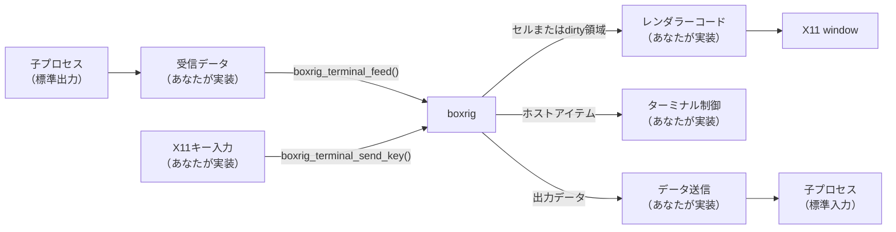
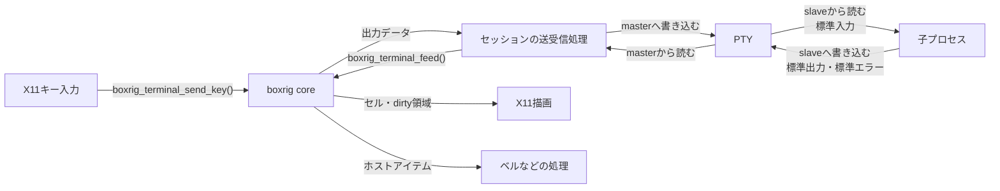

# 簡易ターミナルアプリケーションを実装する (core)

boxrig coreライブラリは、ターミナルアプリケーションを実装する場合に必要となる、バイト列のパースと解釈を行います。
boxrigには、より上位のライブラリとしてboxrig UIがあります。以下に、簡単に違いを示します:

- boxrig core: バイト列のパースと解釈を行うライブラリです。極めてニュートラルで外部依存性がありません。
  この独立性の高さから、boxrigが標準でサポートしていないデバイスや環境に対しても再利用が可能です。
  しかし、特定の表示デバイスや入力に対する操作・通過するテキストなどの操作を一切行わず、それらは利用者が実装する必要があります。
- boxrig UI: boxrig coreを使用し、特定の入出力デバイスを使用してレンダリングと入力受付を行う、再利用可能なライブラリです。
  X11ウィジェットやWin32のコントロールを最小の実装で制御出来るAPIが公開されており、あなたのアプリケーションに組み込みやすく設計されています。

このガイドは、boxrig coreの公開APIから、X11環境で動作するターミナルアプリケーションを段階的に実装するための学習資料です。
上記に示したように、boxrig coreを直接使用する場合は、非常に低レベルな操作を必要とするため、一般的な開発者には向いていません。
もしあなたが、アプリケーションにターミナル機能を導入したいと考えている場合は、 [boxrig UI向けのガイド](./step-by-step-ui.md) を先にチェックすることをお勧めします。

対象は、C言語(C99)を理解している開発者です。

以降では、特別に区別の必要がある場合を除いて、boxrig coreの事を単に"boxrig"と表記します。

---

## boxrigの基礎と全体のデータフロー

boxrigは、`boxrig_terminal` と呼ばれる不透明な構造体で管理されます。
これは `boxrig_terminal_create()` で生成され、ターミナル処理の管理に対応付けられます。

`boxrig_terminal_feed()`関数で、受信データ (例えば子プロセスからの標準出力) を投入すると、
それが処理されて、以下の複数の結果が返されます:

| 結果の種類 | 内容 |
| :--- | :--- |
| セルまたはdirty領域 | 文字の描画に関するデータです。セルとは、表示領域の一文字に相当するエリアを表し、文字のコードや属性が示されます。dirty領域は、表示が無効になり、再描画が必要と判断された範囲を示します |
| ホストアイテム | ターミナルで実行すべき機能に関するデータです。例えば特殊コードやエスケープシーケンスの内容が該当し、ターミナルに対して特殊な効果を発生させる指示となります |
| 出力データ | その他の解釈されなかったデータです。典型的には、子プロセスの標準入力に送信し、有効なキー入力の情報として扱います。特殊効果のない "ABC" のようなテキスト文字列が該当します |

その他に、送信すべきデータ(インタラクションデータ)を投入する必要もあります。これは、 `boxrig_terminal_send_*()` のような関数で、キー入力などに対応した描画処理や、出力データの生成として使用されます。

送信データは、単に送信先に直接送ればよいのではないかと感じるかも知れませんが、エスケープシーケンスの中には、送信データを解釈して反応する場合や、送信データの一部を出力データとして返す必要がある場合もあるため、送信データも必ずboxrigを通す必要があります。

以下に、簡単な模式図を示します:



### データ投入処理の中心部分

まず、boxrigにデータを投入する方法について解説します。以下が `boxrig_terminal_feed()` の宣言です:

```c
boxrig_status boxrig_terminal_feed(
    boxrig_terminal *terminal,
    const uint8_t *bytes,
    size_t length,
    size_t *consumed_out);
```

- `bytes`と`length`が入力すべき投入データを示します。
  `boxrig_terminal_feed()`は同期的です。任意のバイト境界で入力を分割できます。
  戻り値が`BOXRIG_STATUS_WOULD_BLOCK`なら、次回に`consumed_out`が指す未消費位置から同じバイトを再試行する必要があります。

> boxrigは、受信データ（子プロセスからの標準出力）・インタラクションデータ（キー入力など）・送信データ（子プロセスの標準入力）を
> 同時に扱う必要があるため、これらを混同しないように注意して下さい。

インタラクションデータの投入は、 `boxrig_terminal_send_*()` のような関数を使用します。以下はキー入力データを投入する場合に使用する `boxrig_terminal_send_key()` です:

```c
boxrig_status boxrig_terminal_send_key(
    boxrig_terminal *terminal,
    const boxrig_key_event *event);
```

ここではまだ詳細について述べませんが、ユーザーインタラクションが発生したらこのような関数を呼び出すことで、
boxrigにインタラクションに関するデータを投入することが出来ます。

### boxrigの出力を解釈する

boxrigは、処理結果をコールバックで通知しません。
データを投入した後で、必要な種類の結果をそれぞれの関数から取得します。

通常、ターミナルはウインドウシステムに描画することになりますが、
描画すべき文字の情報は「セル」から取得できます。

ターミナルは行数と桁数によるセルで埋め尽くされていると考えることが出来ます。
例えば、80桁x25行のターミナルの場合、2000個のセルがあり、それぞれに文字やその装飾のデータを持っていることになります。

セルの情報を元に描画するなら、これらのセル群の情報を全て取得して、
これを元にレンダリングする単純な方法が考えられます。
`boxrig_terminal_get_cell()` はこのような事を簡単に実現できます:

```c
boxrig_cell_view cell;
const boxrig_status status =
    boxrig_terminal_get_cell(terminal, row, column, &cell);
```

`row` と `column` で、指定された位置のセル情報を参照できます。
取得した `boxrig_cell_view` には、表示するUTF-8文字列、セルの幅、色、装飾などが含まれます。
このデータはboxrigが所有する読み取り専用のビューであり、次に `terminal` の状態を変更するまで有効です。
`boxrig_cell_view` は以下のような構造体です(一部省略):

```c
typedef struct boxrig_cell_view {
    /** Length-delimited UTF-8 extended grapheme cluster. */
    const char *text;
    /** Number of bytes in text. */
    size_t text_length;
    /** Logical foreground color. */
    boxrig_color foreground;
    /** Logical background color. */
    boxrig_color background;
} boxrig_cell_view;
```

他にも様々な属性情報が含まれていますが、セルにはこのような情報が格納されていることが理解できれば十分です。
つまり、80桁x25行のそれぞれのセル情報を取得しながら、X11の描画面に文字を描画すれば、ターミナル画面を表示出来ます。

> dirty領域の情報を使えば、より効率よく描画を実現出来ますが、ここではまだdirty領域については扱いません。
> また、出力データ (子プロセスに送信すべきデータ) もまだ扱いません。

## 最初のバージョンの実装

boxrigを使用する準備が出来ました。
最初のバージョンは、指定した文字列 "Hello boxrig!" をターミナルに描画して表示させる、というものです。

これは、子プロセスを起動もしなければ送受信も行わない、インタラクションも一切受け付けないという、
非常に単純なX11アプリケーションの実装ですが、全体の流れはこれで理解出来るでしょう。

以下のコードを `simple_core_term.c` として保存して下さい。

```c
/* The guide uses the public boundary and no private boxrig headers. */
#include "boxrig/terminal.h"

#include <X11/Xlib.h>
#include <X11/Xutil.h>

#include <stdbool.h>
#include <stdint.h>
#include <stdio.h>

/* Draws every cell in the fixed-size terminal. */
static int draw_terminal(
    Display *display,
    Window window,
    GC graphics,
    XFontStruct *font,
    boxrig_terminal *terminal,
    unsigned int cell_width,
    unsigned int cell_height,
    size_t rows,
    size_t columns)
{
    size_t row;
    size_t column;

    XClearWindow(display, window);
    XSetForeground(display, graphics, BlackPixel(display, DefaultScreen(display)));

    /* Search all cells */
    for (row = 0; row < rows; row++) {
        for (column = 0; column < columns; column++) {
            boxrig_cell_view cell;
            char glyph;

            /* Finish using this view before any terminal mutation occurs. */
            if (boxrig_terminal_get_cell(
                    terminal,
                    row,
                    column,
                    &cell) != BOXRIG_STATUS_OK) {
                return -1;
            }

            /* The first example contains only one-byte ASCII cells. */
            if (cell.text_length != 1) {
                continue;
            }
            glyph = cell.text[0];
            XDrawString(
                display,
                window,
                graphics,
                (int)(column * cell_width),
                (int)(row * cell_height) + font->ascent,
                &glyph,
                1);
        }
    }
    XFlush(display);
    return 0;
}

int main(void)
{
    /* No control sequence is needed to create the first visible cells. */
    static const uint8_t message[] = "Hello boxrig!";

    boxrig_terminal_config config = boxrig_terminal_config_default();
    boxrig_terminal *terminal = NULL;
    Display *display = NULL;
    int screen = 0;
    Window window = None;
    XFontStruct *font = NULL;
    GC graphics = NULL;
    Atom delete_window = None;
    unsigned int cell_width;
    unsigned int cell_height;
    size_t consumed = 0;
    bool running = true;
    int result = 1;

    /* X11 resources remain owned by this frontend, never by boxrig. */
    display = XOpenDisplay(NULL);
    if (display == NULL) {
        fprintf(stderr, "hello-boxrig: could not open X display\n");
        goto cleanup;
    }
    screen = DefaultScreen(display);
    font = XLoadQueryFont(display, "fixed");
    if (font == NULL || font->max_bounds.width <= 0 ||
        font->ascent <= 0 || font->descent < 0) {
        fprintf(stderr, "hello-boxrig: fixed font is unavailable\n");
        goto cleanup;
    }
    cell_width = (unsigned int)font->max_bounds.width;
    cell_height = (unsigned int)(font->ascent + font->descent);

    /* Configure the model before creating the matching pixel-sized window. */
    config.rows = 25;
    config.columns = 80;

    /* feed() is synchronous and reports exactly how many bytes it consumed. */
    if (boxrig_terminal_create(&config, &terminal) != BOXRIG_STATUS_OK ||
        boxrig_terminal_feed(
            terminal,
            message,
            sizeof(message) - 1,
            &consumed) != BOXRIG_STATUS_OK ||
        consumed != sizeof(message) - 1) {
        fprintf(stderr, "hello-boxrig: could not build terminal cells\n");
        goto cleanup;
    }

    /* One fixed-font character cell maps to one terminal grid cell. */
    window = XCreateSimpleWindow(
        display,
        RootWindow(display, screen),
        0,
        0,
        (unsigned int)config.columns * cell_width,
        (unsigned int)config.rows * cell_height,
        0,
        BlackPixel(display, screen),
        WhitePixel(display, screen));
    if (window == None) {
        goto cleanup;
    }
    graphics = XCreateGC(display, window, 0, NULL);
    if (graphics == NULL) {
        goto cleanup;
    }
    XSetFont(display, graphics, font->fid);
    XSelectInput(display, window, ExposureMask);
    delete_window = XInternAtom(display, "WM_DELETE_WINDOW", False);
    if (delete_window == None ||
        XSetWMProtocols(display, window, &delete_window, 1) == 0) {
        goto cleanup;
    }
    XStoreName(display, window, "boxrig core guide: step 1");
    XMapWindow(display, window);

    /* This first event loop only redraws exposure and handles window close. */
    while (running) {
        XEvent event;

        XNextEvent(display, &event);
        if (event.type == Expose && event.xexpose.count == 0) {
            if (draw_terminal(
                    display,
                    window,
                    graphics,
                    font,
                    terminal,
                    cell_width,
                    cell_height,
                    config.rows,
                    config.columns) == -1) {
                goto cleanup;
            }
        } else if (event.type == ClientMessage &&
                   (Atom)event.xclient.data.l[0] == delete_window) {
            running = false;
        }
    }
    result = 0;

cleanup:
    /* No cell view survives here; release each owned resource exactly once. */
    if (display != NULL && graphics != NULL) {
        XFreeGC(display, graphics);
    }
    if (display != NULL && window != None) {
        XDestroyWindow(display, window);
    }
    if (display != NULL && font != NULL) {
        XFreeFont(display, font);
    }
    if (display != NULL) {
        XCloseDisplay(display);
    }
    boxrig_terminal_destroy(terminal);
    return result;
}
```

> 上記のコード、特に `boxrig_terminal_feed()` が一度しか呼び出されていないのは、非常に奇妙な実装です。
> 実際のターミナルを想定すると、連続した子プロセスの出力データや、ユーザーのキー入力を繰り返し `boxrig_terminal_feed()` で投入する必要があります。
> これは、このガイドの最初の実装例なので、極端に簡略化していることに注意して下さい。

> また、ターミナルに想定される非常に多くの機能が、ほとんど無視されていることにも注意して下さい。
> 例えば、このままでは多国語表示に対応できないことや、ウインドウサイズに追従できないなどに気が付いたかも知れません。

ビルドするには、`boxrig/terminal.h` への参照と `libboxrig.a` のリンクが必要です。
以下に、単純なMakefileの例を示します:

```makefile
CC ?= cc
# This default matches build/core-guide below the repository root.
BOXRIG_ROOT ?= ../..
# Only the public boxrig include directory and X11 headers are visible.
CPPFLAGS += -I$(BOXRIG_ROOT)/include $(shell pkg-config --cflags x11)
CFLAGS ?= -O2 -g
# Keep every checkpoint valid portable C99 with strict diagnostics.
CFLAGS += -std=c99 -Wall -Wextra -Wpedantic -Werror
LDLIBS += $(shell pkg-config --libs x11)
LIBBOXRIG := $(BOXRIG_ROOT)/build/libboxrig.a

.PHONY: all clean

all: hello-boxrig

# Reuse the repository's normal core archive target.
$(LIBBOXRIG):
	$(MAKE) -C $(BOXRIG_ROOT) build/libboxrig.a

hello-boxrig: main.c $(LIBBOXRIG)
	$(CC) $(CPPFLAGS) $(CFLAGS) $< $(LIBBOXRIG) $(LDLIBS) -o $@

clean:
	rm -f hello-boxrig
```

## 効率よくセルを描画する

最初のバージョンでは、全てのセルを列挙して、それをターミナル画面に描画するという、
非常に単純な戦略で表示を行っていました。

これは、ターミナルの表示方法としては十分に充足していますが、
たとえターミナル上の1文字だけが変更されたとしても、80桁25行では毎回2000個のセルを描画することになり、描画負荷が高くなります。
ターミナルの典型的な使用方法では、ユーザーがタイプした1文字1文字を、その都度表示に反映させることが想定されるため、非常にタイプ体験が悪くなります。

本来なら、変更があったセルだけを描画すれば良いはずです。
boxrigには、変更があったセルだけを列挙する方法があり、これを使えば大幅にコストを削減できます。

`boxrig_terminal_get_cell()` で全てのセルを列挙するのではなく、
dirty領域を列挙する`boxrig_terminal_take_dirty()`を使用して、無効領域を計算します。

```c
boxrig_dirty dirty;

while (boxrig_terminal_take_dirty(terminal, &dirty)) {
    // Calculate the invalid region
    const size_t end = dirty.column + dirty.column_count;
    size_t column;

    for (column = dirty.column; column < end; column++) {
        boxrig_cell_view cell;

        if (boxrig_terminal_get_cell(
                terminal, dirty.row, column, &cell) == BOXRIG_STATUS_OK) {
            // Render the cell here.
        }
    }
}
```

`boxrig_terminal_take_dirty()` は、取得したdirty領域をキューから取り除きます。
従って、レンダラーは返された範囲を描画してから、次のdirty領域を取得します。

描画部分の改良された実装を示します:

```c
/* Draws only the cells in changed row intervals. */
static int draw_terminal(
    Display *display,
    Window window,
    GC graphics,
    XFontStruct *font,
    boxrig_terminal *terminal,
    unsigned int cell_width,
    unsigned int cell_height)
{
    boxrig_dirty dirty;

    XSetForeground(display, graphics, BlackPixel(display, DefaultScreen(display)));

    while (boxrig_terminal_take_dirty(terminal, &dirty)) {
        const size_t end = dirty.column + dirty.column_count;
        size_t column;

        for (column = dirty.column; column < end; column++) {
            boxrig_cell_view cell;
            char glyph;
            const int x = (int)(column * cell_width);
            const int y = (int)(dirty.row * cell_height);

            /* Finish using this view before the next dirty is consumed. */
            if (boxrig_terminal_get_cell(
                    terminal,
                    dirty.row,
                    column,
                    &cell) != BOXRIG_STATUS_OK) {
                /* Restore redraw work if drawing cannot be completed. */
                boxrig_terminal_invalidate(terminal);
                return -1;
            }

            /* Clear old glyphs even when the updated cell is empty. */
            XClearArea(display, window, x, y, cell_width, cell_height, False);

            /* This version still supports only one-byte ASCII cells. */
            if (cell.text_length != 1) {
                continue;
            }
            glyph = cell.text[0];
            XDrawString(
                display,
                window,
                graphics,
                x,
                y + font->ascent,
                &glyph,
                1);
        }
    }
    XFlush(display);
    return 0;
}
```

全画面を消去していた `XClearWindow()` を、対象セルだけを消去する `XClearArea()` に置き換えました。
文字が消されたセルも背景を消去することで、以前の文字が画面に残ることを防ぎます。
最後の引数を `False` にすると、この消去による追加のExposeイベントは発生しません。
詳しくは、[Xlibリファレンスの「Clearing Areas」](https://www.x.org/releases/current/doc/libX11/libX11/libX11.html) を参照して下さい。

この関数はdirty領域から行と列を取得するため、引数の `rows` と `columns` は不要になりました。
最初の実装例のExpose処理も、次のように置き換えて下さい:

```c
if (event.type == Expose && event.xexpose.count == 0) {
    /* Expose requires repainting even when terminal cells have not changed. */
    boxrig_terminal_invalidate(terminal);
    if (draw_terminal(
            display,
            window,
            graphics,
            font,
            terminal,
            cell_width,
            cell_height) == -1) {
        goto cleanup;
    }
}
```

Exposeは、ウインドウの内容を再描画する要求であり、セルの内容が変更されたことを示すものではありません。
この場合は `boxrig_terminal_invalidate()` で全てのセルを再描画対象にします。
それ以外では、データ投入後に `draw_terminal()` を呼び出すことで、変更されたセルだけを描画できます。

## インタラクションデータの投入

これで基本的なターミナルのレンダリング処理が実装できました。
次はユーザーのインタラクションに応じた情報を、boxrigに投入する処理です。

> 今は "Hello boxrig!" を子プロセスからの擬似的な標準出力として処理していますが、
> 同様に、子プロセスへの標準入力に送信する動作を擬似的に実現させる必要があります。
> その実装は次の章で行うとして、まずは、ユーザーのキー入力をboxrigに投入する部分を実装します。

インタラクションデータの例として `boxrig_terminal_send_key()` を示します。
この関数は、キー入力データが発生した場合に呼び出す必要があります:

```c
boxrig_status boxrig_terminal_send_key(
    boxrig_terminal *terminal,
    const boxrig_key_event *event);
```

`boxrig_key_event` は、キー入力データの情報を構成する構造体です。例えば、以下のように生成します:

```c
//  キー入力データの準備 (Ctrl+C)
boxrig_key_event event = {
    .key = BOXRIG_KEY_NONE,                 // 一般キー
    .codepoint = 'c',
    .shifted_codepoint = 'C',
    .base_layout_codepoint = 'c',
    .action = BOXRIG_KEY_PRESS,             // キーが押された
    .modifiers = BOXRIG_MODIFIER_CONTROL,   // Ctrlキー
    .text = "\x03",                         // 文字列としてのキー
    .text_length = 1,
};

// キー入力データを投入
const boxrig_status status =
    boxrig_terminal_send_key(terminal, &event);
```

`boxrig_key_event` は、単純なASCII文字データではなく、モディファイヤキーなどの付随情報が含まれます。
これによって、boxrigはユーザーが操作するキーボードの状態を細かく判断することが出来ます。

同様に、他の `boxrig_terminal_send_*()` 関数も、様々なユーザーインタラクションの詳細な情報をboxrigに伝達して、
ターミナル動作を実現するための契機として使用します。
言い換えれば、これらの関数のいくつかは選択的に使用できて、呼び出されない関数に対応した機能はターミナルに反映されない、ということです。

例えば `boxrig_terminal_send_mouse()` は、マウス操作によるインタラクションを実現しますが、
マウス操作でこの関数を呼び出さないと、ターミナルはマウス操作に反応しないことになります。

以下では、ユーザーのキー入力を認識して、 `boxrig_terminal_send_key()` を呼び出し、boxrigにキー入力インタラクションデータを通知します。

まず、次のヘッダと関数を `main()` より前に追加して下さい。
ここでは、ASCII文字を入力する基本的なキーボード配列を対象とします:

```c
#include <X11/keysym.h>

/* Converts an X11 key press to one portable terminal input event. */
static boxrig_status send_key_press(
    boxrig_terminal *terminal,
    XKeyEvent *xevent)
{
    char text[32];
    KeySym keysym = NoSymbol;
    const int length = XLookupString(
        xevent, text, (int)sizeof(text), &keysym, NULL);
    boxrig_key_event event = {0};

    event.action = BOXRIG_KEY_PRESS;
    if (xevent->state & ShiftMask) {
        event.modifiers |= BOXRIG_MODIFIER_SHIFT;
    }
    if (xevent->state & ControlMask) {
        event.modifiers |= BOXRIG_MODIFIER_CONTROL;
    }
    /* This example assumes that Mod1 is assigned to Alt. */
    if (xevent->state & Mod1Mask) {
        event.modifiers |= BOXRIG_MODIFIER_ALT;
    }
    if (xevent->state & LockMask) {
        event.modifiers |= BOXRIG_MODIFIER_CAPS_LOCK;
    }

    switch (keysym) {
    case XK_Return:    event.key = BOXRIG_KEY_ENTER; break;
    case XK_BackSpace: event.key = BOXRIG_KEY_BACKSPACE; break;
    case XK_Tab:
    case XK_ISO_Left_Tab: event.key = BOXRIG_KEY_TAB; break;
    case XK_Escape:    event.key = BOXRIG_KEY_ESCAPE; break;
    case XK_Left:     event.key = BOXRIG_KEY_LEFT; break;
    case XK_Right:    event.key = BOXRIG_KEY_RIGHT; break;
    case XK_Up:       event.key = BOXRIG_KEY_UP; break;
    case XK_Down:     event.key = BOXRIG_KEY_DOWN; break;
    default: {
        const KeySym unshifted = XLookupKeysym(xevent, 0);
        const KeySym shifted = XLookupKeysym(xevent, 1);
        int index;

        /* Latin-1 bytes outside ASCII are not valid standalone UTF-8. */
        for (index = 0; index < length; index++) {
            if ((unsigned char)text[index] > 0x7f) {
                return BOXRIG_STATUS_OK;
            }
        }
        if (unshifted < 0x20 || unshifted > 0x7e) {
            return BOXRIG_STATUS_OK;
        }
        event.key = BOXRIG_KEY_NONE;
        event.codepoint = (uint32_t)unshifted;
        if (shifted >= 0x20 && shifted <= 0x7e) {
            event.shifted_codepoint = (uint32_t)shifted;
        }
        /* Keep the native text, including Control-generated ASCII bytes. */
        event.text = text;
        event.text_length = (size_t)length;
        break;
    }
    }

    /* The stack-owned text remains valid for this synchronous call. */
    return boxrig_terminal_send_key(terminal, &event);
}
```

通常の文字キーは `BOXRIG_KEY_NONE` と文字の情報で表し、Enterや矢印キーは `key` に対応する値を指定します。
Ctrl+Cの場合も、 `codepoint` は制御コードへ変換する前の `'c'` です。
`text` にはX11が返した文字列を格納し、boxrigがモディファイヤの情報と合わせて送信データを生成します。
基準配列の情報がないため、 `base_layout_codepoint` は初期値の0のままにします。

`XLookupString()` はLatin-1文字列を返すため、この例ではASCII以外の文字を受け付けません。
また、モディファイヤの割り当てはShift、Control、Caps Lockと、Mod1に割り当てられたAltを想定します。
詳しくは、[Xlibリファレンスの「Using Keyboard Utility Functions」と「Using Latin-1 Keyboard Event Functions」](https://www.x.org/releases/current/doc/libX11/libX11/libX11.html) を参照して下さい。

次に、 `main()` の `XSelectInput()` を置き換え、キーが押されたイベントも受け取るようにします:

```c
XSelectInput(display, window, ExposureMask | KeyPressMask);
```

イベントループでは、Expose処理に続く `else if` として次の処理を追加して下さい。
元のClientMessageによる終了処理は、この後に続けます:

```c
else if (event.type == KeyPress) {
    const boxrig_status status =
        send_key_press(terminal, &event.xkey);

    if (status != BOXRIG_STATUS_OK) {
        fprintf(stderr, "hello-boxrig: could not send key (%d)\n", (int)status);
        goto cleanup;
    }
} else if (event.type == MappingNotify) {
    /* Keep Xlib's cached keymap up to date. */
    XRefreshKeyboardMapping(&event.xmapping);
}
```

ここまででは、キー入力から生成されたデータはboxrigの出力キューに蓄積されます。
boxrigが自動的にエコーバックするわけではないため、このコードだけでは入力したキーの文字はターミナルに表示されません。

出力キューが満杯になると `BOXRIG_STATUS_WOULD_BLOCK` が返り、この段階の例はエラーを表示して終了します。

## 出力データの送信

前章でキー入力をboxrigに投入出来るようになったため、boxrigは送信すべき出力データを準備することが出来ます。

出力データは、 `boxrig_terminal_output_peek()` で連続したバイト列として参照します:

```c
const uint8_t *bytes;
const size_t length = boxrig_terminal_output_peek(terminal, &bytes);

if (length != 0) {
    // Send bytes[0] through bytes[length - 1] to the terminal client.
}
```

`bytes` はboxrigが所有し、次に `terminal` の状態を変更するまでだけ有効です。
送信先が受け取ったバイト数を `boxrig_terminal_output_consume()` に渡すと、その分だけキューから取り除かれます:

```c
const boxrig_status status =
    boxrig_terminal_output_consume(terminal, sent_length);
```

一度に全てを送信できなかった場合は、実際に送信できたバイト数だけを取り除き、残りを次回に送信します。
この仕組みによって、キー入力から生成されたデータと、エスケープシーケンスへの応答データを、生成された順序のまま送信できます。

ここでは、まだリアルな子プロセスを起動・管理していないので、
送信すべきデータは単純に (このアプリケーションの) 標準出力に出力するようにして、動作が確認できるようにします:

```c
#include <errno.h>
#include <unistd.h>

/* Writes queued bytes unchanged to the application's standard output. */
static int flush_terminal_output(boxrig_terminal *terminal)
{
    for (;;) {
        const uint8_t *bytes;
        const size_t length = boxrig_terminal_output_peek(terminal, &bytes);
        ssize_t written;

        if (length == 0) {
            return 0;
        }

        /* Retry interruptions that occurred before any bytes were written. */
        do {
            written = write(STDOUT_FILENO, bytes, length);
        } while (written == -1 && errno == EINTR);

        if (written <= 0) {
            return -1;
        }

        /* Consume only bytes that the destination actually accepted. */
        if (boxrig_terminal_output_consume(terminal, (size_t)written) !=
            BOXRIG_STATUS_OK) {
            return -1;
        }
        /* Obtain a fresh view after consume() changes the terminal state. */
    }
}
```

このヘッダと関数を `main()` より前に追加して下さい。
`write()` の戻り値が書き込めたバイト数であり、その分だけ出力キューから消費します。
残りがある場合は、次のループで改めて `boxrig_terminal_output_peek()` を呼び出して送信します。

シグナルによる中断の `EINTR` は再試行し、それ以外の書き込み失敗は呼び出し元へ返します。
詳しくは、[Linux man-pagesの `write()` の説明](https://man7.org/linux/man-pages/man2/write.2.html) を参照して下さい。

イベントループのExpose、KeyPress、MappingNotify、ClientMessageの分岐が終わった後で、
`while (running)` の末尾に次の処理を追加して下さい:

```c
if (flush_terminal_output(terminal) == -1) {
    fprintf(stderr, "hello-boxrig: could not write terminal output\n");
    goto cleanup;
}
```

これで、キー入力から生成されたバイト列が、その都度アプリケーションの標準出力へ書き出されます。
ここでは文字列のNUL終端を仮定せず、制御コードも含めて取得したバイト列をそのまま送信します。

boxrigのウインドウには引き続き "Hello boxrig!" が表示され、入力した文字はアプリケーションを起動した側の端末に出力されるはずです。

## ホストアイテムの処理

ここまでで、単純な "Hello boxrig!" をターミナルに表示して、入力したキーがアプリケーションの標準出力に表示されるところまでを実現しました。

これで、boxrigを使用した最小限の内部構造を構築できました。
以降で、更にターミナルとしての体裁を整えていきます。

まず、ここまでで触れなかった「ホストアイテム」を処理させるようにします。

ホストアイテムとは、ターミナルに表示すべきテキスト文字以外に影響を与えるための情報です。以下にいくつかの例を示します:

| 種別 | 内容 |
| :--- | :--- |
| `BOXRIG_HOST_ITEM_BELL` | BELコードを受信した。これは通常、ターミナルマシンで短い音(ベル・ビープなど)を発生させる |
| `BOXRIG_HOST_ITEM_TITLE` | ウインドウやアイコンのタイトルを変更する情報を受信した |
| `BOXRIG_HOST_ITEM_WORKING_DIRECTORY` | 子プロセスのカレントディレクトリを示すURIを受信した |
| `BOXRIG_HOST_ITEM_CLIPBOARD_WRITE` | クリップボードへデータを書き込む要求を受信した |

上記以外にも様々なホストアイテム情報があります。
これらの情報は `boxrig_terminal_host_item_peek()` で取得し、 `boxrig_terminal_host_item_consume()` で取得した情報をキューから取り除きます。
この一連の手続きは、データ送信の手法に似ています。

```c
bool boxrig_terminal_host_item_peek(
    const boxrig_terminal *terminal,
    boxrig_host_item *item_out);
```

`boxrig_host_item` に、ホストアイテムの情報が格納されます。
以下に内容を示します (一部省略) :

```c
typedef enum boxrig_host_item_type {
    /** Audible or visible bell request without a payload. */
    BOXRIG_HOST_ITEM_BELL = 0,
} boxrig_host_item_type;

typedef struct boxrig_host_item {
    /** Event or request kind. */
    boxrig_host_item_type type;
    /** Nonzero identifier for a request requiring completion, otherwise zero. */
    uint64_t request_id;
} boxrig_host_item;
```

`BOXRIG_HOST_ITEM_BELL` には追加の情報や判定条件は無いため、 `type` が一致していることだけを確認すれば、ベル音を鳴らすタイミングと判断できます。
また、ベルは完了通知を必要としないため、処理後にキューから消費すれば手続きは完了します。

ここでは、X11でベル音を駆動することで実現するコードを示します:

```c
/* Handles bell items without retaining any boxrig-owned view. */
static int process_host_items(
    Display *display,
    boxrig_terminal *terminal)
{
    boxrig_host_item item;

    while (boxrig_terminal_host_item_peek(terminal, &item)) {
        const uint64_t request_id = item.request_id;

        /* Handle bells and ignore unsupported host operations. */
        if (item.type == BOXRIG_HOST_ITEM_BELL) {
            (void)XBell(display, 0);
        }

        if (boxrig_terminal_host_item_consume(terminal) != BOXRIG_STATUS_OK) {
            return -1;
        }
        /* Resolve unsupported requests after consuming their items. */
        if (request_id != 0 &&
            boxrig_terminal_complete_host_request(
                terminal, request_id, BOXRIG_HOST_REQUEST_UNAVAILABLE,
                NULL, 0) != BOXRIG_STATUS_OK) {
            return -1;
        }
    }
    XFlush(display);
    return 0;
}
```

この関数を `main()` より前に追加して下さい。

- `XBell(display, 0)` は、Xサーバーに設定された基準の音量でベルを鳴らします。
  詳しくは、[Xlibリファレンスの `XBell()` の説明](https://www.x.org/releases/current/doc/libX11/libX11/libX11.html) を参照して下さい。
- ここではベルだけを実装し、他の種類は消費して無視します。完了通知が必要な要求には、未対応として完了を通知します。

動作を確認するために、 `main()` の受信文字列を次のように置き換えます:

```c
static const uint8_t message[] = "Hello boxrig!\a";
```

末尾の `\a` はBELコードです。これが `boxrig_terminal_feed()` に投入されることで、ベルのホストアイテムが生成されます。
次に、イベントループの `XNextEvent()` の直前に処理を追加して下さい:

```c
if (process_host_items(display, terminal) == -1) {
    fprintf(stderr, "hello-boxrig: could not process host item\n");
    goto cleanup;
}
XNextEvent(display, &event);
```

これで、起動時に "Hello boxrig!" が表示されるとともに、ベルを一度鳴らす要求をXサーバーへ送ります。
BELコードは表示する文字にはならず、ホストアイテムとして処理されることが確認できます。

## ターミナルサイズとカーソルの制御

前章までの例では、ターミナルのサイズを80桁x25行として決め打ちしていました。
ここでは、ターミナルのサイズが変更されることを前提とした構造に改良して、
カーソルを表示させるようにしましょう。

> 実際にウインドウサイズに追従させる実装はまだ行いません。

boxrigは、エスケープシーケンスやカーソル移動のデータ、もっと基本的なキャリッジリターンやラインフィードなどの特殊コードなどを処理して、カーソルが存在すべき場所を常に制御しています。
カーソルの現在の状態は、ホストアイテムではなく `boxrig_terminal_get_cursor()` で取得できます。
この情報を元に、ターミナル表示上にカーソルを描画します。

```c
void boxrig_terminal_get_cursor(
    const boxrig_terminal *terminal,
    boxrig_cursor_view *cursor_out);
```

取得する `boxrig_cursor_view` の `row` と `column` は、0から始まるセルの位置を表します。
`visible` は、現在カーソルを表示するべきかどうかを表します。
カーソルの形状や点滅の情報もありますが、ここでは点滅しない四角形の枠として描画します。

これまでは、ターミナルのサイズを固定的に80桁x25行と決め打ちしていました。
ここで、現在の行数と桁数を取得する `boxrig_terminal_size()` を使用して、
boxrigの内部で把握しているターミナルのサイズを使用するように改良します。

```c
void boxrig_terminal_size(
    const boxrig_terminal *terminal,
    size_t *rows_out,
    size_t *columns_out);
```

boxrigは、特殊コードやエスケープシーケンスなどの影響で、非常に細かいカーソルの移動規則を適用する場合があります。
カーソル移動が正しく動作するためには、ターミナルサイズを常に把握する必要があるため、
boxrigの情報を元に駆動させたほうが良いからです。

カーソルの描画は、`draw_terminal()` のdirty領域の処理ループが終わった後、最後の `XFlush()` の直前で行うのが良いでしょう。
これで、セルの描画でカーソルを消してしまう問題を回避できます:

```c
// ...

{
    size_t rows;
    size_t columns;
    boxrig_cursor_view cursor;

    boxrig_terminal_size(terminal, &rows, &columns);
    boxrig_terminal_get_cursor(terminal, &cursor);
    if (cursor.visible && cursor.row < rows && cursor.column < columns) {
        /* Draw the cursor after the cells so that their backgrounds do not erase it. */
        XDrawRectangle(
            display,
            window,
            graphics,
            (int)(cursor.column * cell_width),
            (int)(cursor.row * cell_height),
            cell_width - 1,
            cell_height - 1);
    }
}
```

行と列にセルのピクセル寸法を掛けることで、文字と同じ座標系でカーソルの位置を求めます。
`XDrawRectangle()` の枠は右端と下端を含むため、幅と高さから1を引いて、一つのセル内に収めています。
詳しくは、[Xlibリファレンスの「Drawing Single and Multiple Rectangles」](https://www.x.org/releases/current/doc/libX11/libX11/libX11.html) を参照して下さい。

現在のboxrigは、カーソルを移動すると移動前と移動後のセルをdirty領域に含めます。
前章までの描画処理が以前の枠を消去し、その後で現在の位置に枠を描くため、アプリケーション側で以前のカーソル位置を保持する必要はありません。

カーソルの移動を反映する場合も、受信データを `boxrig_terminal_feed()` に投入してから `draw_terminal()` を呼び出します。
制御コードをアプリケーション側で解釈したり、カーソル位置を直接計算したりする必要はありません。

次に、ウインドウの作成も現在のターミナルサイズを元に行うようにします。
`main()` の `window = XCreateSimpleWindow(...)` の部分を、次に置き換えて下さい:

```c
{
    size_t rows;
    size_t columns;

    /* Use the created terminal's dimensions for the initial window size. */
    boxrig_terminal_size(terminal, &rows, &columns);
    window = XCreateSimpleWindow(
        display,
        RootWindow(display, screen),
        0,
        0,
        (unsigned int)columns * cell_width,
        (unsigned int)rows * cell_height,
        0,
        BlackPixel(display, screen),
        WhitePixel(display, screen));
}
```

これで、初期設定の `config.rows` と `config.columns` を変更しても、ウインドウを作成するコードを変更する必要はありません。
文字とカーソルの描画位置、作成時の表示領域が、同じターミナルのセル数とピクセル寸法を元に決まります。

動作確認には、例えば受信文字列を次のように変更します:

```c
static const uint8_t message[] =
    "Hello boxrig!\r\nNext line\b!\a";
```

改行とバックスペースをboxrigが処理し、2行目には "Next lin!" が表示されます。
その直後のセルである、0から数えた1行目・9列目にカーソル枠が表示されます。
末尾のBELによるベル処理も、前章の実装で引き続き行われるはずです。

## ウインドウのサイズ変更に追従させる

ウインドウのサイズ変更を行った場合、一般的なターミナルエミューレータでは、
ターミナルのフォントサイズを変更するのではなく、ターミナルの行桁数を増減させます。
このガイドのアプリケーションでも、この挙動を再現させることを考えます。

> 逆に、フォントサイズを変更させるという案も実現は可能です。

ウインドウのサイズ変更では、ウインドウシステムが決めた表示領域、boxrigのセル数、実際に描画する内容を一致させる必要があります。
表示領域をセル単位へ換算した結果から、ウインドウのサイズを要求し直すと、ユーザーの操作とアプリケーションの要求が競合し、サイズが往復する場合があります。

動作環境によって、サイズが確定する場所と描画のタイミングも異なります。
恐らくこれは、あなたが考えている以上に複雑であるため、他の環境での違いもここに併記しておきます:

| 環境 | 注意点 |
| :--- | :--- |
| X11 | ウインドウマネージャーが確定した内側の寸法を `ConfigureNotify` で受け取る。セル幅に満たない余剰ピクセルもあり得るため、実寸法を受け入れて描画する |
| GTK 3 | ウィジェットへの領域割り当てと描画の通知は別に進む。割り当て変更の後で描画待ちを開始すると、既に終わった描画を取り逃がして内容の更新が遅れる場合がある |
| GTK 4 | GTK 3にあったgeometry hintsや `gtk_window_resize()` が削除されている。割り当てられた寸法を毎回セル単位に矯正しようとすると、サイズ変更要求の循環を作りやすい |
| Win32 | 対話的な移動・サイズ変更では専用のモーダルメッセージループに入る。通常のイベントループだけに更新を任せると操作中の描画が遅れ、別経路からのサイズ変更要求とも競合し得る |

> 本来は、セルが占めるサイズが、使用するフォントのサイズ(ピクセル)に影響を受ける事に注意して下さい。
> このガイドでは、使用するフォントが1種類に限定されている事、フォントが等幅 (fixed-pitch) であること、表示時にフォントサイズを変更しないという前提を置いています。

このガイドでは、 `ConfigureNotify` で受け取った内側の幅と高さを、固定フォントのセル寸法で割って行数と桁数を求めます。
端数は切り捨て、余剰部分をウインドウの背景として扱います。
そのセル数を `boxrig_terminal_resize()` に渡し、変更後のセルとカーソルを描画します。
この通知を受けて `XResizeWindow()` を呼び返す処理を作らないことで、サイズ変更要求の循環を防ぎます。

`boxrig_terminal_resize()` は、行数と桁数を変更する公開APIです:

```c
boxrig_status boxrig_terminal_resize(
    boxrig_terminal *terminal,
    size_t rows,
    size_t columns);
```

行数と桁数は、どちらも1以上を指定します。
通常画面の文字列は改行と折り返しの情報を元に再配置されるため、変更前のセルのビューをリサイズ後まで保持しません。
失敗した場合はエラーを返し、この例では描画を続けずに終了します。

次の関数を `main()` より前に追加して下さい:

```c
/* Fits the terminal grid to the actual X11 window dimensions. */
static int resize_terminal(
    Display *display,
    Window window,
    boxrig_terminal *terminal,
    unsigned int cell_width,
    unsigned int cell_height,
    unsigned int width,
    unsigned int height)
{
    size_t rows;
    size_t columns;
    size_t current_rows;
    size_t current_columns;
    unsigned int grid_width;
    unsigned int grid_height;

    if (width == 0 || height == 0 || cell_width == 0 || cell_height == 0) {
        return -1;
    }

    /* Floor partial cells, keeping a minimum grid of one cell. */
    rows = height / cell_height;
    columns = width / cell_width;
    if (rows == 0) {
        rows = 1;
    }
    if (columns == 0) {
        columns = 1;
    }

    boxrig_terminal_size(terminal, &current_rows, &current_columns);
    if (rows != current_rows || columns != current_columns) {
        if (boxrig_terminal_resize(terminal, rows, columns) != BOXRIG_STATUS_OK) {
            return -1;
        }
    }

    /* Erase old glyphs in the strips outside the new complete-cell grid. */
    grid_width = (unsigned int)columns * cell_width;
    grid_height = (unsigned int)rows * cell_height;
    if (grid_width < width) {
        XClearArea(
            display, window, (int)grid_width, 0,
            width - grid_width, height, False);
    }
    if (grid_height < height) {
        XClearArea(
            display, window, 0, (int)grid_height,
            width, height - grid_height, False);
    }

    /* Pixel dimensions may change even when the cell count stays the same. */
    boxrig_terminal_invalidate(terminal);
    return 0;
}
```

セル数が変わった場合だけcoreをリサイズしますが、再描画はセル数が同じ場合にも行います。
右端と下端の余剰部分を消去することで、縮小前の文字がセルの外側に残ることも防ぎます。
ウインドウが一つのセルより小さい場合は、coreのセル数を1以上に保ち、画面に収まらない部分はX11のクリッピングに任せます。

次に、 `main()` の `XSelectInput()` を次へ置き換えて下さい:

```c
XSelectInput(display, window, ExposureMask | KeyPressMask | StructureNotifyMask);
```

`StructureNotifyMask` を加えると、対象ウインドウの `ConfigureNotify` を受け取れます。
イベントループには、ClientMessageの終了処理より前に次の分岐を追加します:

```c
else if (event.type == ConfigureNotify &&
         event.xconfigure.window == window &&
         event.xconfigure.width > 0 && event.xconfigure.height > 0) {
    if (resize_terminal(
            display,
            window,
            terminal,
            cell_width,
            cell_height,
            (unsigned int)event.xconfigure.width,
            (unsigned int)event.xconfigure.height) == -1 ||
        draw_terminal(
            display,
            window,
            graphics,
            font,
            terminal,
            cell_width,
            cell_height) == -1) {
        fprintf(stderr, "hello-boxrig: could not resize terminal\n");
        goto cleanup;
    }
}
```

別ウインドウの通知や正の寸法を持たない通知は採用せず、coreの変更が成功した後で描画します。
`ConfigureNotify` はウインドウの移動でも発生するため、同じセル数なら再配置を省略できることも役立ちます。
内側の寸法と通知内容の詳細は、[Xlibリファレンスの「ConfigureNotify Events」](https://www.x.org/releases/current/doc/libX11/libX11/libX11.html) を参照して下さい。

実行したウインドウを広げたり狭めたりすると、文字の折り返しとカーソルの位置が、新しい行数と桁数に追従するようになるはずです。

> なお、GTKやWin32向けの本格的な描画同期、DPI変更、フォントサイズ変更などは、
> boxrig UIの実装を参照するのが良いでしょう。

## 子プロセスと接続する

boxrig coreは完全に独立的なライブラリです。
ターミナルの表示やユーザーの入力だけでなく、ターミナルへの入出力を行う対象を子プロセスに限定していないことは、ここまでの実装でも理解出来ると思います。

例えば、直接的なTCPソケット接続に対してデータの送受信を行ったり、
シリアルのようなデバイスに結合させることも可能です。

ここではいよいよ子プロセスと接続して、ターミナルエミュレーターとして使用できることを確認します。

> 子プロセスとの接続はこのガイドの目的ではありませんが、
> 次章の解説に必要となるため、ここで示します。

POSIX環境では、子プロセスとの接続にPTY (pseudo terminal、疑似端末) を使用します。
PTYは、アプリケーションが読み書きするmaster側と、子プロセスから端末として見えるslave側の組です。
子プロセスの標準入力・標準出力・標準エラーをslave側へ接続すると、master側を通して双方向にデータを交換できます。
通常のパイプと異なり、子プロセスは端末としての入力処理やサイズの取得も利用できます。
詳しくは、[Linux man-pagesのPTYの説明](https://man7.org/linux/man-pages/man7/pty.7.html) を参照して下さい。



この例では `/bin/sh -i` を起動します。
接続部分を小さくするために、boxrigの公開ライブラリである `libboxrig-posix` と `libboxrig-session` を使用します。
これらはcoreとは別のライブラリであり、PTYの起動と非ブロッキングI/Oを担当します。
`boxrig_session_dispatch()` は、PTYから受信したバイト列をcoreへ投入し、coreの出力データをPTYへ送信します。
投入しきれなかった入力を保持し、部分書き込みで送信できた分だけ出力キューから消費する処理も、この関数が行います。

まず、ソースファイルの全ての `#include` より前に、次の定義を追加して下さい。
POSIX APIの宣言を有効にするための定義です:

```c
#define _POSIX_C_SOURCE 200809L
```

ヘッダも追加します:

```c
#include "boxrig/posix.h"

#include <errno.h>
#include <poll.h>
#include <signal.h>
```

`main()` の固定文字列 `message` と、その投入量を受け取る `consumed` は不要になるので削除します。
これまでの `boxrig_terminal_create()` と `boxrig_terminal_feed()` をまとめた初期化処理を、次へ置き換えて下さい:

```c
/* The child process supplies terminal input from this point on. */
if (boxrig_terminal_create(&config, &terminal) != BOXRIG_STATUS_OK) {
    fprintf(stderr, "hello-boxrig: could not create terminal\n");
    goto cleanup;
}
```

`main()` の他のリソース変数と同じ位置に、NULLで初期化した変数を追加します。
途中で初期化に失敗した場合にも、既存の `cleanup` で解放できるようにします:

```c
boxrig_posix_pty *pty = NULL;
boxrig_session *session = NULL;
```

X11ウインドウを作成した後、イベントループの直前に次を追加します:

```c
{
    char *arguments[] = { "/bin/sh", "-i", NULL };
    boxrig_session_config session_config = boxrig_session_config_default();
    size_t rows;
    size_t columns;

    boxrig_terminal_size(terminal, &rows, &columns);
    if (boxrig_posix_pty_spawn(arguments, "dumb", rows, columns, &pty) == -1 ||
        boxrig_posix_pty_session_create(
            terminal, pty, &session_config, &session) != BOXRIG_SESSION_OK) {
        fprintf(stderr, "hello-boxrig: could not connect child process\n");
        goto cleanup;
    }
}
```

`boxrig_posix_pty_spawn()` は、PTYと子プロセスを作成し、master側を非ブロッキングに設定します。
初期サイズにはcoreの行数と桁数を渡します。
子プロセスの `TERM` は、この例が扱う表示機能に合わせて `dumb` としています。
セッションは `terminal` と `pty` を借用するので、それらをセッションより先に解放してはいけません。

次に、標準出力へ書き込んでいた `flush_terminal_output()` と、イベントループ末尾の呼び出しを削除して下さい。
送信はセッションが担当するようになります。

これまでの `XNextEvent()` は、X11イベントが来るまで待機していました。
子プロセスの出力だけが到着した場合にも処理するため、X11接続とPTYを `poll()` で一緒に待つように変更します。
`while (running)` の開始から `XNextEvent()` までを、次へ置き換えて下さい。
その後のExpose、KeyPress、MappingNotify、ConfigureNotify、ClientMessageの分岐と、ループを閉じる括弧はそのまま使用します:

```c
uint32_t ready = BOXRIG_SESSION_READY_NONE;

while (running) {
    XEvent event;
    boxrig_session_dispatch_result dispatched;
    boxrig_host_item item;
    uint32_t interests;
    bool had_host_items;
    bool retry_input;
    int timeout;
    struct pollfd descriptors[2] = {
        { XConnectionNumber(display), POLLIN, 0 },
        { boxrig_posix_pty_descriptor(pty), 0, 0 }
    };

    /* Retained input is retried even when ready is NONE. */
    if (boxrig_session_dispatch(session, ready, &dispatched) != BOXRIG_SESSION_OK) {
        fprintf(stderr, "hello-boxrig: could not exchange terminal data\n");
        goto cleanup;
    }
    had_host_items = boxrig_terminal_host_item_peek(terminal, &item);
    if (process_host_items(display, terminal) == -1 ||
        draw_terminal(
            display, window, graphics, font,
            terminal, cell_width, cell_height) == -1) {
        fprintf(stderr, "hello-boxrig: could not process terminal results\n");
        goto cleanup;
    }
    if (dispatched.peer_closed) {
        break;
    }

    interests = boxrig_session_interests(session);
    if ((interests & BOXRIG_SESSION_INTEREST_READ) != 0) {
        descriptors[1].events |= POLLIN;
    }
    if ((interests & BOXRIG_SESSION_INTEREST_WRITE) != 0) {
        descriptors[1].events |= POLLOUT;
    }

    /* Retry after capacity was freed; otherwise wait for PTY writability. */
    retry_input = (interests & BOXRIG_SESSION_INTEREST_DISPATCH) != 0 &&
        (!dispatched.core_blocked || had_host_items ||
         dispatched.transport_bytes_written != 0);
    timeout = XPending(display) > 0 || retry_input ? 0 : -1;
    ready = BOXRIG_SESSION_READY_NONE;
    if (poll(descriptors, 2, timeout) == -1) {
        if (errno == EINTR) {
            continue;
        }
        perror("hello-boxrig: poll");
        goto cleanup;
    }
    if ((descriptors[0].revents & (POLLERR | POLLHUP | POLLNVAL)) != 0 ||
        (descriptors[1].revents & POLLNVAL) != 0) {
        fprintf(stderr, "hello-boxrig: connection is unavailable\n");
        goto cleanup;
    }
    /* Read remaining bytes before treating a PTY hangup as EOF. */
    if ((descriptors[1].revents & (POLLIN | POLLHUP | POLLERR)) != 0) {
        ready |= BOXRIG_SESSION_READY_READ;
    }
    if ((descriptors[1].revents & (POLLOUT | POLLHUP | POLLERR)) != 0) {
        ready |= BOXRIG_SESSION_READY_WRITE;
    }

    /* Xlib may already have queued events even when its descriptor is quiet. */
    if (XPending(display) == 0) {
        continue;
    }
    XNextEvent(display, &event);
```

`ready` は、直前の待機で読み書きが可能になったことを、次のループでセッションへ伝えます。
書き込みを待つのは出力キューにデータがある場合だけです。
受信データがcoreで止まった場合は、ホストアイテムの消費や送信によって空きが出来た後で再試行します。
空きが出来ていない場合はPTYの書き込み可能通知を待ち、同じ入力を繰り返してCPUを占有することを防ぎます。
セッションは一度に処理する受信量にも上限を設けているため、連続した子プロセスの出力があってもX11イベントを処理できます。

また、Xlib内部にイベントが残っている場合は待機せず、`XPending()` が0なら `XNextEvent()` を呼びません。
待機とイベントキューの詳細は、[Linux man-pagesの `poll()` の説明](https://man7.org/linux/man-pages/man2/poll.2.html) と
[Xlibリファレンスの「Event Queue Management」](https://www.x.org/releases/current/doc/libX11/libX11/libX11.html) を参照して下さい。

`cleanup:` の直後には、次の解放処理を追加します:

```c
/* Release the borrower before its terminal and PTY. */
boxrig_session_destroy(session);
if (pty != NULL) {
    int child_status;

    /* Stop the direct child before waiting for its termination. */
    (void)kill(boxrig_posix_pty_child(pty), SIGKILL);
    if (boxrig_posix_pty_wait(pty, &child_status) == -1) {
        perror("hello-boxrig: could not reap child process");
        result = 1;
    }
    boxrig_posix_pty_destroy(pty);
}
```

この例は、終了時に直接の子プロセスを停止し、終了状態を回収してからPTYを解放します。
`kill()` の対象とシグナルの詳細は、[Linux man-pagesの説明](https://man7.org/linux/man-pages/man2/kill.2.html) を参照して下さい。
その後は既存のX11リソースとcoreの解放処理が続きます。

Makefileでは、`LIBBOXRIG` の定義と、そのアーカイブを作成するルールを次へ置き換えて下さい。
LinuxでPTYを使用するための `-lutil` も追加します:

```makefile
# Link the PTY adapter, session, and core in dependency order.
LIBBOXRIG := $(BOXRIG_ROOT)/build/libboxrig-posix.a \
             $(BOXRIG_ROOT)/build/libboxrig-session.a \
             $(BOXRIG_ROOT)/build/libboxrig.a
LDLIBS += -lutil

$(LIBBOXRIG):
	$(MAKE) -C $(BOXRIG_ROOT) $(patsubst $(BOXRIG_ROOT)/%,%,$@)
```

既存の `hello-boxrig` のリンク規則は、この変数をそのまま使用できます。
ビルドして起動すると、ウインドウにシェルのプロンプトが表示されます。
`printf 'Hello boxrig!\n'` と入力してEnterを押すと、子プロセスの出力が表示され、`exit` でウインドウも終了します。
ウインドウを閉じる操作でも終了できます。

## 子プロセスにターミナルサイズを通知する

boxrigは内部でターミナルのサイズを管理していることは、以前の章で説明しました。
ここではその情報を使用して、子プロセスのPTYにターミナルサイズを通知出来るようにして、子プロセスがウインドウ変更に追従出来るようにします。

PTYには、coreとは別に行数と桁数が記録されています。
coreをリサイズしてもPTYのサイズは変わらないため、同じ行数と桁数をPTYにも設定する必要があります。
子プロセスはこのサイズを取得して、プロンプトの配置や画面の描き直しに使用できます。

POSIX接続ライブラリの `boxrig_posix_pty_resize()` は、PTYへサイズを設定する公開APIです:

```c
int boxrig_posix_pty_resize(
    boxrig_posix_pty *pty,
    size_t rows,
    size_t columns);
```

Linuxでは、この関数は `ioctl(TIOCSWINSZ)` を使用します。
PTYのサイズが変わると、カーネルがその端末のフォアグラウンドプロセスグループへ `SIGWINCH` を送ります。
そのため、アプリケーションから子プロセスへ別途シグナルを送る必要はありません。
詳しくは、[Linux man-pagesの `TIOCSWINSZ` の説明](https://man7.org/linux/man-pages/man2/TIOCSWINSZ.2const.html) を参照して下さい。
実際に再描画するかどうかは子プロセス次第であり、全てのプログラムがサイズ変更に反応するわけではありません。

前の章で作成した `resize_terminal()` の引数に、PTYを追加して下さい:

```c
static int resize_terminal(
    Display *display,
    Window window,
    boxrig_terminal *terminal,
    boxrig_posix_pty *pty,
    unsigned int cell_width,
    unsigned int cell_height,
    unsigned int width,
    unsigned int height)
```

その関数内の、coreの現在サイズを取得してリサイズする部分を、次へ置き換えます:

```c
boxrig_terminal_size(terminal, &current_rows, &current_columns);
if (rows != current_rows || columns != current_columns) {
    if (boxrig_terminal_resize(terminal, rows, columns) != BOXRIG_STATUS_OK ||
        boxrig_posix_pty_resize(pty, rows, columns) == -1) {
        return -1;
    }
}
```

`boxrig_terminal_size()` で現在サイズと比較し、変更がある場合だけcoreとPTYを更新します。
PTYへ渡す値は、ピクセル寸法ではなく、coreに採用した行数と桁数です。
どちらかが失敗した場合は、既存の呼び出し元のエラー処理で終了します。
coreとPTYの変更は一括して取り消せないため、サイズが食い違ったまま処理を続けません。

ConfigureNotifyの分岐では、`resize_terminal()` の呼び出しにも `pty` を追加します。
前章の `draw_terminal()` の呼び出しとエラー処理はそのまま使用して下さい:

```c
resize_terminal(
    display,
    window,
    terminal,
    pty,
    cell_width,
    cell_height,
    (unsigned int)event.xconfigure.width,
    (unsigned int)event.xconfigure.height)
```

起動したシェルで `stty size` を実行すると、PTYに記録された行数と桁数が表示されます。
ウインドウをリサイズしてから再度実行し、その値が表示領域のセル数に追従することを確認して下さい。

`stty size` による確認では、子プロセスの再描画機能に依存せず、サイズの通知結果を確認できます。
シェルがサイズ変更に応じて表示を更新するかどうかは、そのシェルや行編集機能の実装によって決まります。

`vim` などの画面全体を使用するプログラムを動かす場合は、環境変数 `TERM` に、端末が対応する画面制御機能を示す識別子を設定して下さい。
この例では、子プロセスを起動する `boxrig_posix_pty_spawn()` の第2引数を `"dumb"` から `"xterm"` に変更します。
この引数が子プロセスの `TERM` に設定され、シェルから起動したVimにも引き継がれます。
`xterm` は [coreの互換性プロファイル](../compatibility.md) の対象ですが、この例の描画処理は引き続きASCII文字と単純なカーソル表示に限定されます。

`TERM` は、Vimがカーソル移動や画面消去などに使用する制御シーケンスを、terminfoなどから取得するための情報です。
サイズ変更の通知は、前述のPTYの更新と `SIGWINCH` によって行われます。
Vimはこの通知を受けて新しい行数と桁数を取得し、表示領域に合わせて画面を更新します。
詳しくは、[Vimの端末情報の説明](https://github.com/vim/vim/blob/master/runtime/doc/term.txt) と
[Unix向けのサイズ変更処理](https://github.com/vim/vim/blob/master/src/os_unix.c) を参照して下さい。

> `vim` のような本格的なCLIアプリケーションは、他にも対応しなければならない制御コードやエスケープシーケンスがあることに注意して下さい。
> これらを埋めるには、不足しているホストアイテムの処理を充足することから始めると良いでしょう。

## 更なる改善

ここまでの実装で、子プロセスの出力をboxrigへ投入し、キー入力から生成されたデータを子プロセスへ送信するターミナルが出来ました。
ウインドウのサイズ変更も、coreの表示領域と子プロセスのPTYへ反映されます。

以上で、このガイドの解説は完了です。お疲れ様でした。

更なる改善に挑むのであれば、以下のような課題があります。
あなたが必要とする機能をインクリメンタルに実装するのが良いでしょう。

| 機能 | 実装の概要 |
| :--- | :--- |
| Unicode文字の表示 | ASCII一文字だけを描く処理を、長さ付きUTF-8文字列を扱うレンダラーへ置き換える。結合文字、全角文字、フォントの代替も扱い、`column_width` と `continuation` を考慮して同じ文字を重複描画しないようにする |
| 色と文字装飾 | セルの `foreground`、`background`、`attributes` などを描画へ反映する。インデックス色はパレット、既定色はdynamic colorの取得APIで解決し、まず背景色と文字色から段階的に対応する |
| キー入力とIME | キーマップから文字の情報とモディファイヤを取得し、現在の例で省略したキー、リピート、リリースも扱う。IMEの確定したUTF-8文字列を投入し、編集中の文字列と候補の表示位置も管理する |
| マウスとフォーカス | ウインドウのイベントをセル座標やフォーカス状態へ変換し、`boxrig_terminal_send_mouse()` と `boxrig_terminal_send_focus()` に投入する。フォーカスやマウスの報告データは、子プロセスが有効にしたモードに応じて生成される |
| スクロールバック | `boxrig_terminal_scrollback_rows()` で保持された行数を取得し、ホイールやスクロールバー操作を `boxrig_terminal_set_viewport_offset()` に反映する。表示領域が変わった後でセルを再描画する |
| 選択・コピー・ペースト | マウスによる文字列の選択とクリップボード連携を追加する。ペーストは `boxrig_terminal_send_paste()` の開始・データ・終了の手続きで投入する。選択範囲や文字列の取得には [boxrig UIのガイド](./step-by-step-ui.md) の公開APIも利用できる |
| ベル以外のホストアイテム | まずタイトル変更を実装し、その後クリップボードや通知などへ対応を広げる。ペイロードは長さと有効期間を守って使用し、`request_id` が0以外の要求は消費後に `boxrig_terminal_complete_host_request()` で一度だけ完了を通知する |
| カーソルの形状と点滅 | `boxrig_cursor_view.shape` に応じてブロック、下線、縦棒を描き分ける。`blinking` が有効な場合はイベントループで表示を切り替え、カーソルを消す際には下にあるセルの表示を復元する |
| 保持画像と描画タイミング | ウインドウとは別に描画結果を保持し、Exposeでは保持画像を再提示する。`boxrig_terminal_synchronized_output()` が有効な間はdirty領域を消費せずに以前の表示を維持し、受信データやホストアイテムの処理は続ける |

また、 `boxrig_term` サンプルコードは、boxrig coreを使用して包括的に実装した例であり、
このガイドで実装した機能よりも複雑な機能を実現しています。
ガイドを理解した上で参照すれば、更に理解を深めることが出来るでしょう。

---

## Appendix: 完成した簡易ターミナル

ここまでの変更を全て実装したソースコードは [simple_core_term.c](./simple_core_term.c) です。
同じディレクトリの [Makefile](./Makefile) でビルドできます。

リポジトリのルートで次を実行して下さい:

```sh
make -C docs/ja/step-by-step simple_core_term
./docs/ja/step-by-step/simple_core_term
```
