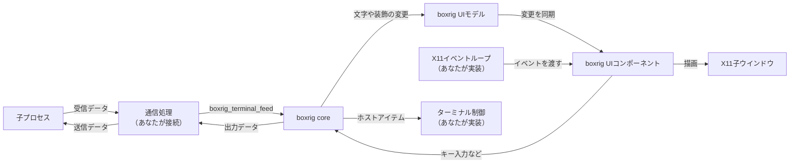

# 簡易ターミナルアプリケーションを実装する (UI)

boxrig UIライブラリを使用すると、少量のコードを追加するだけで、ターミナルアプリケーションを実現できます。
boxrigには、より低レベルのデータ処理を行うライブラリとしてboxrig coreがあります。以下に、簡単に違いを示します:

- boxrig core: バイト列のパースと解釈を行うライブラリです。極めてニュートラルで外部依存性がありません。
  この独立性の高さから、boxrigが標準でサポートしていないデバイスや環境に対しても再利用が可能です。
  しかし、特定の表示デバイスや入力に対する操作・通過するテキストなどの操作を一切行わず、それらは利用者が実装する必要があります。
- boxrig UI: boxrig coreを使用し、特定の入出力デバイスを使用してレンダリングと入力受付を行う、再利用可能なライブラリです。
  X11ウィジェットやWin32のコントロールを最小の実装で制御出来るAPIが公開されており、あなたのアプリケーションに組み込みやすく設計されています。

このガイドは、boxrig UIの公開APIから、X11環境で動作するターミナルアプリケーションを段階的に実装するための学習資料です。
また、Wayland,OpenGL,Win32 (GDI),Direct 2D/3Dなどで使用する場合の概要も記載されています。

boxrig UIは一般的な開発者向けに設計されており、非常に細かい制御を加えたいと考えている場合や、
boxrig UIがサポートしていない、全く異なる環境にターミナルを実装したいと考えている開発者には向きません。
そのような場合は、 [boxrig core向けのガイド](./step-by-step-core.md) を先にチェックすることをお勧めします。

対象は、C言語(C99)を理解している開発者です。

---

## boxrig UIの基礎と全体のデータフロー

boxrig UIはboxrig coreと連携して、boxrig coreが解釈した文字やその装飾を描画し、
ウインドウシステムから受け取ったキー入力などを、boxrig coreに投入するための抽象モデルとコンポーネントを公開します。

boxrig core向けのガイドでは、文字の表示単位であるセルを一つずつ取得して描画する手順を示しましたが、boxrig UIでは、その処理を自分で実装する必要はありません。

まず、以下の三つの構造体の役割を把握して下さい:

| 構造体 | 役割 |
| :--- | :--- |
| `boxrig_terminal` | boxrig coreそのもので、ターミナルの論理的な状態を管理します。受信データを解釈し、文字や装飾、カーソルなどを保持します |
| `boxrig_ui_model` | boxrigユーザーインターフェイスの論理的な状態を管理します。ターミナルとboxrig UIを接続し、ターミナルの変更を、接続されている表示先に伝えます |
| `boxrig_x11_terminal_component` | X11用のboxrig UIコンポーネントです。子ウインドウを持ち、文字の描画とキー入力、マウス操作、IMEなどを扱います。他にも、Wayland/OpenGL/Win32など、プラットフォーム別の特殊化されたコンポーネントがいくつか用意されています |

これらは不透明な構造体で、生成関数と操作関数を使って管理します。
このガイドでは、ターミナル、UIモデル、コンポーネントをそれぞれ一つだけ生成します。

boxrig UIコンポーネントは、あなたが作成した親ウインドウの中に配置します。
親ウインドウの生成、イベントループ、子プロセスの起動と通信は、アプリケーション側で実装する必要があります。
以下に、簡単な模式図を示します:



### ターミナルとboxrig UIを接続する

ターミナルは、boxrig coreの `boxrig_terminal_create()` で生成します。
続いて、ターミナルに対応するUIモデルを生成します:

```c
boxrig_ui_status boxrig_ui_model_create(
    boxrig_terminal *terminal,
    boxrig_ui_model **model_out);
```

UIモデルはターミナルを参照しますが、ターミナルを破棄することはありません。
UIモデルを使い終わるまで、ターミナルを維持する必要があります。

次に、X11用のboxrig UIコンポーネントを生成します:

```c
boxrig_ui_status boxrig_x11_terminal_component_create_child(
    Display *display,
    Window parent,
    boxrig_ui_model *model,
    const boxrig_x11_terminal_component_config *config,
    boxrig_x11_terminal_component **component_out);
```

この関数は、指定した親ウインドウの中に、コンポーネント専用の子ウインドウを生成します。
レンダラーやフォント、入力処理も同時に準備されます。
親ウインドウやUIモデルは参照するだけなので、コンポーネントを破棄するまで維持して下さい。

### 受信データを表示する

受信データは、boxrig coreの `boxrig_terminal_feed()` に投入します。
ターミナルの内容が変わったら、以下の順番でboxrig UIに表示を更新させます:

```c
boxrig_ui_model_synchronize(model);
boxrig_x11_terminal_component_frame(component, &frame);
```

`boxrig_ui_model_synchronize()` は、ターミナルで発生した変更を、UIモデルに接続されている表示先へ配布します。
`boxrig_x11_terminal_component_frame()` は、その変更を元に描画します。
いずれもアプリケーション側から呼び出す関数で、データを投入しただけで自動的に描画される訳ではありません。

> ウィジェットやコントロールのように、配置しただけで機能するコンポーネントではない理由は、
> ホストするアプリケーション側の描画の都合に合わせて、カスタマイズ出来る余地を残すためです。
> ただし、その手間は最小限となるように設計されています。

以降で、この呼び出しを中心に、必要な処理を順に追加していきます。

## 最初のバージョンの実装

まず、80桁x25行のウインドウに、固定文字列 `"Hello boxrig UI!"` を表示します。

以下のコードを `hello_ui_term.c` として保存して下さい。

<!-- ui-guide-source: hello_ui_term.c -->
```c
/* The guide uses the public boundary and no private boxrig headers. */
#include "boxrig/terminal.h"
#include "boxrig/x11.h"

#include <X11/Xlib.h>

#include <limits.h>
#include <locale.h>
#include <stdbool.h>
#include <stdint.h>
#include <stdio.h>

/* Display the number of rows and columns determined by the component in the terminal */
static int apply_grid_resize(
    boxrig_x11_terminal_component *component,
    boxrig_terminal *terminal)
{
    boxrig_ui_layout_action action;

    while (boxrig_x11_terminal_component_take_layout_action(component, &action)) {
        if (action.kind != BOXRIG_UI_LAYOUT_ACTION_GRID_RESIZE) {
            return -1;
        }
        const bool succeeded = boxrig_terminal_resize(
            terminal, action.value.grid_resize.rows,
            action.value.grid_resize.columns) == BOXRIG_STATUS_OK;

        if (boxrig_x11_terminal_component_complete_grid_resize(
                component, action.revision, succeeded) != BOXRIG_UI_OK ||
            !succeeded) {
            return -1;
        }
    }
    return 0;
}

int main(void)
{
    static const uint8_t message[] = "Hello boxrig UI!";

    boxrig_terminal_config config = boxrig_terminal_config_default();
    boxrig_x11_terminal_component_config component_config =
        boxrig_x11_terminal_component_config_default();
    boxrig_terminal *terminal = NULL;
    boxrig_ui_model *model = NULL;
    boxrig_x11_terminal_component *component = NULL;
    Display *display = NULL;
    Window window = None;
    Atom delete_window = None;
    Atom protocols = None;
    boxrig_font_effective_metrics metrics;
    unsigned int width;
    unsigned int height;
    size_t consumed = 0;
    bool running = true;
    int result = 1;

    /* Select the application locale before creating the XIM input adapter. */
    if (setlocale(LC_ALL, "") == NULL || XSetLocaleModifiers("") == NULL) {
        goto cleanup;
    }
    display = XOpenDisplay(NULL);
    if (display == NULL) {
        fprintf(stderr, "hello-ui-term: could not open X display\n");
        goto cleanup;
    }
    window = XCreateSimpleWindow(
        display, DefaultRootWindow(display), 0, 0, 1, 1, 0, 0, 0);
    if (window == None) {
        goto cleanup;
    }
    XSelectInput(display, window, FocusChangeMask);
    delete_window = XInternAtom(display, "WM_DELETE_WINDOW", False);
    protocols = XInternAtom(display, "WM_PROTOCOLS", False);
    if (delete_window == None || protocols == None ||
        XSetWMProtocols(display, window, &delete_window, 1) == 0) {
        goto cleanup;
    }
    XStoreName(display, window, "boxrig UI guide: step 1");

    /* The component owns its child, renderer, fonts, and input adapter. */
    config.rows = 25;
    config.columns = 80;
    component_config.scrollbar_presentation = BOXRIG_UI_COMPONENT_SCROLLBAR_NONE;
    /* This first example has no animation adapter yet. */
    component_config.view.blink.text_enabled = false;
    component_config.view.blink.cursor_enabled = false;
    if (boxrig_terminal_create(&config, &terminal) != BOXRIG_STATUS_OK ||
        boxrig_ui_model_create(terminal, &model) != BOXRIG_UI_OK ||
        boxrig_x11_terminal_component_create_child(
            display, window, model, &component_config, &component) != BOXRIG_UI_OK ||
        boxrig_x11_terminal_component_get_effective_metrics(
            component, &metrics) != BOXRIG_FONT_CATALOG_OK ||
        metrics.cell_width == 0 || metrics.cell_height == 0 ||
        metrics.cell_width > UINT_MAX / config.columns ||
        metrics.cell_height > UINT_MAX / config.rows) {
        goto cleanup;
    }
    width = (unsigned int)config.columns * metrics.cell_width;
    height = (unsigned int)config.rows * metrics.cell_height;
    XResizeWindow(display, window, width, height);

    {
        const boxrig_ui_component_allocation allocation = {
            0, 0, width, height, BOXRIG_UI_WINDOW_EMBEDDED
        };
        boxrig_ui_layout_result layout;

        if (boxrig_x11_terminal_component_allocate(
                component, &allocation, &layout) != BOXRIG_UI_OK ||
            apply_grid_resize(component, terminal) == -1 ||
            boxrig_x11_terminal_component_set_visible(component, true) != BOXRIG_UI_OK ||
            boxrig_terminal_feed(
                terminal, message, sizeof(message) - 1, &consumed) != BOXRIG_STATUS_OK ||
            consumed != sizeof(message) - 1) {
            goto cleanup;
        }
    }
    XMapWindow(display, window);

    while (running) {
        boxrig_ui_component_frame_result frame;
        XEvent event;
        boxrig_ui_component_event_result handled;

        if (boxrig_ui_model_synchronize(model) != BOXRIG_UI_OK ||
            boxrig_x11_terminal_component_frame(component, &frame) != BOXRIG_UI_OK) {
            goto cleanup;
        }
        if (frame.additional_dispatch && XPending(display) == 0) {
            continue;
        }
        XNextEvent(display, &event);
        handled = boxrig_x11_terminal_component_dispatch_event(component, &event);
        if (handled == BOXRIG_UI_COMPONENT_EVENT_FAILURE ||
            handled == BOXRIG_UI_COMPONENT_EVENT_BLOCKED) {
            goto cleanup;
        }
        if (handled == BOXRIG_UI_COMPONENT_EVENT_UNRELATED) {
            if (event.type == FocusIn && event.xfocus.window == window) {
                if (boxrig_x11_terminal_component_request_focus(component) != BOXRIG_UI_OK) {
                    goto cleanup;
                }
            } else if (event.type == ClientMessage &&
                       event.xclient.window == window &&
                       event.xclient.message_type == protocols &&
                       event.xclient.format == 32 &&
                       (Atom)event.xclient.data.l[0] == delete_window) {
                running = false;
            }
        }
    }
    result = 0;

cleanup:
    if (result != 0) {
        fprintf(stderr, "hello-ui-term: terminal operation failed\n");
    }
    /* Destroy borrowers before their model, terminal, parent, and Display. */
    boxrig_x11_terminal_component_destroy(component);
    boxrig_ui_model_destroy(model);
    boxrig_terminal_destroy(terminal);
    if (display != NULL) {
        if (window != None) {
            XDestroyWindow(display, window);
        }
        XCloseDisplay(display);
    }
    return result;
}
```

TODO: boxrig_x11_terminal_component_get_effective_metrics()のように、説明されていない関数が唐突に解説に出ている。これではガイドにならないので、きちんと説明を追加する必要がある

フォントはboxrig UIが準備するため、X11のフォントを自分で読み込む必要はありません。
`boxrig_x11_terminal_component_get_effective_metrics()` から、実際に使用される一セルの幅と高さを取得し、
80桁x25行に対応する親ウインドウの大きさを決めています。

`boxrig_x11_terminal_component_allocate()` は、親ウインドウ内でのコンポーネントの位置と大きさを指定します。
ここでは親の全領域に配置するため、原点は `0, 0` です。
`BOXRIG_UI_WINDOW_EMBEDDED` は、コンポーネントの大きさを親の割り当てに従わせることを示します。

この例では、初期サイズの計算を簡単にするため、スクロールバーを表示しません。
`scrollbar_presentation` の指定を省略すると、既定ではコンポーネント専用のスクロールバーが追加されます。

`apply_grid_resize()` は、コンポーネントが決定した行数・桁数をターミナルに反映する処理です。
描画を始める前に、この処理を済ませる必要があります。サイズ変更の章で詳しく解説します。

### ビルドして実行する

この例は、boxrig UIのX11用ライブラリ、プラットフォーム共通のboxrig UIライブラリ、boxrig coreライブラリを使用します。
X11用の開発パッケージとPango、Cairo、Fontconfig、D-Bus、`pkg-config` が必要です。
リポジトリ全体のビルド環境については、[README](../../../README_ja.md)を参照して下さい。

以下の `Makefile` を、コードと同じディレクトリに保存します。
既に置かれている完成版用のMakefileを維持したい場合は、別のディレクトリに二つのファイルを保存し、
`BOXRIG_ROOT` にboxrigリポジトリの絶対パスを指定して下さい。

<!-- ui-guide-source: Makefile -->
```make
CC ?= cc
BOXRIG_ROOT ?= ../../..
ROOT := $(abspath $(BOXRIG_ROOT))
PACKAGES := x11 xcomposite xrender xfixes 'pango >= 1.50' pangocairo pangoft2 fontconfig dbus-1

CPPFLAGS += -I$(ROOT)/include $(shell pkg-config --cflags $(PACKAGES))
CFLAGS ?= -O2 -g
CFLAGS += -std=c99 -Wall -Wextra -Wpedantic -Werror
LDLIBS += $(shell pkg-config --libs $(PACKAGES))
LIBBOXRIG := $(ROOT)/build/libboxrig-x11.a \
             $(ROOT)/build/libboxrig-ui.a \
             $(ROOT)/build/libboxrig.a

.PHONY: all clean libraries

all: hello_ui_term

libraries:
	$(MAKE) -C $(ROOT) build/libboxrig-x11.a build/libboxrig-ui.a build/libboxrig.a

$(LIBBOXRIG): libraries

hello_ui_term: hello_ui_term.c $(LIBBOXRIG)
	$(CC) $(CPPFLAGS) $(CFLAGS) $(LDFLAGS) $< $(LIBBOXRIG) $(LDLIBS) -o $@

editable_document: editable_document.c $(LIBBOXRIG)
	$(CC) $(CPPFLAGS) $(CFLAGS) $(LDFLAGS) $< $(ROOT)/build/libboxrig-ui.a $(ROOT)/build/libboxrig.a -o $@

clean:
	$(RM) hello_ui_term editable_document
```

以下でビルドと起動を行います:

```sh
make
./hello_ui_term
```

別のディレクトリに保存した場合は、例えば以下のようにビルドします:

```sh
make BOXRIG_ROOT=/path/to/boxrig
./hello_ui_term
```

ウインドウに `Hello boxrig UI!` が表示され、閉じる操作で終了すれば成功です。
親ウインドウを閉じる操作はアプリケーションが処理し、文字の描画に必要なExposeイベントはboxrig UIが処理します。

### リソースを破棄する順序

最初のコードでは、コンポーネント、UIモデル、ターミナル、親ウインドウ、X11接続の順に破棄しています。
コンポーネントはUIモデルと親ウインドウ、X11接続を参照し、UIモデルはターミナルを参照するためです。

コンポーネントの破棄では、その子ウインドウやレンダラーも破棄されます。
子ウインドウをアプリケーション側から重ねて破棄する必要はありません。
親ウインドウとX11接続はアプリケーションが所有するため、最後に自分で破棄します。

## 効率よくセルを描画する

最初のコードは、描画する際に `boxrig_ui_model_synchronize()` と
`boxrig_x11_terminal_component_frame()` を呼んでいます。
これだけで、boxrig UIは変更があったセルを中心に表示を更新します。
core向けのガイドで実装した、dirty領域の取得やセルごとの描画は不要です。

また、文字の色や背景色、カーソル、複数バイトの文字などもboxrig UIが描画します。
最初のコードの `message` を、例えば以下のように変更してみて下さい:

```c
static const uint8_t message[] =
    "Hello boxrig UI!\r\n"
    "\033[31mRed text\033[0m\r\n"
    "\033[1mBold text\033[0m";
```

ビルドして起動すると、行を分けて、赤い文字と太字が表示されます。
`\033` はESCを表し、後続のエスケープシーケンスをboxrig coreが解釈します。
解釈結果をboxrig UIが描画するので、アプリケーション側に装飾のためのコードを追加する必要はありません。

> boxrig UIを使用している間は、アプリケーション側でboxrig coreのdirty領域を消費しないで下さい。
> `boxrig_ui_model_synchronize()` がdirty領域を取得して、コンポーネントに伝えます。

`boxrig_x11_terminal_component_frame()` は待機を行わず、一回分の描画処理を進めます。
戻された `frame.additional_dispatch` がtrueなら、次の処理で進められる仕事が残っているため、
イベントを待たずに再びフレームを実行します。

`frame.frame_pending` も未完了の仕事を示しますが、サイズ変更の完了やX11イベントを待っている場合も含みます。
こちらだけを見てループを繰り返すと、待つべき場面で処理を回し続けてしまいます。
最初のコードでは、`additional_dispatch` を使って再実行を判断しています。

## インタラクションデータの投入

core向けのガイドでは、X11のキー入力をboxrig coreのキーイベントに変換し、
`boxrig_terminal_send_key()` などで投入しました。
boxrig UIでは、X11イベントをコンポーネントに渡すだけで、その変換を行います。

最初のコードには、既に以下の処理を含めています:

```c
handled = boxrig_x11_terminal_component_dispatch_event(component, &event);
```

コンポーネントは、キー入力、マウス操作、フォーカスの移動、IME、選択や描画に関するイベントを扱います。
戻り値で、コンポーネントがそのイベントを処理したかどうかを判定できます:

| 戻り値 | 意味 |
| :--- | :--- |
| `BOXRIG_UI_COMPONENT_EVENT_HANDLED` | コンポーネントが処理しました |
| `BOXRIG_UI_COMPONENT_EVENT_UNRELATED` | 親ウインドウなど、コンポーネント以外に関するイベントです。アプリケーション側で処理します |
| `BOXRIG_UI_COMPONENT_EVENT_BLOCKED` | 出力データを保持する空き領域が不足しています。同じイベントを保持し、空きができてから再試行します |
| `BOXRIG_UI_COMPONENT_EVENT_FAILURE` | 処理に失敗しました |

イベントは、対象のウインドウをアプリケーション側で絞り込まずに、全てコンポーネントに渡して下さい。
IMEの通信には、入力用の子ウインドウ以外を対象にするイベントも使用されるためです。
親ウインドウの終了操作などは `UNRELATED` として返されるので、その後で処理できます。

最初のコードは、親にフォーカスが移った時に、
`boxrig_x11_terminal_component_request_focus()` でコンポーネントへフォーカスを渡しています。
これで子ウインドウがキー入力を受け取れます。
ロケールの設定をコンポーネントの生成前に行っているのも、IMEのための準備です。

ただし、この段階では子プロセスがありません。
キー入力は出力データになりますが、そのデータを表示内容として投入してはいないため、
文字を入力してもウインドウには表示されません。次の章で、生成された出力データを確認します。

最初のコードでは `BLOCKED` も終了する条件にしています。
子プロセスと接続する章で、終了せずに同じイベントを再試行するように変更します。

## 出力データの送信

boxrig UIは、キー入力をboxrig coreへ投入しますが、生成された出力データの送信先は決めません。
出力データはアプリケーション側で取得し、子プロセスなどへ送信する必要があります。
ターミナルからの問い合わせに対する応答も、同じ出力データに含まれます。

まだ子プロセスがないので、ここではアプリケーションの標準出力へ書き出して確認します。
以下の関数を、`main()` より前に追加して下さい:

```c
static int send_output(boxrig_terminal *terminal)
{
    const uint8_t *bytes;
    size_t length;

    while ((length = boxrig_terminal_output_peek(terminal, &bytes)) != 0) {
        const size_t written = fwrite(bytes, 1, length, stdout);

        if (written != 0 &&
            boxrig_terminal_output_consume(terminal, written) != BOXRIG_STATUS_OK) {
            return -1;
        }
        if (written != length) {
            return -1;
        }
    }
    return fflush(stdout) == 0 ? 0 : -1;
}
```

イベントループの `boxrig_ui_model_synchronize()` より前に、以下を追加します:

```c
if (send_output(terminal) == -1) {
    goto cleanup;
}
```

ビルドして起動し、boxrig UIのウインドウで英数字を入力して下さい。
起動元のターミナルに、その英数字が書き出されれば成功です。
boxrig UIのウインドウに入力文字を表示するには、子プロセス側から返された文字を受信データとして投入します。

`boxrig_terminal_output_peek()` で得られるバイト列はターミナルが管理しています。
送信できたバイト数だけ `boxrig_terminal_output_consume()` で消費して下さい。
この確認用コードは標準出力への書き込みを待つことがあります。後の章では、待機しないPTY通信に置き換えます。

## ホストアイテムの処理

文字やカーソルの描画はboxrig UIが処理しますが、ウインドウタイトルの変更やベルなどのホストアイテムは、
アプリケーション側で処理する必要があります。
ここではcore向けのガイドと同様に、ベルだけを処理し、他のホストアイテムは無視します。

boxrig UIでは、UIモデルに対してホストアイテムを取得する窓口を一つ生成できます。
まず、`main()` の変数宣言に以下を追加します:

```c
boxrig_ui_host_item_consumer *consumer = NULL;
```

ターミナルとコンポーネントの生成に成功した後、初期配置より前に、以下を追加して下さい:

```c
if (boxrig_ui_host_item_consumer_create(model, &consumer) != BOXRIG_UI_OK) {
    goto cleanup;
}
```

続いて、以下の関数を `main()` より前に追加します:

```c
static int process_host_items(
    Display *display,
    boxrig_ui_host_item_consumer *consumer)
{
    boxrig_host_item item;

    while (boxrig_ui_host_item_consumer_peek(consumer, &item)) {
        const uint64_t request_id = item.request_id;

        /* Handle bells and ignore unsupported host operations. */
        if (item.type == BOXRIG_HOST_ITEM_BELL) {
            (void)XBell(display, 0);
        }
        if (boxrig_ui_host_item_consumer_consume(consumer) != BOXRIG_UI_OK ||
            (request_id != 0 &&
             boxrig_ui_host_item_consumer_complete(
                 consumer, request_id, BOXRIG_HOST_REQUEST_UNAVAILABLE,
                 NULL, 0) != BOXRIG_UI_OK)) {
            return -1;
        }
    }
    return 0;
}
```

イベントループの `send_output()` より前に、以下を追加して下さい:

```c
if (process_host_items(display, consumer) == -1) {
    goto cleanup;
}
```

終了処理にも、UIモデルを破棄するより前に、以下を追加します:

```c
boxrig_ui_host_item_consumer_destroy(consumer);
```

確認するには、固定文字列の最後に `\a` を加えます:

```c
static const uint8_t message[] = "Hello boxrig UI!\a";
```

ビルドして起動すると、表示に加えてベルが要求されます。
ベルの音が鳴るかどうかは、X11環境の設定によります。
設定と動作については、[Xlibのベル機能の解説](https://www.x.org/releases/X11R7.6/doc/libX11/specs/libX11/libX11.html)を参照して下さい。

未対応のホストアイテムも消費し、応答が必要な要求には「利用できない」と完了を通知しています。
処理しないアイテムをキューに残すと、やがて受信データの投入を進められなくなるためです。

## ターミナルサイズとカーソルの制御

ターミナルの行数・桁数はboxrig coreが保持します。
カーソルの位置や形もboxrig coreが解釈し、boxrig UIが描画するので、
アプリケーション側でカーソルの座標を取得して描く必要はありません。

例えば、固定文字列を以下に変更すると、文字列の次の位置にカーソルが表示されます:

```c
static const uint8_t message[] = "Hello boxrig UI!\033[?25h";
```

最初の例では点滅を無効にしています。ここでは標準のpoll adapterを接続し、
カーソルの点滅と画像アニメーションを有効にします。
共有runtimeが時計と期限を管理し、表示を変える時だけフレームを要求します。
アプリケーション側で必要なのは、通常のイベント処理とフレーム処理です。

まず、ファイルの先頭、全ての`#include`より前に以下を追加します。

```c
#define _POSIX_C_SOURCE 200809L
```

さらに、以下のヘッダーを追加してください。

```c
#include <errno.h>
#include <poll.h>
```

まず、`main()`の変数宣言へadapterを追加します。

```c
boxrig_ui_animation_poll *animations = NULL;
```

componentを作る前に、最初の例で点滅を無効にした2行を次の処理へ置き換えます。

```c
if (boxrig_x11_animation_poll_create(&animations) != BOXRIG_UI_OK) {
    goto cleanup;
}
component_config.animation_runtime = boxrig_ui_animation_poll_runtime(animations);
component_config.view.blink = boxrig_ui_blink_config_default();
```

`cleanup`では、componentの破棄直後にadapterを解放してください。

```c
boxrig_ui_animation_poll_destroy(animations);
```

イベントループ全体を以下に置き換えます。
前の章で追加した、ホストアイテムと出力データの処理も含んでいます。

```c
while (running) {
    boxrig_ui_component_frame_result frame;
    XEvent event;
    boxrig_ui_component_event_result handled;
    struct pollfd descriptor = { ConnectionNumber(display), POLLIN, 0 };
    int timeout;

    if (boxrig_ui_animation_poll_dispatch(animations) != BOXRIG_UI_OK ||
        process_host_items(display, consumer) == -1 ||
        send_output(terminal) == -1 ||
        boxrig_ui_model_synchronize(model) != BOXRIG_UI_OK ||
        boxrig_x11_terminal_component_frame(component, &frame) != BOXRIG_UI_OK) {
        goto cleanup;
    }
    timeout = frame.additional_dispatch || XPending(display) > 0 ? 0 : -1;
    if (boxrig_ui_animation_poll_prepare_wait(animations, timeout, &timeout) != BOXRIG_UI_OK) {
        goto cleanup;
    }
    XFlush(display);
    if (poll(&descriptor, 1, timeout) == -1) {
        if (errno == EINTR) {
            continue;
        }
        goto cleanup;
    }
    if ((descriptor.revents & (POLLERR | POLLHUP | POLLNVAL)) != 0) {
        goto cleanup;
    }
    if (XPending(display) == 0) {
        continue;
    }
    XNextEvent(display, &event);
    handled = boxrig_x11_terminal_component_dispatch_event(component, &event);
    if (handled == BOXRIG_UI_COMPONENT_EVENT_FAILURE ||
        handled == BOXRIG_UI_COMPONENT_EVENT_BLOCKED) {
        goto cleanup;
    }
    if (handled == BOXRIG_UI_COMPONENT_EVENT_UNRELATED) {
        if (event.type == FocusIn && event.xfocus.window == window) {
            if (boxrig_x11_terminal_component_request_focus(component) != BOXRIG_UI_OK) {
                goto cleanup;
            }
        } else if (event.type == ClientMessage &&
                   event.xclient.window == window &&
                   event.xclient.message_type == protocols &&
                   event.xclient.format == 32 &&
                   (Atom)event.xclient.data.l[0] == delete_window) {
            running = false;
        }
    }
}
```

`boxrig_ui_animation_poll_dispatch()`の役割は、期限を迎えた表示の更新と、必要なフレームの要求です。
描画は通常の`frame()`で行います。新しく受信した画像アニメーションや同期描画の開始時刻も、
モデル同期時にruntimeが確定します。

`boxrig_ui_animation_poll_prepare_wait()`は、通常の待機へruntimeの期限を反映します。
対象がない場合は無期限待機です。利用者が周期や次の点滅時刻を計算する必要はありません。
同じterminalの時計を手動でも更新すると`BUSY`になるため、この例では時刻更新APIを呼びません。

[Xlibのイベントキューの解説](https://www.x.org/releases/X11R7.6/doc/libX11/specs/libX11/libX11.html#Event_Queue_Management)にあるように、
イベントはXlibの内部にも保持されます。
接続のファイルディスクリプタだけを待つと、既に受信済みのイベントを処理し損ねるため、
待機前に `XPending()` も確認しています。
また、[pollの解説](https://man7.org/linux/man-pages/man2/poll.2.html)に従い、
タイムアウト時にも次のループでadapterをdispatchします。

ビルドして起動し、ウインドウにフォーカスを与えると、他の操作をしなくてもカーソルの点滅が進みます。

## ウインドウのサイズ変更に追従させる

次に、親ウインドウのサイズ変更に合わせて、コンポーネントとターミナルの大きさを変更します。
boxrig UIは、ピクセル数と実際のフォントから行数・桁数を計算します。
アプリケーション側で一セルの大きさを使って割り算する必要はありません。

サイズ変更は、以下の順序で処理します:

1. 親ウインドウの `ConfigureNotify` から、実際に割り当てられた幅と高さを取得する。
2. `boxrig_x11_terminal_component_allocate()` に、その幅と高さを渡す。
3. `boxrig_x11_terminal_component_take_layout_action()` で、行数・桁数の変更を取得する。
4. ターミナルの行数・桁数を変更し、同じリビジョンの変更が完了したことをコンポーネントに伝える。
5. UIモデルを同期し、フレームを実行する。

割り当ての通知だけでは、ターミナルの行数・桁数は変更されません。
子プロセスと接続している場合は、通信先のサイズも同時に変更する必要があるため、
変更の適用はアプリケーション側の仕事になっています。

### 親の大きさをコンポーネントに渡す

最初のコードでは、初期配置を `main()` の中で指定しています。
同じ処理をサイズ変更にも使うため、以下の関数を `main()` より前に追加して下さい:

```c
static int allocate_component(
    boxrig_x11_terminal_component *component,
    unsigned int width,
    unsigned int height)
{
    const boxrig_ui_component_allocation allocation = {
        0, 0, width, height, BOXRIG_UI_WINDOW_EMBEDDED
    };
    boxrig_ui_layout_result layout;

    return boxrig_x11_terminal_component_allocate(
        component, &allocation, &layout) == BOXRIG_UI_OK ? 0 : -1;
}
```

幅には、コンポーネントのスクロールバーも含まれます。
スクロールバーを有効にする場合も、アプリケーション側でその幅を差し引かず、親の幅をそのまま渡して下さい。

親ウインドウのイベントを選択する処理に、`StructureNotifyMask` を追加します:

```c
XSelectInput(display, window, StructureNotifyMask | FocusChangeMask);
```

### 行数・桁数の変更を適用する

最初のコードの `apply_grid_resize()` を、以下の `process_layout()` に置き換えます:

```c
static int process_layout(
    boxrig_x11_terminal_component *component,
    boxrig_terminal *terminal,
    unsigned int width,
    unsigned int height)
{
    boxrig_ui_layout_action action;

    while (boxrig_x11_terminal_component_take_layout_action(component, &action)) {
        if (action.kind == BOXRIG_UI_LAYOUT_ACTION_GRID_RESIZE) {
            const bool succeeded = boxrig_terminal_resize(
                terminal, action.value.grid_resize.rows,
                action.value.grid_resize.columns) == BOXRIG_STATUS_OK;

            if (boxrig_x11_terminal_component_complete_grid_resize(
                    component, action.revision, succeeded) != BOXRIG_UI_OK ||
                !succeeded) {
                return -1;
            }
        } else {
            bool applied;
            boxrig_ui_layout_result layout;

            /* This host keeps its parent allocation for content-size requests. */
            if (boxrig_x11_terminal_component_complete_size_command(
                    component, action.revision, BOXRIG_UI_SIZE_REJECTED,
                    (boxrig_ui_fixed)width * BOXRIG_UI_FIXED_ONE,
                    (boxrig_ui_fixed)height * BOXRIG_UI_FIXED_ONE,
                    &applied, &layout) != BOXRIG_UI_OK) {
                return -1;
            }
        }
    }
    return 0;
}
```

`GRID_RESIZE` には、新しい行数・桁数と、その変更を識別するリビジョンが含まれています。
`take_layout_action()` は一つの変更を一度だけ取得するので、
適用結果は、取得した `action.revision` を使って完了させて下さい。

`CONTENT_SIZE` は、例えばフォント変更の際に、親の大きさも変えてほしいという要求です。
この簡易アプリケーションでは親の割り当てを維持する方針にし、現在の幅と高さで拒否を完了します。
完了関数の座標は26.6固定小数点なので、ピクセル数に `BOXRIG_UI_FIXED_ONE` を掛けて渡しています。
このガイドでは、操作によるフォント変更は追加しません。

### 初期配置とイベントループを変更する

`main()` にある初期配置のブロックを、以下に置き換えます:

```c
if (allocate_component(component, width, height) == -1 ||
    process_layout(component, terminal, width, height) == -1 ||
    boxrig_x11_terminal_component_set_visible(component, true) != BOXRIG_UI_OK ||
    boxrig_terminal_feed(
        terminal, message, sizeof(message) - 1, &consumed) != BOXRIG_STATUS_OK ||
    consumed != sizeof(message) - 1) {
    goto cleanup;
}
```

続いて、イベントループの `UNRELATED` を処理する部分で、
`FocusIn` の条件より前にサイズ変更を追加します:

```c
if (event.type == ConfigureNotify &&
    event.xconfigure.window == window &&
    event.xconfigure.width > 0 && event.xconfigure.height > 0) {
    width = (unsigned int)event.xconfigure.width;
    height = (unsigned int)event.xconfigure.height;
    if (allocate_component(component, width, height) == -1) {
        goto cleanup;
    }
} else if (event.type == FocusIn && event.xfocus.window == window) {
    /* Keep the existing focus handling here. */
}
```

イベントを処理した後、ループの末尾に以下を追加します:

```c
if (process_layout(component, terminal, width, height) == -1) {
    goto cleanup;
}
```

フレームの実行で新しいサイズ要求が確定する場合もあるため、
`boxrig_x11_terminal_component_frame()` に成功した直後にも、同じ呼び出しを追加して下さい。

ビルドして起動し、ウインドウを大きくすると、ターミナルの表示領域も大きくなります。
次の章では、子プロセスを接続し、その行数・桁数も同じ変更に追従させます。

## 子プロセスと接続する

ここまでのコードは、固定文字列を受信データとして投入し、キー入力から生成された出力データを標準出力へ書き出しています。
これを、PTYを使った子プロセスとの通信に置き換えます。
PTYは、子プロセスからターミナルとして扱える入出力先です。

boxrig UIコンポーネントは、子プロセスやPTYを生成しません。
アプリケーション側でboxrigのPOSIX用ライブラリとセッションライブラリを接続します。
セッションは、受信データをboxrig coreへ投入し、出力データをPTYへ送信します。
途中までしか処理できなかったデータの保持も、セッションが担当します。

### PTYとセッションを生成する

以下のヘッダーを追加して下さい:

```c
#include "boxrig/posix.h"
#include <signal.h>
```

`main()` の変数宣言に、以下を追加します:

```c
boxrig_session_config session_config = boxrig_session_config_default();
boxrig_posix_pty *pty = NULL;
boxrig_session *session = NULL;
```

初期配置より前に、以下の処理を追加します:

```c
{
    char *child_arguments[] = { "/bin/sh", "-i", NULL };

    if (boxrig_posix_pty_spawn(
            child_arguments, "xterm", config.rows, config.columns, &pty) == -1 ||
        boxrig_posix_pty_session_create(
            terminal, pty, &session_config, &session) != BOXRIG_SESSION_OK) {
        goto cleanup;
    }
}
```

`boxrig_posix_pty_spawn()` はPTYに接続した子プロセスを起動します。
第二引数の `"xterm"` は、子プロセスの `TERM` 環境変数に設定されるターミナルの種類です。
`TERM` は行数・桁数を示す変数ではなく、子プロセスが使用するエスケープシーケンスなどの前提を指定します。

ここで、固定文字列の `message` と `consumed` の変数宣言、および初期配置にある
`boxrig_terminal_feed()` と消費量の確認を削除します。
また、`send_output()` とその呼び出しも削除します。
受信と送信はセッションに任せるので、同じ出力データを自分で消費してはいけません。

### 子プロセスにターミナルサイズを通知する

前の章の `process_layout()` では、boxrig coreの行数・桁数だけを変更しています。
子プロセスにも同じサイズを知らせるため、第二引数を
`boxrig_terminal *terminal` から `boxrig_session *session` に変更し、
`GRID_RESIZE` の適用を以下に置き換えます:

```c
const bool succeeded = boxrig_session_resize(
    session, action.value.grid_resize.rows,
    action.value.grid_resize.columns) == BOXRIG_SESSION_OK;
```

完了を通知する処理は、そのまま維持します。
`process_layout()` を呼ぶ全ての場所も、第二引数を `terminal` から `session` に変更して下さい。

`boxrig_session_resize()` は、PTYとターミナルの両方を変更します。
POSIX用のPTY実装は `TIOCSWINSZ` を使い、Linuxではサイズの変更が
フォアグラウンドのプロセスグループへ `SIGWINCH` として通知されます。
シェルから起動したvimなども、これによって新しいサイズを取得できます。
詳しくは[TTYのサイズ変更の解説](https://man7.org/linux/man-pages/man2/TIOCSWINSZ.2const.html)を参照して下さい。

### 通信とイベント処理を同じループで進める

イベントループでは、X11接続とPTYの両方を待つ必要があります。
待機結果は、次の対応でセッションに渡します:

| セッションの関心 | pollで待つ条件 | セッションに渡す準備状態 |
| :--- | :--- | :--- |
| `BOXRIG_SESSION_INTEREST_READ` | `POLLIN` | `BOXRIG_SESSION_READY_READ` |
| `BOXRIG_SESSION_INTEREST_WRITE` | `POLLOUT` | `BOXRIG_SESSION_READY_WRITE` |
| `BOXRIG_SESSION_INTEREST_DISPATCH` | 保持している受信データを再試行する | 準備状態がなくてもdispatchする |

ループの順序も、以下のように変更します:

1. 現在時刻を更新し、`boxrig_session_dispatch()` で受信・送信を進める。
2. ホストアイテムを処理する。
3. X11イベントをコンポーネントに渡し、親ウインドウのイベントも処理する。
4. 行数・桁数の変更をセッションへ適用する。
5. UIモデルを同期し、フレームを実行する。その直後にもサイズ要求を確認する。
6. 次の通信条件とアニメーションの期限を調べ、X11接続とPTYを待つ。

`boxrig_session_dispatch()` が受信データの投入を進められない時は、
ホストアイテムの消費や出力の送信によって空きを作り、保持されているデータを再試行します。
単に `INTEREST_DISPATCH` だけを見て待機時間を0にすると、空きができない間もループを回し続ける場合があります。
完成版では、直前のdispatchが詰まっているか、ホストアイテムを消費したか、送信が進んだかも確認しています。

`BLOCKED` になったX11イベントも、取り出したまま捨ててはいけません。
完成版では、`blocked_event` に保存し、新しいイベントを取り出す前に、同じイベントを再試行します:

```c
if (blocked) {
    event = blocked_event;
} else {
    XNextEvent(display, &event);
}
handled = boxrig_x11_terminal_component_dispatch_event(component, &event);
if (handled == BOXRIG_UI_COMPONENT_EVENT_FAILURE) {
    goto cleanup;
}
blocked = handled == BOXRIG_UI_COMPONENT_EVENT_BLOCKED;
if (blocked) {
    blocked_event = event;
} else if (handled == BOXRIG_UI_COMPONENT_EVENT_UNRELATED) {
    /* Handle parent allocation, focus, and window close here. */
}
```

保存したイベントが詰まっている時は、Xlibに後続イベントがあっても、それだけを理由に直ちにループを繰り返しません。
PTYへの送信やフレームを進め、再試行できる条件を待ちます。
この間はX11接続の読み込み可能通知も待機対象から外し、まだ取り出せないイベントによる再起動を避けます。
コンポーネント内にも入力が保持される場合があるため、`frame.input_blocked` がtrueで送信が進んでいない間は、
`additional_dispatch` による即時の再実行も抑え、PTYが書き込み可能になるのを待ちます。
また、X11イベントを一回のループで一つずつ処理することで、イベントが続く間も通信と描画に処理を戻します。

まず、`main()` の変数宣言に、再試行するイベントと通信の準備状態を保持する変数を追加します:

```c
bool blocked = false;
XEvent blocked_event;
uint32_t ready = BOXRIG_SESSION_READY_NONE;
```

続いて、イベントループ全体を以下に置き換えて下さい。
サイズ変更やフォーカスの移動、終了操作の処理も含んでいます。

```c
while (running) {
    boxrig_session_dispatch_result dispatched;
    boxrig_ui_component_frame_result frame;
    boxrig_host_item item;
    bool had_host_items;
    uint32_t interests;
    bool retry_session;
    bool waiting_for_output;
    int timeout;
    struct pollfd descriptors[2] = {
        { ConnectionNumber(display), POLLIN, 0 },
        { boxrig_posix_pty_descriptor(pty), 0, 0 }
    };

    if (boxrig_ui_animation_poll_dispatch(animations) != BOXRIG_UI_OK ||
        boxrig_session_dispatch(session, ready, &dispatched) != BOXRIG_SESSION_OK) {
        goto cleanup;
    }
    ready = BOXRIG_SESSION_READY_NONE;
    had_host_items = boxrig_ui_host_item_consumer_peek(consumer, &item);
    if (process_host_items(display, consumer) == -1) {
        goto cleanup;
    }

    /* Handle at most one native event before servicing the PTY and frame. */
    if (blocked || XPending(display) > 0) {
        XEvent event;
        boxrig_ui_component_event_result handled;

        if (blocked) {
            event = blocked_event;
        } else {
            XNextEvent(display, &event);
        }
        handled = boxrig_x11_terminal_component_dispatch_event(component, &event);
        if (handled == BOXRIG_UI_COMPONENT_EVENT_FAILURE) {
            goto cleanup;
        }
        blocked = handled == BOXRIG_UI_COMPONENT_EVENT_BLOCKED;
        if (blocked) {
            blocked_event = event;
        } else if (handled == BOXRIG_UI_COMPONENT_EVENT_UNRELATED) {
            if (event.type == ConfigureNotify &&
                event.xconfigure.window == window &&
                event.xconfigure.width > 0 && event.xconfigure.height > 0) {
                width = (unsigned int)event.xconfigure.width;
                height = (unsigned int)event.xconfigure.height;
                if (allocate_component(component, width, height) == -1) {
                    goto cleanup;
                }
            } else if (event.type == FocusIn && event.xfocus.window == window) {
                if (boxrig_x11_terminal_component_request_focus(component) !=
                    BOXRIG_UI_OK) {
                    goto cleanup;
                }
            } else if (event.type == ClientMessage &&
                       event.xclient.window == window &&
                       event.xclient.message_type == protocols &&
                       event.xclient.format == 32 &&
                       (Atom)event.xclient.data.l[0] == delete_window) {
                running = false;
            }
        }
    }
    if (!running) {
        break;
    }
    if (process_layout(component, session, width, height) == -1 ||
        boxrig_ui_model_synchronize(model) != BOXRIG_UI_OK ||
        boxrig_x11_terminal_component_frame(component, &frame) != BOXRIG_UI_OK ||
        process_layout(component, session, width, height) == -1) {
        goto cleanup;
    }
    if (dispatched.peer_closed) {
        break;
    }

    interests = boxrig_session_interests(session);
    /* Later native events cannot advance a retained blocked event. */
    descriptors[0].events = blocked ? 0 : POLLIN;
    if ((interests & BOXRIG_SESSION_INTEREST_READ) != 0) {
        descriptors[1].events |= POLLIN;
    }
    if ((interests & BOXRIG_SESSION_INTEREST_WRITE) != 0) {
        descriptors[1].events |= POLLOUT;
    }
    retry_session = (interests & BOXRIG_SESSION_INTEREST_DISPATCH) != 0 &&
        (!dispatched.core_blocked || had_host_items ||
         dispatched.transport_bytes_written != 0);
    waiting_for_output = frame.input_blocked &&
        (interests & BOXRIG_SESSION_INTEREST_WRITE) != 0 &&
        dispatched.transport_bytes_written == 0;
    timeout = (frame.additional_dispatch && !waiting_for_output) || retry_session ||
        (blocked && dispatched.transport_bytes_written != 0) ||
        (!blocked && XPending(display) > 0) ? 0 : -1;
    if (boxrig_ui_animation_poll_prepare_wait(animations, timeout, &timeout) != BOXRIG_UI_OK) {
        goto cleanup;
    }
    XFlush(display);
    /* poll with timeout zero still collects PTY readiness during UI work. */
    if (poll(descriptors, 2, timeout) == -1) {
        if (errno == EINTR) {
            continue;
        }
        perror("simple-ui-term: poll");
        goto cleanup;
    }
    if ((descriptors[0].revents & (POLLERR | POLLHUP | POLLNVAL)) != 0 ||
        (descriptors[1].revents & POLLNVAL) != 0) {
        goto cleanup;
    }
    /* Drain unread bytes on hangup before accepting transport EOF. */
    if ((descriptors[1].revents & (POLLIN | POLLHUP | POLLERR)) != 0) {
        ready |= BOXRIG_SESSION_READY_READ;
    }
    if ((descriptors[1].revents & (POLLOUT | POLLHUP | POLLERR)) != 0) {
        ready |= BOXRIG_SESSION_READY_WRITE;
    }
}

```

PTYの切断が通知された時も、残っている受信データを読み取ってからセッションに終了を判定させます。
`dispatched.peer_closed` がtrueになると、アプリケーションも終了します。

### 終了処理を追加する

終了処理では、コンポーネントのイベント受付を止めてから破棄し、
セッションを破棄した後に、子プロセスを終了させて回収します。
コンポーネントを破棄する処理と、UIモデルを破棄する処理の間を以下に変更して下さい:

```c
if (component != NULL) {
    (void)boxrig_x11_terminal_component_quiesce(component);
}
boxrig_x11_terminal_component_destroy(component);
boxrig_ui_animation_poll_destroy(animations);
boxrig_session_destroy(session);
boxrig_ui_host_item_consumer_destroy(consumer);
if (pty != NULL) {
    int child_status;

    /* This minimal host forcibly stops its direct child on window close. */
    (void)kill(boxrig_posix_pty_child(pty), SIGKILL);
    if (boxrig_posix_pty_wait(pty, &child_status) == -1) {
        result = 1;
    }
    boxrig_posix_pty_destroy(pty);
}
```

セッションはターミナルとPTYを参照するので、どちらよりも先に破棄します。
PTYの破棄だけでは子プロセスを回収しないため、`boxrig_posix_pty_wait()` も呼び出しています。
この簡易アプリケーションでは、終了時に直接の子プロセスを強制終了させる方針にしています。

### ビルドして動作を確認する

Makefileのライブラリ一覧を、以下に変更します:

```make
LIBBOXRIG := $(ROOT)/build/libboxrig-x11.a \
             $(ROOT)/build/libboxrig-posix.a \
             $(ROOT)/build/libboxrig-session.a \
             $(ROOT)/build/libboxrig-ui.a \
             $(ROOT)/build/libboxrig.a
LDLIBS += -lutil

libraries:
	$(MAKE) -C $(ROOT) build/libboxrig-x11.a build/libboxrig-posix.a build/libboxrig-session.a build/libboxrig-ui.a build/libboxrig.a
```

これは既存の `LIBBOXRIG` と `libraries` を置き換える指定です。
既存の `LDLIBS` に加えて `-lutil` を追加し、ソースと実行ファイルの名前はそのままでもビルドできます。

ビルドして起動すると、固定文字列の代わりにシェルのプロンプトが表示されます。
`echo hello` などを入力して、結果がboxrig UIのウインドウに表示されれば成功です。

続いて `stty size` を実行すると、行数と桁数が表示されます。
初期状態では `25 80` です。
ウインドウのサイズを変更してからもう一度実行し、値が変わることを確認して下さい。
vimなどを起動した場合も、同じサイズ変更の通知が使用されます。

## GTKとWaylandのIME・候補表示を選ぶ

GTK 3／4ウィジェットの生成設定にある`ime_policy`は、既定の`BOXRIG_GTK_IME_AUTO`、通常GTKの`BOXRIG_GTK_IME_GTK`、直接IBusの`BOXRIG_GTK_IME_IBUS`から選びます。AUTOは実際のGDKバックエンド、GTK版、Waylandの入力機能、明示されたmoduleを照合します。GTK 4.23.4以降のGTK 4で文節属性に対応する標準Wayland入力を優先し、旧環境やX11では設定されたIBusへ直接接続します。

候補の表示方式は生成設定の`candidate_policy`で指定します。既定の`BOXRIG_UI_CANDIDATE_AUTO`は、直接IBusでは端末内、標準経路ではOSの候補表示を使います。`BOXRIG_UI_CANDIDATE_SYSTEM`はOS表示、`BOXRIG_UI_CANDIDATE_CLIENT`は端末内の表示を要求します。CLIENTは自動選択で利用できるIBusを選びますが、明示したGTK経路やmoduleは上書きしません。SYSTEMを指定したGTK 4／X11のAUTOは通常GTK入力を使います。

`boxrig_gtk3_terminal_widget_get_ime_state()`または`boxrig_gtk4_terminal_widget_get_ime_state()`で、入力経路、選択理由、候補の表示所有者と利用できない理由を確認できます。公開型は[GTK共通入力ヘッダー](../../../include/boxrig/gtk/input.h)にあります。IBusへの接続に失敗した場合は通常入力へ戻り、候補表示が使えると報告しません。

native Waylandでは`boxrig_wayland_context_config`の`input_method`と`candidate_policy`を指定します。ライブラリの既定入力は`BOXRIG_WAYLAND_IME_WAYLAND`です。付属サンプルと同じ自動選択が必要な場合は`BOXRIG_WAYLAND_IME_AUTO`を指定してください。候補の設定値はGTKと共通です。実効経路はcontextの診断、候補の状態は`boxrig_wayland_terminal_component_get_diagnostic()`で確認できます。

端末内の候補はCairo／OpenGLの両方で、caretと端末の表示領域に合わせて配置します。選択中の候補を含む範囲を表示し、表示しきれない行がある場合は方向を示します。操作はIMEのキーボード入力を使い、候補上のクリックやホイールを背後の端末へ渡しません。focus喪失時には候補を消します。候補表示の消去と、未確定文字を確定または取消する方針は別の設定です。

候補と未確定文字は端末のscreenやPTYの本文には含まれません。通常のターミナルでは確定文字だけをPTYへ渡します。アプリケーション自身が編集文書を持つ場合は、次節のAPIで文書の所有者を接続します。

## IMEへアプリケーションの編集文書を渡す

通常の端末では、シェルなどの子プロセスが入力を編集します。
IMEから確定した文字はPTYへ送り、表示済みの画面から編集文書を推測しません。
アプリケーション自身が本文とカーソルを管理する場合は、viewの編集文書APIを使えます。

次の例を `editable_document.c` として保存します。
これは、画面を開かずに本文の公開、同期置換、所有者による拒否を試す例です。
IMEの入力を受けるウィジェットへ組み込む場合も、同じ文書所有者を使います。

<!-- ui-guide-source: editable_document.c -->
```c
/* The application owns the body; boxrig owns a copied context. */
#include "boxrig/ui.h"

#include <inttypes.h>
#include <stdio.h>
#include <stdlib.h>
#include <string.h>

typedef struct document_state {
    char text[64];
    uint64_t revision;
    uint64_t cursor;
    bool accept;
} document_state;

static boxrig_ui_status apply_document_edit(
    const boxrig_ui_editable_replacement_request *request,
    const boxrig_ui_editable_document_snapshot *proposed, void *context)
{
    document_state *owner = context;
    if (request->document_identity != 1 ||
        request->base_document_revision != owner->revision)
        return BOXRIG_UI_STALE;
    if (!owner->accept) return BOXRIG_UI_UNAVAILABLE;

    size_t length = strlen(owner->text);
    if (request->range.offset > length ||
        request->range.length > length - (size_t)request->range.offset)
        return BOXRIG_UI_STALE;
    size_t retained = length - request->range.length;
    if (request->replacement_length >= sizeof(owner->text) - retained)
        return BOXRIG_UI_LIMIT_EXCEEDED;

    /* All checks precede mutation. No I/O, endpoint mutation or event loop
     * is permitted inside the synchronous owner callback. */
    size_t first = (size_t)request->range.offset;
    memmove(owner->text + first + request->replacement_length,
        owner->text + first + request->range.length,
        length - first - request->range.length + 1);
    if (request->replacement_length != 0)
        memcpy(owner->text + first, request->replacement,
            request->replacement_length);
    owner->revision = proposed->document_revision;
    owner->cursor = proposed->cursor;
    return BOXRIG_UI_OK;
}

int main(int argc, char **argv)
{
    if (argc > 2 || (argc == 2 && strcmp(argv[1], "--reject") != 0))
        return EXIT_FAILURE;
    document_state owner = {"前かな後", 1, 9, argc == 1};
    boxrig_terminal *terminal = NULL;
    boxrig_ui_model *model = NULL;
    boxrig_ui_view *view = NULL;
    boxrig_terminal_config terminal_config = boxrig_terminal_config_default();
    boxrig_ui_view_config view_config = boxrig_ui_view_config_default();
    int result = EXIT_FAILURE;
    if (boxrig_terminal_create(&terminal_config, &terminal) != BOXRIG_STATUS_OK ||
        boxrig_ui_model_create(terminal, &model) != BOXRIG_UI_OK ||
        boxrig_ui_view_create(model, &view_config, &view) != BOXRIG_UI_OK)
        goto cleanup;

    boxrig_ui_editable_document *document = boxrig_ui_view_editable_document(view);
    boxrig_ui_editable_context_input input = {
        .document_identity = 1,
        .document_revision = owner.revision,
        .context = owner.text,
        .context_length = strlen(owner.text),
        .context_offset = 0,
        .cursor = owner.cursor,
        .anchor = owner.cursor,
    };
    if (boxrig_ui_editable_document_set_apply_handler(
            document, apply_document_edit, &owner) != BOXRIG_UI_OK ||
        boxrig_ui_editable_document_publish_context(document, &input) != BOXRIG_UI_OK)
        goto cleanup;

    boxrig_ui_editable_document_snapshot snapshot;
    if (boxrig_ui_editable_document_get_context(document, 4000, &snapshot) != BOXRIG_UI_OK)
        goto cleanup;
    /* Replace the committed character before the cursor. Native frontends
     * normally translate an IME request into this public edit operation. */
    boxrig_ui_editable_edit edit = {
        .input_generation = snapshot.input_generation,
        .range = {6, 3},
        .replacement = "語",
        .replacement_length = 3,
        .cursor_after = 9,
        .anchor_after = 9,
    };
    boxrig_ui_status expected = owner.accept ? BOXRIG_UI_OK : BOXRIG_UI_UNAVAILABLE;
    if (boxrig_ui_editable_document_apply_edit(document, &edit) != expected)
        goto cleanup;
    if (owner.accept && boxrig_ui_editable_document_apply_edit(document, &edit) != BOXRIG_UI_STALE)
        goto cleanup;
    const uint8_t *output;
    size_t output_length = boxrig_terminal_output_peek(terminal, &output);
    printf("%s revision=%" PRIu64 " cursor=%" PRIu64 " pty=%zu\n",
        owner.text, owner.revision, owner.cursor, output_length);
    result = EXIT_SUCCESS;

cleanup:
    boxrig_ui_view_destroy(view);
    boxrig_ui_model_destroy(model);
    boxrig_terminal_destroy(terminal);
    return result;
}
```

次のコマンドで実行します。この例のターゲットは、既存のガイド用Makefileに追加済みです。

```sh
make editable_document
./editable_document
./editable_document --reject
```

成功時は`前か語後 revision=2 cursor=9 pty=0`、拒否時は
`前かな後 revision=1 cursor=9 pty=0`と表示します。
同じ入力世代で二度適用した要求は`BOXRIG_UI_STALE`となり、本文を二度変更しません。
ここでは本文全体を公開しています。大きな文書では、カーソルとanchorを含む有限の窓を公開し、
`context_offset`に窓の先頭の絶対バイト位置を指定します。

### ウィジェットへの接続と所有権

実際の入力に接続するときは、上の例で生成したviewをコンポーネントのviewへ置き換えます。
X11コンポーネントで文書の接続先を取得する例です。

```c
boxrig_ui_editable_document *document = boxrig_ui_view_editable_document(
    boxrig_x11_terminal_component_view(component));
```

GTK 3／4とnative Waylandでも、それぞれのウィジェットまたはコンポーネントの`view()`を使います。
X11とWin32の低水準input adapterを単独で使う場合は、`set_editable_document()`で接続先を明示します。
Win32コンポーネントでは、`boxrig_win32_terminal_component_set_editable_document_provider(component, true)`の設定も必要です。
文書の表示とアプリケーションのカーソル管理は、文書所有者が担当します。
公開した文字列が端末画面へ自動的に描かれるわけではありません。

本文とコールバックの状態はアプリケーションが所有し、viewは公開された文脈をコピーします。
取得した文書の接続先はviewと同じ寿命です。スナップショット内の文字列は借用であり、
次に文書の状態が更新されるまでだけ参照できます。保存する場合は長さを使ってコピーします。
`get_context()`が返す窓は、指定された長さの位置でNUL終端されているとは限りません。

同期コールバックは、要求の文書IDと本文revision、絶対バイト範囲を照合して、一度だけ置換します。
`BOXRIG_UI_OK`を返す前に本文を更新し、渡された次のrevisionとカーソル位置を採用します。
失敗を返す場合は本文を変更しません。処理待ちは`BOXRIG_UI_BUSY`で返せます。
コールバック内ではI/O待ち、イベントループの再入、文書APIの更新、viewの破棄を行いません。
文字単位の削除が結合文字の一部を指す場合、boxrigは残す文字を含めた書記素全体の置換に整えてから渡します。

アプリケーション側で本文を変更したらrevisionを進めて公開し直します。
カーソルだけが変わる場合、更新する値はcursorとanchorだけです。本文revisionはそのままです。
boxrigが管理する入力世代は本文revisionと別で、文書切り替えやカーソル変更前のIME要求を無効にします。
明示的な入力取消には`boxrig_ui_editable_document_invalidate_input()`を使います。
文書を外す操作は`clear()`です。所有者の状態を解放する前に、`set_apply_handler(document, NULL, NULL)`で登録を外します。
各操作の戻り値を確認し、処理待ち中の再試行も通常のframe／dispatchから進めます。

### 文脈提供と編集の違い

`publish_context()`だけなら文脈を提供し、同期所有者を登録するとGTK、Wayland、対応するXIMの編集要求を受けられます。
空文書と空選択も有効です。`capabilities()`で文脈、同期編集、非空選択の再変換を別々に確認できます。
この値は文書側の能力であり、接続先IMEの対応を保証しません。
文脈だけの文書が削除を拒否した場合、GTK、Wayland、XIMは後続の確定文字をPTYへ転送しません。

Win32は`IMR_DOCUMENTFEED`で文脈を提供し、明示した選択の再変換を既存の非同期要求で扱います。
`take_replacement()`で要求を取り出し、本文へ適用した結果を`complete_replacement()`で一度返します。
同期所有者を登録するだけでは、Win32の通常IME確定は文書入力へ切り替わりません。
通常の確定文字は従来どおりPTYへ送られます。

文脈の既定上限は64 KiB、選択・置換は4 KiBです。公開時に上限を超えた場合は失敗し、以前の文書を維持します。
WaylandとXIMへ渡す窓は最大4000バイトで、カーソルとanchorの両方を含む範囲を確保できない場合は未対応です。
GTKとWaylandはNULを含む文脈を送らず、XIMはNULやロケールで表せない文字を含む要求範囲に未対応を返します。
検証したIMEの版、選択位置の制約、未対応時の動作は[対応表](../compatibility.md#imeの周辺文字列と同期編集)を参照してください。

## 更なる改善

これで、boxrig UIを使用した簡易ターミナルが完成しました。
文字や装飾、キー入力、マウス操作などはコンポーネントに任せ、
アプリケーションでは親ウインドウ、イベントループ、通信とサイズ変更を接続しています。

更に機能を加える場合は、以下が候補になります:

| 改善項目 | 実装の方向 |
| :--- | :--- |
| スクロールバー | コンポーネントの設定を既定の `BOXRIG_UI_COMPONENT_SCROLLBAR_NATIVE_CHILD` に戻します。初期幅にはスクロールバーの領域も加えます |
| ウインドウタイトルやクリップボード | `boxrig_x11_host_adapter` をホストアイテムの処理に使います。親ウインドウと選択データの所有先を指定し、許可する操作を設定します |
| フォントの変更 | `boxrig_x11_terminal_component_set_font_specification()` を使います。親サイズの変更も許可する場合は、`CONTENT_SIZE` を実際の割り当てまで完了させます |
| 終了時の子プロセスの扱い | 強制終了の代わりに、終了要求と回収を段階的に行う方針を追加します |
| 他のウインドウシステム | Win32、GTK、Wayland用のboxrig UIを使います。UIモデルとターミナルの接続は共通で、イベントの渡し方や配置方法が異なります |

公開APIの詳細は、[boxrig UIの共通ヘッダー](../../../include/boxrig/ui/view.h)と
[X11コンポーネントのヘッダー](../../../include/boxrig/x11/component.h)を参照して下さい。
より多くの機能を接続した実装は、[ターミナルアプリケーションのサンプル](../../../examples/boxrig_term/)にあります。

---

## Appendix: 完成した簡易ターミナル

このガイドの完成版は、同じディレクトリの [simple_ui_term.c](./simple_ui_term.c) です。
初期サイズは80桁x25行で、引数を指定しない場合は `/bin/sh -i` を起動します。
完成版では、動作を試しやすいように、引数で別のコマンドも指定できるようにしています。

リポジトリのルートから、以下でビルドして実行できます:

```sh
make -C docs/ja/step-by-step
./docs/ja/step-by-step/simple_ui_term
```

別のコマンドを試す場合は、例えば以下のように起動します:

```sh
./docs/ja/step-by-step/simple_ui_term /bin/sh -c 'printf "Hello boxrig UI!\r\n"; exec /bin/sh -i'
```

同じディレクトリの [Makefile](./Makefile) は、core向けの完成版 `simple_core_term` と、
boxrig UI向けの完成版 `simple_ui_term` の両方をビルドします。

---

## Appendix: 他のプラットフォームへの対応

TODO: Wayland,OpenGL,Win32 (GDI),Direct 2D/3Dについて、X11との差となる部分を記載する

### Wayland

### OpenGL

### GTK 3／4のOpenGL接続を確認する

GtkGLAreaに端末を表示する最小driverを、GTKの版ごとにビルドできます。
現在のdriverは固定した端末内容を表示し、画素と診断を検証して終了します。

```sh
make gtk3-gl-driver gtk4-gl-driver
./build/tests/gtk3_gl_driver require none /tmp/gtk3-terminal.png
./build/tests/gtk4_gl_driver require none /tmp/gtk4-terminal.png
```

第1引数は`cairo`、`prefer`、`require`から選びます。
それぞれCairo固定、OpenGL優先、OpenGL必須に対応します。
第2引数の`none`は通常動作です。`context`ではコンテキスト作成失敗を、
`capability`では必要なGL関数の不足を注入します。
`prefer`はCairoで表示し、`require`は描画を完了せずに診断を返すことを検証します。
これらは検証用driverの引数です。

GTK 3／4の公開ウィジェットでは、生成前に`render_policy`を設定します。
既定値はCairo固定です。次の例はGLを優先し、利用できなければCairoへ戻します。

```c
boxrig_gtk3_terminal_widget_config config =
    boxrig_gtk3_terminal_widget_config_default();
config.render_policy = BOXRIG_GTK_RENDER_OPENGL_PREFERRED;
boxrig_gtk_render_state state;
BoxrigGtk3TerminalWidget *widget = NULL;
boxrig_ui_status status = boxrig_gtk3_terminal_widget_create_with_render_state(
    model, &config, &widget, &state);
```

GLの準備はGTKによるrealizeと描画の際に進むため、生成直後の`active_backend`は`NONE`です。
従来どおり`frame()`を呼び、GTKのイベントループへ制御を戻してください。
表示後の経路と失敗理由は`boxrig_gtk3_terminal_widget_get_render_state()`で取得できます。
必須方針でGLを使えず、継続できる以前の描画経路もない場合は`frame()`が失敗します。
優先方針でCairoへ戻った場合も、GLの診断は残ります。
GTK 4では、同じ例の`gtk3`を`gtk4`、`Gtk3`を`Gtk4`へ置き換えてください。

両版のサンプルでは、起動時に次のように選択できます。

```sh
make boxrig-term-gtk3 boxrig-term-gtk4
./build/boxrig_term/gtk3/boxrig_term --renderer=cairo
./build/boxrig_term/gtk3/boxrig_term --renderer=auto
./build/boxrig_term/gtk3/boxrig_term --renderer=opengl
./build/boxrig_term/gtk4/boxrig_term --renderer=opengl
```

`auto`はOpenGL優先、`opengl`はOpenGL必須です。実際の表示経路と診断を標準出力へ記録します。
サンプルを`BOXRIG_RENDERER_DEMO=1`付きで起動すると、実行中にも切り替えられます。
`Ctrl+Shift+F6`はCairo固定、`Ctrl+Shift+F7`はOpenGL優先、`Ctrl+Shift+F8`はOpenGL必須です。
切り替え中は`render-pending=1`、完了後は`render-pending=0`を出力し、端末セッションを維持します。

実行途中は`set_render_policy()`で切り替えます。GTKの所有スレッドから、`frame()`やGTKの描画処理の外で呼び出してください。

```c
status = boxrig_gtk3_terminal_widget_set_render_policy(
    widget, BOXRIG_GTK_RENDER_OPENGL_PREFERRED);
```

要求を受け付けると`pending`がtrueになり、切り替え先の全面描画が完了するとfalseになります。
待機中も、`frame()`とGTKのイベント処理を続けてください。
`active_backend`は、切り替え先の描画が成功してから更新されます。
準備に失敗した場合は、継続できる以前の経路を保持し、失敗を`status`と`reason`へ記録します。
GLからCairoへの切り替えでも同じ扱いです。
失敗したGL方針を再選択すると初期化を試します。通常のフレーム処理で自動的に再試行することはありません。
描画方式だけを変える場合、端末モデル、view、履歴位置、選択、IME合成と実効セル寸法は維持されます。

GL描画にはOpenGL ES 3.0以上、またはデスクトップOpenGL 3.3 core以上が必要です。
GTK 3ではESを優先して要求し、利用できなければデスクトップGLを試します。実際のAPIは[GDKの共有コンテキスト](https://gitlab.gnome.org/GNOME/gtk/-/blob/3.24.41/gdk/x11/gdkglcontext-x11.c)にも依存します。
描画先の条件は、RGBA各8ビット、マルチサンプルなしです。
要求方針と実効経路は[GTK共通の描画設定](../../../include/boxrig/gtk/rendering.h)で区別します。
GTK 4では[GtkGLAreaで両APIを許可](https://docs.gtk.org/gtk4/method.GLArea.set_allowed_apis.html)し、GTKが実行環境に応じてAPIを選びます。
最後に検証したGLコンテキストのAPIは描画状態の`is_gles`で判別でき、サンプルの`graphics-api`には`OpenGL`または`OpenGL ES`を表示します。
GLコンテキストと最終合成はGTKが管理し、boxrigは借りた描画先に端末を描きます。
利用者はGTKの所有スレッドでウィジェットを操作し、ウィジェットの破棄まで端末モデルを生存させてください。
ウィジェットが持つGL資源は切り替えやunrealizeで解放され、再表示時には端末内容から作り直します。
利用者がGTKのGLコンテキストや描画先を破棄したり、独自にバッファを交換したりする必要はありません。
GTK 4の`GSK_RENDERER`はGTK自身の合成方式の設定です。boxrigの描画方式は`render_policy`で選びます。
GTK側のテクスチャが入れ替わっても、端末の未変更部分はboxrigの保持用バッファから転送されます。

GTKライブラリへのOpenGLの組み込みは`GTK_OPENGL=1`が既定です。
Cairo専用の成果物は`make GTK_OPENGL=0 install-gtk3 install-gtk4 PREFIX=...`で作成できます。
この構成でも描画方針のAPIは利用でき、GL優先ではCairoへ戻り、GL必須での生成は`UNAVAILABLE`となります。
診断理由は`NOT_BUILT`です。GTK自身の依存とは別に、boxrigのGL用ヘッダーやlibepoxyを要求しません。
OpenGL対応構成では静的リンク時にlibepoxyが必要です。実行時のCairo復帰は、リンク先ライブラリが存在しない場合の起動を保証しません。

### Win32 (GDI)

### Direct 2D/3D

---

## Appendix: レンダラーの使用

TODO: boxrig rendererの概要と、使用する方法について、簡潔に示す。
